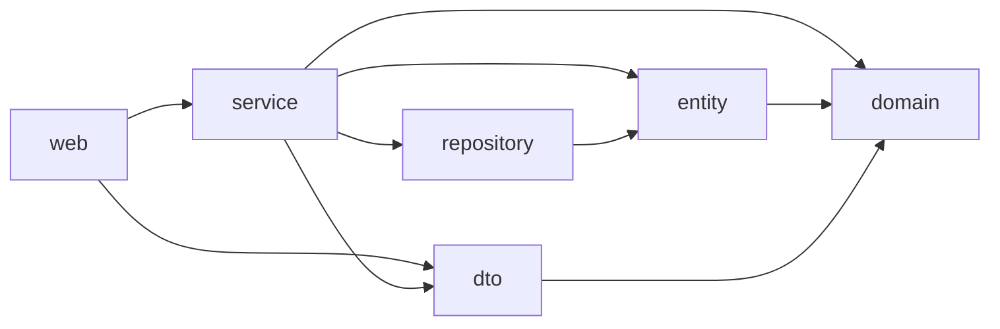
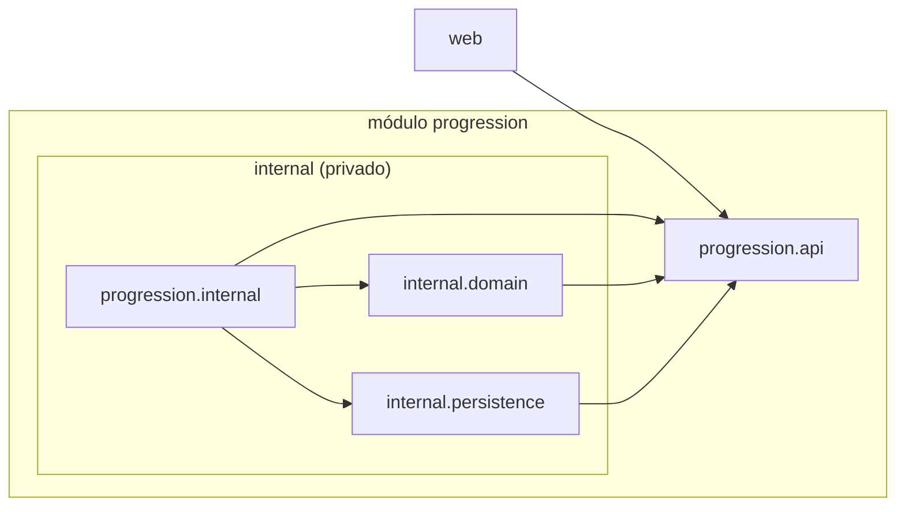
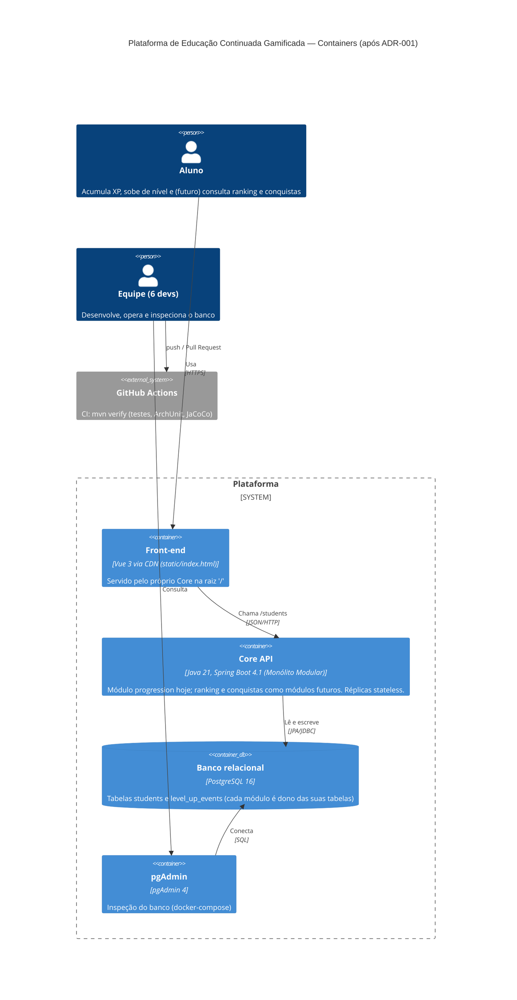
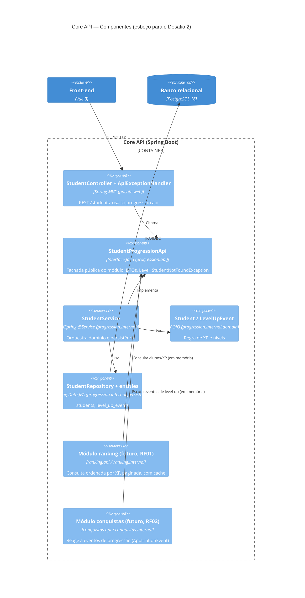

# Desafio 1 — Drivers e Evolução do Core

Documento de arquitetura do Core da plataforma de Educação Continuada Gamificada (AC1, Grupo 10).
Objetivo: decidir, com rastreabilidade, como o Core deve evoluir quando o MVP cresce de
**1.000 para até 100.000 usuários**, com o **Ranking** crescendo mais que as demais
funcionalidades e cursos, conquistas e recompensas continuando a evoluir.

Cadeia de rastreabilidade seguida neste documento:

```
RF → RNF → ASR + RPC → alternativas/trade-offs → ADR → C4 → evidência (código, testes, CI)
```

**Resumo da decisão:** Monólito Modular. Não há necessidade comprovada de escala ou deploy
independente, e a complexidade distribuída não se justifica para 6 devs com um banco relacional
único. Ranking e Conquistas entram como módulos com API própria. A extração do Ranking tem
gatilhos mensuráveis (§6). A tabela que liga cada item ao seguinte está na
**[§12 Rastreabilidade](#12-rastreabilidade)** e o registro formal está no
[ADR-001](adr/ADR-001-estilo-arquitetural-core.md).

---

## 1. Requisitos funcionais (RF)

Estado **real** do código da AC1 (branch `main`, commit `ecc44f7`):

| RF | Situação no código | Classes / endpoints reais | Onde entra na arquitetura |
|---|---|---|---|
| **RF01 — Ranking** | **Não existe.** Não há endpoint, consulta ordenada nem tabela de ranking. | O dado de origem já existe: `xp_total` em `StudentEntity` (tabela `students`), exposto por `GET /students` (`StudentController.listStudents`). | Novo módulo `ranking` que **consome a API pública** do módulo `progression` (consulta de alunos ordenada por XP) e mantém seu próprio cache/projeção. Nunca acessa `StudentRepository`/`StudentEntity` diretamente. |
| **RF02 — Conquistas** | **Não existe.** | O conceito mais próximo é o histórico de level-up: `LevelUpEvent` (domínio) / `LevelUpEventEntity` (tabela `level_up_events`), gerado em `Student.receiveXp`. | Novo módulo `conquistas` que reage a eventos de progressão (ex.: "subiu de nível", "acumulou X XP") publicados pelo módulo `progression`, em processo (Spring `ApplicationEvent`), sem chamada remota. |
| **RF-EVO — Evolução das funcionalidades existentes** | Existe (US1–US4). | `POST /students`, `POST /students/{id}/xp`, `GET /students/{id}`, `GET /students` (`StudentController` → `StudentService` → `StudentRepository`); regra de XP/nível em `Student` e `Level`. | Vira o módulo `progression` (mini-lab, seção 7). Cursos e recompensas **também não existem** no código; entrariam como módulos irmãos (`cursos`, `recompensas`) seguindo o mesmo padrão `api/` + `internal/`. |

## 2. Requisitos não funcionais (RNF) analisados

| RNF | Análise no contexto da AC1 |
|---|---|
| **Manutenibilidade** | Hoje o código é organizado só por camada técnica (`web`, `service`, `repository`, `entity`, `dto`, `domain`); com Ranking, Conquistas, Cursos e Recompensas entrando, cada funcionalidade ficaria espalhada por todas as camadas e qualquer classe poderia importar qualquer outra (ex.: nada impede `web` de usar `StudentRepository`). |
| **Desempenho** | 100 mil usuários é carga moderada; o risco real é de consulta, não de processo: `GET /students` faz `findAll()` sem paginação e carrega `levelUpEvents` em modo lazy (N+1) — um Ranking ingênuo em cima disso degradaria. Resolve-se com consulta ordenada + índice em `students.xp_total`, paginação e cache, sem mudar o estilo arquitetural. |
| **Escalabilidade** | O Ranking é *read-heavy* e cresce mais que o resto; um monólito *stateless* escala horizontalmente (várias réplicas atrás de um balanceador) e o ranking pode ser servido de cache. Não há, hoje, evidência medida de que só o Ranking precise de escala independente. |
| **Testabilidade** | Boa base: domínio em POJO e 100% de cobertura. Falta testar as **fronteiras**: nenhuma verificação automática impede um acoplamento indevido entre funcionalidades. |
| **Complexidade operacional** | Hoje: 1 jar, 1 imagem Docker, 1 Postgres, 1 `docker-compose.yml`. Serviços separados trariam múltiplos pipelines, versionamento de contrato, rede entre serviços, observabilidade distribuída e consistência de dados entre bancos — custo alto para 6 desenvolvedores. |

## 3. ASR — requisitos arquiteturalmente significativos (máx. 3)

| ASR | RNF de origem | Como altera a arquitetura (uma frase) |
|---|---|---|
| **ASR1 — Evoluir funcionalidades com baixo acoplamento** | Manutenibilidade | Altera a **estrutura**: o Core passa a ser dividido em módulos por funcionalidade (`api/` público + `internal/` privado), e só a API de um módulo pode ser usada pelo restante do sistema. |
| **ASR2 — Ranking responder bem sob até 100 mil usuários** | Desempenho + Escalabilidade | Altera **dados e implantação**: o Ranking ganha consulta indexada/paginada e cache próprios, e o Core é implantado como réplicas *stateless* que escalam horizontalmente juntas. |
| **ASR3 — Fronteiras verificáveis automaticamente** | Testabilidade | Altera a **operação** (pipeline): regras de dependência entre módulos viram testes ArchUnit que rodam em todo commit e Pull Request, bloqueando o merge quando violadas. |

Complexidade operacional **não** virou ASR por si só: ela entra como **restrição** na escolha
(seção 5), não como requisito a maximizar.

## 4. RPC — restrições de projeto e contexto

| RPC | Restrição | Impacto na decisão |
|---|---|---|
| RPC1 | Core em **Java 21 / Spring Boot** (stack atual da AC1). | A modularização deve usar recursos da própria stack (pacotes, interfaces, eventos do Spring), sem nova linguagem/runtime. |
| RPC2 | Equipe de **6 desenvolvedores**. | Um único time; não há times independentes que justifiquem deploys independentes (lei de Conway). |
| RPC3 | **Banco relacional único** (PostgreSQL 16) e **legado da AC1** (tabelas `students` e `level_up_events`, endpoints `/students` consumidos pelo front-end Vue). | Contratos HTTP e schema existentes não podem quebrar; dividir o banco exigiria migração de dados e consistência eventual. |

## 5. Decisão do Tech Lead

**Quais RNFs viram ASRs?** Manutenibilidade (ASR1), Desempenho + Escalabilidade do Ranking (ASR2)
e Testabilidade das fronteiras (ASR3). Complexidade operacional é tratada como restrição.

**Há necessidade COMPROVADA de escala ou deploy independente?** **Não.** Não há medição de
latência, de carga nem de gargalo do Ranking — o Ranking sequer existe ainda. 100 mil usuários é
carga moderada para um monólito bem estruturado, com índices, paginação e cache, rodando em
réplicas *stateless*. Também não há demanda de deploy independente: um único time de 6 pessoas
publica um único artefato.

**A complexidade distribuída é justificável?** **Não, agora.** Microsserviços trariam rede,
contratos versionados, banco por serviço, consistência eventual e observabilidade distribuída
para resolver um problema que ainda não foi medido. Com 6 devs e um banco relacional único, o
custo superaria o benefício.

**Decisão:** adotar o **Monólito Modular (alternativa B)**, com fronteiras por funcionalidade
verificadas por ArchUnit no CI, e manter **gatilhos mensuráveis** (seção 6) para extrair o
Ranking como serviço quando — e se — houver evidência. Registro formal no
[ADR-001](adr/ADR-001-estilo-arquitetural-core.md).

## 6. Alternativas e trade-offs

| RNF | (A) Monólito em Camadas | (B) Monólito Modular | (C) Decomposição seletiva (Ranking como serviço) |
|---|---|---|---|
| Manutenibilidade | Baixa com o crescimento: funcionalidades espalhadas por camadas, acoplamento livre. | **Alta**: cada funcionalidade isolada atrás de uma API; mudanças locais ao módulo. | Alta para o Ranking, mas exige versionar contrato HTTP/eventos entre Core e serviço. |
| Desempenho | Adequado com índice/cache. | Adequado com índice/cache (igual a A em runtime: chamadas em memória). | Ganho só se o Ranking for gargalo isolado; adiciona latência de rede e serialização. |
| Escalabilidade | Horizontal, do sistema inteiro. | Horizontal, do sistema inteiro; o módulo `ranking` já fica pronto para extração. | Escala o Ranking de forma independente (único benefício real, ainda não necessário). |
| Testabilidade | Testes unitários bons, mas sem verificação de fronteiras. | **Fronteiras testáveis** (ArchUnit) + testes por módulo. | Exige testes de contrato e ambientes integrados; mais difícil reproduzir localmente. |
| Complexidade operacional | Mínima (1 jar, 1 banco). | **Mínima** (1 jar, 1 banco) — mesmo pipeline e mesmo deploy. | Alta: 2+ pipelines, 2+ deploys, rede, *service discovery*, observabilidade distribuída, dados duplicados ou banco compartilhado (antipadrão). |
| **Prós** | Simples, já existe. | Baixo acoplamento com custo operacional de monólito; prepara extração futura. | Escala e deploy independentes do Ranking. |
| **Contras** | Degrada a cada nova funcionalidade; não protege fronteiras. | Exige disciplina (garantida por ArchUnit no CI); escala ainda é do conjunto. | Custo alto e prematuro para 6 devs e banco único; resolve gargalo não comprovado. |

### Gatilhos mensuráveis para extrair o Ranking como serviço (revisitar o ADR-001)

A extração só deve ser reavaliada quando **pelo menos dois** gatilhos forem observados de forma
sustentada (ex.: 2 semanas em produção), **depois** de aplicados índice, paginação e cache:

| # | Gatilho | Limite sugerido |
|---|---|---|
| G1 | Latência do endpoint de ranking | p95 > 300 ms sob carga real, mesmo com cache e índice |
| G2 | Carga desproporcional | Ranking > 60% das requisições ou da CPU do Core, forçando escalar o monólito inteiro só por ele |
| G3 | Contenção no banco | Consultas de ranking > 40% do tempo de banco ou afetando a latência de `POST /students/{id}/xp` |
| G4 | Frequência de deploy | Ranking precisa de deploy ≥ 2×/semana independente dos demais e > 30% dos releases ficam bloqueados por outros módulos |
| G5 | Organização | Equipe cresce para ≥ 2 times com ownership separado do Ranking |

Pré-condição para extrair barato: o módulo `ranking` já estar isolado atrás de sua API, com
ArchUnit verde — exatamente o que a alternativa B garante.

---

## 7. Mini-lab — modularização do módulo `progression`

**Funcionalidade escolhida:** como Ranking e Conquistas ainda não existem (seção 1), foi
modularizada a funcionalidade real mais próxima: a **progressão do aluno (XP e níveis, US1–US4)**,
que é exatamente a fonte de dados do futuro Ranking e dos eventos que alimentarão Conquistas.

**Comportamento externo inalterado:** mesmos endpoints (`/students`), mesmos DTOs/JSON, mesmas
tabelas (`students`, `level_up_events` — nomes explícitos em `@Table`/`@Column`). Os 26 testes
existentes continuaram passando sem alteração de asserções; só mudaram `package`/`import` e o
`StudentControllerTest` passou a mockar a interface `StudentProgressionApi` no lugar da classe
concreta `StudentService`.

### Estrutura

ANTES (organização só por camada técnica):

```
org.example.ac1devops
├── web/         StudentController, ApiExceptionHandler
├── service/     StudentService, StudentNotFoundException
├── repository/  StudentRepository
├── entity/      StudentEntity, LevelUpEventEntity
├── dto/         CreateStudentRequestDTO, ReceiveXpRequestDTO, StudentResponseDTO, LevelUpEventDTO
├── domain/      Student, Level, LevelUpEvent
└── config/      OpenApiConfig
```

DEPOIS (módulo por funcionalidade, com API pública e implementação privada):

```
org.example.ac1devops
├── web/                         StudentController, ApiExceptionHandler  → usam só progression.api
├── config/                      OpenApiConfig
└── progression/                 MÓDULO de progressão (alunos, XP, níveis)
    ├── api/                     PÚBLICO: StudentProgressionApi (fachada), DTOs, Level,
    │                            StudentNotFoundException
    └── internal/                PRIVADO ao módulo
        ├── StudentService       implementa StudentProgressionApi
        ├── domain/              Student, LevelUpEvent (POJOs, regra de XP/nível)
        └── persistence/         StudentEntity, LevelUpEventEntity, StudentRepository
```

`Level` ficou em `api/` porque faz parte do contrato publicado (é o tipo do campo `level` e dos
eventos nos DTOs de resposta).

### Dependências entre pacotes (imports `org.example.ac1devops.*`)

Levantamento feito por script sobre `src/main/java` (cada linha = pacote de origem → pacote
importado, com a quantidade de imports):

| ANTES | | DEPOIS | |
|---|---|---|---|
| `web → service` | 2 | `web → progression.api` | 5 |
| `web → dto` | 3 | `progression.internal → progression.api` | 7 |
| `service → domain` | 3 | `progression.internal → progression.internal.domain` | 2 |
| `service → dto` | 4 | `progression.internal → progression.internal.persistence` | 3 |
| `service → entity` | 2 | `progression.internal.domain → progression.api` | 2 |
| `service → repository` | 1 | `progression.internal.persistence → progression.api` | 2 |
| `repository → entity` | 1 | | |
| `entity → domain` | 2 | | |
| `dto → domain` | 2 | | |





### Contagem de dependências

| Métrica | ANTES | DEPOIS |
|---|---|---|
| Arestas entre pacotes | 9 | 6 |
| Imports entre pacotes | 20 | 21 (+1: a interface `StudentProgressionApi`) |
| Pacotes que `web` conhece | 2 (`service`, `dto`) | 1 (`progression.api`) |
| Dependências de `web` em classe concreta de implementação | 1 (`StudentService`) | 0 |
| Dependências de fora do módulo para `internal` | — (não havia fronteira; `web` podia importar `entity`/`repository`) | 0 (garantido por ArchUnit) |
| Ciclos entre pacotes | 0 | 0 |

---

## 8. Evidência de QA

### Testes que protegem a decisão

| Teste | Tipo | O que garante |
|---|---|---|
| [`ModularArchitectureTest`](../../src/test/java/org/example/ac1devops/architecture/ModularArchitectureTest.java) | ArchUnit (6 regras) | `ninguemForaDoModuloAcessaInternal`, `apiDoModuloNaoDependeDoInternal`, `camadasRespeitadas` (Web → ProgressionApi ← ProgressionInternal; ninguém acessa Web/Config/Internal), `dominioSemFramework` (domínio sem Spring/JPA), `controllersFicamNaCamadaWeb`, `semCiclosEntrePacotes`. |
| [`StudentServiceTest`](../../src/test/java/org/example/ac1devops/progression/internal/StudentServiceTest.java) | Unitário (JUnit 5 + Mockito) | 10 cenários do service do módulo (8 existentes + 2 novos: reconstrução a partir do estado persistido gerando só os eventos novos, e XP inválido mantendo o estado). |
| [`StudentEndpointIntegrationTest`](../../src/test/java/org/example/ac1devops/web/StudentEndpointIntegrationTest.java) | Integração (`@SpringBootTest`, HTTP real + H2) | Fluxo completo `POST /students` → `POST /students/{id}/xp` → `GET /students/{id}` → `GET /students` e o `404` com mensagem: prova que o contrato externo não mudou. |
| `StudentControllerTest`, `StudentRepositoryTest`, `StudentTest`, `LevelTest`, `SwaggerIntegrationTest`, `Ac1DevOpsApplicationTests` | Já existentes | Continuam passando sem mudança de asserções. |

**Prova de que a regra funciona:** uma classe temporária em `web` com um campo do tipo
`progression.internal.persistence.StudentRepository` fez o build **falhar** em 2 regras
(`ninguemForaDoModuloAcessaInternal` e `camadasRespeitadas`); a classe foi removida em seguida.
Saída registrada em [`evidencias/archunit-violacao.txt`](evidencias/archunit-violacao.txt).

### Resultado dos testes

| | ANTES (`main`, `ecc44f7`) | DEPOIS (esta branch) |
|---|---|---|
| Testes executados | 26 | 36 |
| Falhas / erros | 0 / 0 | 0 / 0 |
| Regras de arquitetura verificadas | 0 | 6 (ArchUnit) |
| Testes de integração HTTP do módulo (sem mock) | 0 | 2 |
| Piso de cobertura no build | não havia | `jacoco:check` — linhas ≥ 90% e branches ≥ 90% (falha o `verify`) |

### Cobertura JaCoCo do módulo (classes da funcionalidade de progressão)

| Classe (ANTES → DEPOIS) | Instruções | Linhas | Branches |
|---|---|---|---|
| `service.StudentService` → `progression.internal.StudentService` | 100% → 100% (155) | 100% → 100% (29) | 100% → 100% (4/4) |
| `domain.Student` → `progression.internal.domain.Student` | 100% → 100% (74) | 100% → 100% (22) | 100% → 100% (4/4) |
| `domain.LevelUpEvent` → `progression.internal.domain.LevelUpEvent` | 100% → 100% (15) | 100% → 100% (6) | — |
| `entity.StudentEntity` / `LevelUpEventEntity` → `progression.internal.persistence.*` | 100% → 100% (85) | 100% → 100% (32) | — |
| `domain.Level` → `progression.api.Level` | 100% → 100% (68) | 100% → 100% (14) | 100% → 100% (4/4) |
| DTOs + `StudentNotFoundException` → `progression.api.*` | 100% → 100% (47) | 100% → 100% (6) | — |
| **Total do módulo** | **100% → 100% (444/444)** | **100% → 100% (109/109)** | **100% → 100% (12/12)** |

A cobertura de linhas já era 100% antes (herança do ciclo RED→GREEN→BLUE da AC1) e foi
**mantida** após a refatoração. O ganho de qualidade não está no percentual, mas em **o que** é
verificado: fronteiras do módulo (ArchUnit), fluxo HTTP real sem mocks e um piso de cobertura
que impede regressão. `StudentProgressionApi` é interface e não gera instruções no relatório.

Fontes brutas: [`evidencias/jacoco-antes.csv`](evidencias/jacoco-antes.csv) e
[`evidencias/jacoco-depois.csv`](evidencias/jacoco-depois.csv). Relatório HTML gerado em
`target/site/jacoco/index.html` a cada `./mvnw verify` e publicado como artifact pelo CI
(seção 9).

---

## 9. Evidência de DevOps — pipeline de CI

Workflow: [`.github/workflows/ci.yml`](../../.github/workflows/ci.yml) (não havia workflow
anterior no repositório).

| Gatilho | Passos |
|---|---|
| `push` em qualquer branch e `pull_request` para `main` | 1. `actions/checkout` → 2. `actions/setup-java` (Temurin **21**, igual ao `<java.version>` do `pom.xml`, com cache Maven) → 3. `./mvnw -B clean verify` → 4. publica `target/site/jacoco/` como artifact **`jacoco-report`** e `target/surefire-reports/` como **`surefire-reports`** (mesmo se o build falhar). |

### Como o pipeline protege a decisão arquitetural

1. **A regra modular é código executável.** `ModularArchitectureTest` roda dentro do
   `mvn verify` como qualquer teste; não depende de revisão manual lembrar da regra.
2. **Verificada a cada commit e a cada Pull Request.** Todo `push` dispara o workflow; todo PR
   para a `main` mostra o check `Build, testes, ArchUnit e cobertura`. Um import de
   `progression.internal` fora do módulo deixa o check **vermelho** com a mensagem do ArchUnit
   apontando classe e campo/método infrator (exemplo real em
   [`evidencias/archunit-violacao.txt`](evidencias/archunit-violacao.txt)).
3. **O contrato externo também é protegido.** `StudentEndpointIntegrationTest` falha se a
   refatoração (ou uma futura extração do Ranking) mudar status/JSON de `/students`.
4. **Qualidade não regride em silêncio.** `jacoco:check` falha o build abaixo de 90% de linhas ou
   branches; o relatório fica anexado ao run para auditoria.
5. **Merge só com CI verde.** Recomendado ativar em *Settings → Branches → Branch protection
   rules* da `main`: "Require a pull request before merging" + "Require status checks to pass"
   marcando o check `Build, testes, ArchUnit e cobertura`. Assim a decisão do ADR-001 não pode
   ser violada nem por push direto na `main`.

---

## 10. Decisão registrada — ADR

[ADR-001 — Estilo arquitetural do Core: Monólito Modular](adr/ADR-001-estilo-arquitetural-core.md)
(status **Aceito**, 2026-10-06).

## 11. C4

### C4 — Nível 2 (Container)

A decisão é **interna ao Core**, então o diagrama de containers **não muda**: continuam um
único container de aplicação e um único banco. Esse é justamente o efeito pretendido, porque não
entra nenhum container, rede ou pipeline novo. O impacto aparece no nível de componentes, logo
abaixo.



### C4 — Nível 3 (Component) do Core: esboço preparando o Desafio 2

Os componentes **sólidos** já existem no código. **Ranking** e **Conquistas** são o desenho-alvo
e só dependem de `StudentProgressionApi`, nunca de `progression.internal`.



---

## 12. Rastreabilidade

| RF | RNF | ASR + RPC | Alternativa escolhida e trade-off | ADR | C4 | Evidência |
|---|---|---|---|---|---|---|
| RF01 Ranking (futuro; fonte de dados: `xp_total` em `StudentEntity`) | Desempenho, Escalabilidade | ASR2 + RPC3 (banco único) | B: índice, cache e réplicas *stateless*; extração só com gatilhos G1–G5 (§6) | [ADR-001](adr/ADR-001-estilo-arquitetural-core.md), Decisão item 5 | Component: "Módulo ranking (futuro)" → `StudentProgressionApi` | Módulo `progression` isolado (§7); dívida N+1 registrada no ADR |
| RF02 Conquistas (futuro; base: `LevelUpEvent`) | Manutenibilidade | ASR1 + RPC1 (Spring) | B: módulo próprio reagindo a eventos em processo, sem rede | ADR-001, Decisão item 4 | Component: "Módulo conquistas (futuro)" | `LevelUpEvent` em `progression.internal.domain`; regra `dominioSemFramework` |
| RF-EVO Progressão (US1–US4, `/students`) | Manutenibilidade, Testabilidade | ASR1 + ASR3 + RPC2 (6 devs) + RPC3 (legado) | B: `progression.api` + `progression.internal`; contrato externo intacto | ADR-001, Decisão itens 1–4 | Container (inalterado) + Component (`StudentController` → `StudentProgressionApi` ← `StudentService`) | [`ModularArchitectureTest`](../../src/test/java/org/example/ac1devops/architecture/ModularArchitectureTest.java), [`StudentServiceTest`](../../src/test/java/org/example/ac1devops/progression/internal/StudentServiceTest.java), [`StudentEndpointIntegrationTest`](../../src/test/java/org/example/ac1devops/web/StudentEndpointIntegrationTest.java), [CI](../../.github/workflows/ci.yml), [JaCoCo antes](evidencias/jacoco-antes.csv)/[depois](evidencias/jacoco-depois.csv) |
| (todos) | Complexidade operacional | Restrição (RPC2 + RPC3) | B mantém 1 jar, 1 banco, 1 pipeline; C rejeitada | ADR-001, Alternativas | Container: nenhum container novo | [`ci.yml`](../../.github/workflows/ci.yml) único; `docker-compose.yml` inalterado |

## 13. Índice de artefatos

| Artefato | Caminho |
|---|---|
| ADR | [`docs/arquitetura/adr/ADR-001-estilo-arquitetural-core.md`](adr/ADR-001-estilo-arquitetural-core.md) |
| Diagramas | Seção 7 (dependências antes/depois), seção 11 (C4 Container e Component) |
| Fachada do módulo | [`StudentProgressionApi`](../../src/main/java/org/example/ac1devops/progression/api/StudentProgressionApi.java) |
| Regras de arquitetura | [`ModularArchitectureTest`](../../src/test/java/org/example/ac1devops/architecture/ModularArchitectureTest.java) |
| Testes do módulo | [`StudentServiceTest`](../../src/test/java/org/example/ac1devops/progression/internal/StudentServiceTest.java), [`StudentEndpointIntegrationTest`](../../src/test/java/org/example/ac1devops/web/StudentEndpointIntegrationTest.java) |
| Workflow de CI | [`.github/workflows/ci.yml`](../../.github/workflows/ci.yml) |
| Relatório de cobertura | Artifact `jacoco-report` de cada run do CI; local em `target/site/jacoco/index.html`; CSVs em [`evidencias/`](evidencias/) |
| Prova de violação barrada | [`evidencias/archunit-violacao.txt`](evidencias/archunit-violacao.txt) |
