# Estudo de Caso: Educação Continuada Gamificada

**AC2 — Exercício B1: Arquitetura de Software e Tomada de Decisão Tech Lead** · Disciplina DevOps e QA · Facens · Grupo 10 · Entrega em 04/11/2026

Registro único e cumulativo do **Exercício B1 — Architecture Lab (DevOps e QA)**, sobre o Core da
plataforma de Educação Continuada Gamificada (AC1, Grupo 10).

## Contexto e case-base

**Cenário:** o MVP cresceu de **1.000 para até 100.000 usuários**; o **Ranking** cresce mais que
as outras funcionalidades; cursos, conquistas e recompensas continuam evoluindo.

**Base existente:** Java 21, Spring Boot 4.1, PostgreSQL 16, front-end Vue 3 servido pelo próprio
Core, Docker Compose e CI no GitHub Actions. Detalhes e instruções de execução no
[README do projeto](../../README.md).

> **Legenda de estado:** **Existe** = implementado e testado nesta branch. **Planejado** = desenho-alvo
> das próximas etapas; nenhum código correspondente existe ainda.

## Padrão de decisão

Cadeia de rastreabilidade seguida neste documento:

```
RF → RNF → ASR → RPC (trade-offs) → ADR → C4 → evidência no código
```

Cada desafio segue exatamente esta sequência:

1. **RF**
2. **RNF**, classificado por FURPS+
3. **ASR**, no máximo 3, cada um com uma frase dizendo como altera estrutura, comunicação, dados,
   implantação ou operação
4. **RPC**
5. **Decisão do Tech Lead**, respondendo às perguntas do desafio
6. **Alternativas** (mínimo 2) e trade-offs em tabela
7. **ADR**, em [`adr/`](adr/)
8. **C4**, atualizando só o nível afetado, em Mermaid
9. **Evidência**: mini-lab, teste, métrica ou falha simulada, com como reproduzir e o resultado obtido

Critérios aplicados em todas as decisões:

- Toda tecnologia responde a um problema do case; "é moderno" ou "o mercado usa" não são justificativa.
- Nem todo RNF é ASR.
- RPC é restrição, não solução.
- A microsolução testa uma hipótese arquitetural, não apenas o funcionamento da ferramenta.
- Prefere-se a solução mais simples que atenda aos ASRs.

Microsoluções ficam em `/labs/desafio-N/` ou no próprio código do Core, sempre linkadas aqui. Prints
ficam em [`evidencias/img/`](evidencias/img/), com o prefixo do desafio (`d1-`, `d2-`...).

## Matriz cumulativa de ASRs

A numeração é global, de ASR1 a ASR17.

| ASR | Desafio de origem | RNF / FURPS+ | Decisão / ADR | Evidência | Status |
|---|---|---|---|---|---|
| **ASR1** — Evoluir funcionalidades com baixo acoplamento | Desafio 1 | Manutenibilidade / S | Monólito Modular, [ADR-001](adr/ADR-001-estilo-arquitetural-core.md) | [`ModularArchitectureTest`](../../src/test/java/org/example/ac1devops/architecture/ModularArchitectureTest.java); mini-lab (item 9.8) | **Atendido** |
| **ASR2** — Ranking com p95 ≤ 300 ms para 100.000 usuários | Desafio 1 | Desempenho e Escalabilidade / P | Índice, paginação, cache e gatilhos G1–G5, [ADR-001](adr/ADR-001-estilo-arquitetural-core.md) | [`RankingPerformanceTest`](../../src/test/java/org/example/ac1devops/ranking/internal/RankingPerformanceTest.java) (item 9.4); [p95 em PostgreSQL, com 100.000 alunos](evidencias/d6-observabilidade.txt) (D6) | **Atendido** para top 100 (114 ms) e posição (79 ms), em medição local; página aleatória no limite (317 ms); várias réplicas sem teste |
| **ASR3** — Fronteiras verificáveis automaticamente | Desafio 1 | Testabilidade / S | ArchUnit no `verify` e no CI, [ADR-001](adr/ADR-001-estilo-arquitetural-core.md) | Falha simulada em [`archunit-violacao.txt`](evidencias/archunit-violacao.txt); [`ci.yml`](../../.github/workflows/ci.yml); prints do CI: [runs](evidencias/img/d1-ci-verde.png), [resumo](evidencias/img/d1-ci-resumo.png), [etapas](evidencias/img/d1-ci-etapas.png) | **Atendido (CI no GitHub)** |
| **ASR4** — Mudar regra de gamificação sem tocar em persistência ou framework | Desafio 2 | Modificabilidade / S | Ports & Adapters só em `conquistas`, [ADR-002](adr/ADR-002-ports-and-adapters-em-conquistas.md) | [`BadgeAwardContract`](../../src/test/java/org/example/ac1devops/conquistas/internal/domain/BadgeAwardContract.java) nos dois adapters; [mutação da regra](evidencias/d2-mutacao-regra.txt); CI no GitHub, run #2: [lista de runs](evidencias/img/d2-ci-verde.png), [etapas do job](evidencias/img/d2-ci-etapas.png) | **Atendido** |
| **ASR5** — Regra de gamificação testável sem Spring nem banco | Desafio 2 | Testabilidade / S | Domínio puro com adapter em memória; ArchUnit na fronteira, [ADR-002](adr/ADR-002-ports-and-adapters-em-conquistas.md) | [`BadgeAwardInMemoryTest`](../../src/test/java/org/example/ac1devops/conquistas/internal/domain/BadgeAwardInMemoryTest.java); [violação barrada](evidencias/d2-archunit-violacao.txt); CI no GitHub, run #2: [lista de runs](evidencias/img/d2-ci-verde.png), [etapas do job](evidencias/img/d2-ci-etapas.png) | **Atendido** |
| **ASR6** — Indisponibilidade da IA não bloqueia o Core | Desafio 3 | Tolerância a falhas e Desempenho / R, P | Timeout, circuit breaker e fallback, [ADR-003](adr/ADR-003-servico-python-de-ia.md) | [`RecomendacaoEndpointIntegrationTest`](../../src/test/java/org/example/ac1devops/web/RecomendacaoEndpointIntegrationTest.java); [roteiro](evidencias/d3-roteiro.txt) e prints ([no ar](evidencias/img/d3-02-core-com-ia.png), [fora do ar](evidencias/img/d3-03-core-ia-fora.png), [fluxo essencial](evidencias/img/d3-04-fluxo-essencial.png)); [falhas simuladas](evidencias/d3-falhas-simuladas.txt) | **Atendido** |
| **ASR7** — IA publicada e escalada sem o Core | Desafio 3 | Deploy independente e Escalabilidade / +, P | Serviço Python independente, [ADR-003](adr/ADR-003-servico-python-de-ia.md) | [`Dockerfile`](../../labs/desafio-3/ia-service/Dockerfile); job `ia-service` no [`ci.yml`](../../.github/workflows/ci.yml) | **Parcial:** imagem própria demonstrada e serviço parado sem parar o Core ([print](evidencias/img/d3-03-core-ia-fora.png)); job `ia-service` verde no GitHub ([run #4](evidencias/img/d3-06-ci-dois-jobs.png), [pytest](evidencias/img/d3-07-ci-pytest.png)); **escala sem teste de carga** |
| **ASR8** — Contrato HTTP/JSON verificável pelos dois lados | Desafio 3 | Interoperabilidade / + | Contrato versionado, [ADR-003](adr/ADR-003-servico-python-de-ia.md) | [`contract/`](../../labs/desafio-3/ia-service/contract/), usado por [`test_api.py`](../../labs/desafio-3/ia-service/tests/test_api.py) e [`IaRecommendationAdapterTest`](../../src/test/java/org/example/ac1devops/recomendacao/internal/adapter/http/IaRecommendationAdapterTest.java) | **Atendido** |
| **ASR9** — Conclusão independente dos consumidores | Desafio 4 | Tolerância a falhas, Disponibilidade, Latência e Desacoplamento / R, P, S | Consumidor fora da transação, depois do commit, [ADR-004](adr/ADR-004-eventos-com-outbox-transacional.md) | [`CourseCompletionIntegrationTest`](../../src/test/java/org/example/ac1devops/web/CourseCompletionIntegrationTest.java); [falhas simuladas](evidencias/d4-falhas-simuladas.txt); [PostgreSQL](evidencias/d4-postgres.txt); prints ([conclusão com o canal fora](evidencias/img/d4-01-conclusao-canal-fora.png), [evento pendente](evidencias/img/d4-02-evento-pendente.png), [CI](evidencias/img/d4-06-ci-verde.png)) | **Atendido** |
| **ASR10** — Conclusão e recompensa atômicas e exatamente uma vez | Desafio 4 | Consistência / R | Transação única, `@Version` e restrição única, [ADR-004](adr/ADR-004-eventos-com-outbox-transacional.md) | [`CourseCompletionIntegrationTest`](../../src/test/java/org/example/ac1devops/web/CourseCompletionIntegrationTest.java); [PostgreSQL](evidencias/d4-postgres.txt): 0 alunos com XP divergente; [repetição sem novo XP](evidencias/img/d4-04-recuperado.png) | **Atendido** |
| **ASR11** — Nenhum evento confirmado se perde | Desafio 4 | Recuperabilidade / R | Outbox transacional, novas tentativas e reenvio manual, [ADR-004](adr/ADR-004-eventos-com-outbox-transacional.md) | [`CourseCompletionIntegrationTest`](../../src/test/java/org/example/ac1devops/web/CourseCompletionIntegrationTest.java); [PostgreSQL](evidencias/d4-postgres.txt): queda forçada e 1.601 de 1.601 notificações; prints ([queda](evidencias/img/d4-03-queda-processo.png), [recuperação](evidencias/img/d4-04-recuperado.png)) | **Atendido** em uma réplica; várias réplicas sem teste |
| **ASR12** — Evento confirmado sobrevive à conexão instável | Desafio 5 | Conectividade intermitente e Disponibilidade / R | QoS 1 e sessão persistente, [ADR-005](adr/ADR-005-iot-com-mqtt-e-gateway.md) | [`MqttBrokerIntegrationTest`](../../src/test/java/org/example/ac1devops/iot/internal/adapter/mqtt/MqttBrokerIntegrationTest.java); [fluxo real](evidencias/d5-fluxo-real.txt); prints ([dispositivo offline](evidencias/img/d5-03-dispositivo-offline.png), [Core fora do ar](evidencias/img/d5-04-core-fora.png)) | **Atendido** em um gateway |
| **ASR13** — Um único efeito por evento, mesmo com reentrega | Desafio 5 | Consistência da integração / R | `eventId` único e efeito antes do registro, [ADR-005](adr/ADR-005-iot-com-mqtt-e-gateway.md) | [`DeviceEventProcessorTest`](../../src/test/java/org/example/ac1devops/iot/internal/domain/DeviceEventProcessorTest.java); [fluxo real](evidencias/d5-fluxo-real.txt): 0 repetições; [print do reenvio](evidencias/img/d5-02-reenvio-duplicado.png) | **Atendido** |
| **ASR14** — Core desacoplado dos dispositivos | Desafio 5 | Interoperabilidade / + | Broker MQTT e gateway no módulo `iot`, [ADR-005](adr/ADR-005-iot-com-mqtt-e-gateway.md) | Regra `soOAdapterDeIotConheceMqtt` do [`ModularArchitectureTest`](../../src/test/java/org/example/ac1devops/architecture/ModularArchitectureTest.java); [simulador](../../labs/desafio-5/simulador/simulador.py); prints ([eventos](evidencias/img/d5-01-eventos-normais.png), [CI](evidencias/img/d5-05-ci-verde.png)) | **Atendido**; autenticação e TLS pendentes para uso real |
| **ASR15** — Nenhum artefato sai sem passar pelos gates | Desafio 6 | Testabilidade e Confiabilidade / S, R | Esteira única com estágios por componente, [ADR-006](adr/ADR-006-esteira-unica-e-observabilidade.md) | [`Jenkinsfile`](../../Jenkinsfile); [build #1 no Jenkins](evidencias/img/d6-01-jenkins-verde.png): 182 testes, 0 falhas; [artefatos](evidencias/img/d6-02b-jenkins-artefatos.png) | **Atendido**; a interrupção por um gate com falha não foi provocada dentro do Jenkins |
| **ASR16** — ASRs de execução observáveis em operação | Desafio 6 | Observabilidade e Desempenho / S, P | Métricas por ASR, Prometheus e Grafana, [ADR-006](adr/ADR-006-esteira-unica-e-observabilidade.md) | [`ObservabilityIntegrationTest`](../../src/test/java/org/example/ac1devops/web/ObservabilityIntegrationTest.java); [fluxo real](evidencias/d6-observabilidade.txt): fallback de 90,8% com alerta ativo; prints ([painel](evidencias/img/d6-04-grafana-painel.png), [fallback](evidencias/img/d6-05a-fallback.png), [alerta](evidencias/img/d6-05b-alerta.png)) | **Atendido** |
| **ASR17** — Operação reproduzível a partir do repositório | Desafio 6 | Recuperabilidade / R | Configurações versionadas e compose próprio, [ADR-006](adr/ADR-006-esteira-unica-e-observabilidade.md) | [`observabilidade/`](../../observabilidade/); [fluxo real](evidencias/d6-observabilidade.txt): recriado do zero; [Prometheus](evidencias/img/d6-03-prometheus-alvos.png) | **Atendido** para a observabilidade; o job do Jenkins é criado manualmente |

---

## Desafio 1 — Drivers e Evolução do Core

Como o Core deve evoluir quando o MVP cresce de 1.000 para até 100.000 usuários, com o Ranking
crescendo mais que as demais funcionalidades.

> Retrato do fim do Desafio 1. Mudanças posteriores estão no desafio correspondente; os totais de testes e
> cobertura vigentes estão na evidência do desafio mais recente.

### 1. RF

| RF | Estado | Classes / endpoints reais | Onde entra na arquitetura |
|---|---|---|---|
| **RF01 — Ranking** | **Existe.** | `GET /ranking?page&size`, `GET /ranking/top?n`, `GET /ranking/students/{id}` → `RankingController` → `RankingApi` (impl. `RankingService`) → `StudentProgressionApi.listByScore` / `getScore` / `countStudentsAhead` → `StudentRepository.findScoresOrderedByXp` / `countAhead`. DTOs `RankingEntryDTO`, `RankingPageDTO`; `400` via `InvalidRankingQueryException`. | Módulo `ranking` (`ranking.api` + `ranking.internal`), que consome **apenas** `StudentProgressionApi`; ordenação e paginação no banco, índice `idx_students_xp_total` e cache do top N (item 9.4). |
| **RF02 — Conquistas** | **Planejado no Desafio 1**; badges implementados no [Desafio 2](#desafio-2--organização-interna-do-core). | Conceito mais próximo: histórico de level-up — `LevelUpEvent` (domínio) / `LevelUpEventEntity` (tabela `level_up_events`), gerado em `Student.receiveXp`. | Novo módulo `conquistas` que reage a eventos de progressão em processo (Spring `ApplicationEvent`), sem chamada remota. |
| **RF03 — Cadastrar aluno** (US4) | **Existe.** | `POST /students` → `StudentController.createStudent` → `StudentProgressionApi.createStudent` (impl. `StudentService`) → `StudentRepository.save`. DTO `CreateStudentRequestDTO`. | Módulo `progression`. |
| **RF04 — Conceder XP e subir de nível** (US1, US2, US3) | **Existe.** | `POST /students/{id}/xp` → `StudentController.receiveXp` → `StudentService.receiveXp`; regra em `Student.receiveXp` + `Level.fromXp` (BRONZE 0, PRATA 100, OURO 300, DIAMANTE 700); um `LevelUpEvent` por faixa atravessada. DTO `ReceiveXpRequestDTO`. | Módulo `progression` (domínio em `progression.internal.domain`). |
| **RF05 — Consultar perfil do aluno** (US4) | **Existe.** | `GET /students/{id}` → `StudentController.getStudent` → `StudentService.getStudent`; `404` via `StudentNotFoundException` + `ApiExceptionHandler`. DTOs `StudentResponseDTO`, `LevelUpEventDTO`. | Módulo `progression`. |
| **RF06 — Listar alunos** | **Existe.** | `GET /students` → `StudentController.listStudents` → `StudentService.listStudents` (`findAll()` sem paginação, mantido por compatibilidade com o front-end). | Módulo `progression`. Para volume, o caminho é o `GET /ranking` paginado. |
| **RF-EVO — Cursos e recompensas** | **Planejado.** Não existem no código. | — | Módulos irmãos (`cursos`, `recompensas`) no mesmo padrão `api/` + `internal/`. |

Interfaces de apoio que já existem: front-end Vue 3 em `src/main/resources/static/index.html`
(consome `/students`) e documentação OpenAPI (`OpenApiConfig`, `/swagger-ui.html`, `/v3/api-docs`).

### 2. RNF (FURPS+)

| RNF | FURPS+ | Análise no contexto da AC1 | Meta mensurável | Situação hoje |
|---|---|---|---|---|
| **Manutenibilidade** | S (Supportability) | Com Ranking, Conquistas, Cursos e Recompensas entrando, uma organização só por camada técnica espalharia cada funcionalidade por todos os pacotes e permitiria qualquer import. | 0 violações das regras de `ModularArchitectureTest`; um novo módulo não exige alterar classes de `progression.internal`. | Existe: 8 regras ArchUnit verdes no `mvn verify`. |
| **Desempenho** | P (Performance) | O risco é de consulta, não de processo: `GET /students` faz `findAll()` sem paginação e carrega `levelUpEvents` em modo lazy (N+1). Um Ranking ingênuo em cima disso degradaria. | Ranking (top 100 e posição do aluno) com **p95 ≤ 300 ms** e **base de 100.000 alunos**; `POST /students/{id}/xp` com p95 ≤ 200 ms. | Ranking com 100.000 alunos no H2 de teste: página 0 em **15 ms**, última página em **49 ms**, posição de um aluno em **52 ms** (item 9.4). É medição única, não p95: falta medir em PostgreSQL sob carga HTTP. |
| **Escalabilidade** | P (Performance: capacidade) | Ranking é *read-heavy* e cresce mais que o resto. Monólito *stateless* escala horizontalmente; o ranking pode vir de cache. | Atender 100.000 usuários escalando réplicas do Core sem mudar código; nenhuma sessão em memória. | Core *stateless* (sem sessão HTTP); 1 réplica no `docker-compose.yml`. O cache do top N é por instância: com várias réplicas, trocar por um cache compartilhado (ex.: Redis), sem mudar o código do módulo. |
| **Testabilidade** | S (Supportability) | Domínio em POJO e regra de fronteira verificável por teste. | **Cobertura de 100%** de linhas e branches; piso de **90%** que quebra o build (`jacoco:check`). | Existe: 100% instruções/linhas/branches/métodos; piso de 90% no `pom.xml`. |
| **Observabilidade** | S (Supportability: serviceability) | Sem métricas não há como saber se os gatilhos de extração do Ranking (item 5) foram atingidos — a decisão depende disso. | Latência p95, taxa de erro e throughput por endpoint expostos em formato Prometheus e visualizados no Grafana; alerta se p95 do ranking > 300 ms. | **Não existe:** sem Actuator, Micrometer, Prometheus ou Grafana no projeto. Ver item 9.6. |
| **Complexidade operacional** | + (restrição de implementação e operação) | Hoje: 1 jar, 1 imagem Docker, 1 PostgreSQL, 1 `docker-compose.yml`, 1 workflow de CI. Serviços separados trariam múltiplos pipelines, contratos versionados, rede e dados distribuídos. | Continuar com **1 artefato, 1 banco e 1 pipeline**; ambiente completo sobe com um único `docker compose up`. | Atendido. |

### 3. ASR

| ASR | RNF de origem | Como altera a arquitetura (uma frase) |
|---|---|---|
| **ASR1 — Evoluir funcionalidades com baixo acoplamento** | Manutenibilidade | Altera a **estrutura**: o Core é dividido em módulos por funcionalidade (`api/` público + `internal/` privado) e só a API de um módulo pode ser usada pelo restante do sistema. |
| **ASR2 — Ranking com p95 ≤ 300 ms para 100.000 usuários** | Desempenho + Escalabilidade (medido via Observabilidade) | Altera **dados e implantação**: o Ranking ganha consulta indexada/paginada e cache próprios, o Core roda em réplicas *stateless* e expõe métricas que dizem quando escalar ou extrair. |
| **ASR3 — Fronteiras verificáveis automaticamente** | Testabilidade | Altera a **operação** (pipeline): as regras de dependência viram testes ArchUnit que rodam em todo commit e Pull Request, bloqueando o merge quando violadas. |

Observabilidade não é um driver isolado: é o meio de verificar a ASR2 e os gatilhos do item 5.
Complexidade operacional entra como **restrição** na escolha (itens 4 e 6), não como requisito a maximizar.

### 4. RPC

| RPC | Restrição / premissa | Impacto na decisão |
|---|---|---|
| **RPC1** | Core em **Java 21 / Spring Boot 4.1** (stack atual). | Modularização com recursos da própria stack (pacotes, interfaces, `ApplicationEvent`), sem nova linguagem ou runtime. |
| **RPC2** | Equipe de **6 desenvolvedores**. | Um único time; não há times independentes que justifiquem deploys independentes (lei de Conway). |
| **RPC3** | **Banco relacional único** (PostgreSQL 16). | Dividir o banco por serviço exigiria migração de dados e consistência eventual. |
| **RPC4** | **Legado da AC1**: tabelas `students` e `level_up_events`, endpoints `/students` consumidos pelo front-end Vue, 100% de cobertura herdada do ciclo RED→GREEN→BLUE. | Contratos HTTP, JSON e schema não podem quebrar (protegido por `StudentEndpointIntegrationTest`). |

**Premissas:** não há medição de carga em produção; 100.000 usuários cadastrados não significam
100.000 simultâneos; o Ranking pode tolerar alguns segundos de defasagem (cache).

### 5. Decisão do Tech Lead

**Quais RNFs viram ASRs?** Manutenibilidade (ASR1), Desempenho + Escalabilidade do Ranking (ASR2)
e Testabilidade das fronteiras (ASR3). Complexidade operacional é tratada como restrição.

**Há necessidade COMPROVADA de escala ou deploy independente?** **Não.** Na data da decisão não
havia medição de latência, de carga nem de gargalo do Ranking, que sequer existia. 100 mil usuários
é carga moderada para um monólito bem estruturado, com índices, paginação e cache, rodando em
réplicas *stateless*. Também não há demanda de deploy independente: um único time de 6 pessoas
publica um único artefato.

**A complexidade distribuída é justificável?** **Não, agora.** Microsserviços trariam rede,
contratos versionados, banco por serviço, consistência eventual e observabilidade distribuída
para resolver um problema que ainda não foi medido. Com 6 devs e um banco relacional único, o
custo superaria o benefício.

**Resumo da decisão:** **Monólito Modular.** Não há necessidade comprovada de escala ou deploy
independente, e a complexidade distribuída não se justifica para 6 devs com um banco relacional
único. O Ranking já é um módulo com API própria (`ranking`) e Conquistas entrará no mesmo padrão; a
extração do Ranking como serviço tem gatilhos mensuráveis (abaixo). Tabela completa em
**[Rastreabilidade](#911-rastreabilidade)**; registro formal no
[ADR-001](adr/ADR-001-estilo-arquitetural-core.md).

#### Gatilhos mensuráveis para extrair o Ranking como serviço

A extração (alternativa C) só deve ser reavaliada quando **pelo menos dois** gatilhos forem
observados de forma sustentada (ex.: 2 semanas em produção), **depois** de aplicados índice,
paginação e cache. As medições vêm do Prometheus/Grafana (item 8.2).

| # | Gatilho | Limite |
|---|---|---|
| G1 | Latência do endpoint de ranking | p95 > 300 ms sob carga real, mesmo com cache e índice |
| G2 | Carga desproporcional | Ranking > 60% das requisições ou da CPU do Core, forçando escalar o monólito inteiro só por ele |
| G3 | Contenção no banco | Consultas de ranking > 40% do tempo de banco ou elevando o p95 de `POST /students/{id}/xp` acima de 200 ms |
| G4 | Frequência de deploy | Ranking precisa de deploy ≥ 2×/semana independente dos demais e > 30% dos releases ficam bloqueados por outros módulos |
| G5 | Organização | Equipe cresce para ≥ 2 times com ownership separado do Ranking |

Pré-condição para extrair barato: o módulo `ranking` isolado atrás da sua API, com ArchUnit
verde — exatamente o que a alternativa B garante.

### 6. Alternativas e trade-offs

| Critério | (A) Monólito em Camadas | (B) Monólito Modular | (C) Decomposição em serviços (Ranking como serviço) |
|---|---|---|---|
| Manutenibilidade | Baixa com o crescimento: funcionalidades espalhadas pelas camadas, acoplamento livre. | **Alta**: cada funcionalidade isolada atrás de uma API; mudanças locais ao módulo. | Alta para o Ranking, mas exige versionar contrato HTTP/eventos entre Core e serviço. |
| Desempenho | Adequado com índice e cache. | Adequado com índice e cache (chamadas em memória, igual a A). | Ganho só se o Ranking for gargalo isolado; adiciona latência de rede e serialização. |
| Escalabilidade | Horizontal, do sistema inteiro. | Horizontal, do sistema inteiro; `ranking` já fica pronto para extração. | Escala o Ranking de forma independente (único benefício real, ainda não necessário). |
| Testabilidade | Testes unitários bons, sem verificação de fronteiras. | **Fronteiras testáveis** (ArchUnit) + testes por módulo. | Exige testes de contrato e ambientes integrados; mais difícil reproduzir localmente. |
| Observabilidade | Simples: um processo, um `/actuator/prometheus`. | Simples: um processo; métricas por endpoint/módulo com tags. | Distribuída: métricas por serviço, *tracing* entre serviços para seguir uma requisição. |
| Complexidade operacional | Mínima (1 jar, 1 banco). | **Mínima** (1 jar, 1 banco, 1 pipeline). | Alta: 2+ pipelines e deploys, rede, *service discovery*, dados duplicados ou banco compartilhado (antipadrão). |
| Aderência às RPCs | Atende RPC1–4. | Atende RPC1–4. | Conflita com RPC2 (6 devs) e RPC3 (banco único). |
| **Prós** | Simples, já existia. | Baixo acoplamento com custo operacional de monólito; prepara extração futura. | Escala e deploy independentes do Ranking. |
| **Contras** | Degrada a cada nova funcionalidade; não protege fronteiras. | Exige disciplina (garantida por ArchUnit no CI); a escala ainda é do conjunto. | Custo alto e prematuro; resolve um gargalo não comprovado. |

### 7. ADR

[**ADR-001 — Estilo arquitetural do Core: Monólito Modular**](adr/ADR-001-estilo-arquitetural-core.md)
— status **Aceito**, 2026-10-27.

- **Decisão:** Monólito Modular (B). Cada funcionalidade é um pacote-módulo
  `org.example.ac1devops.<modulo>` com `api/` (fachada pública) e `internal/` (service, domínio,
  persistência); o resto do sistema só usa a `api/`. Primeiro módulo: `progression`, com a
  fachada `StudentProgressionApi`.
- **Garantia:** `ModularArchitectureTest` (ArchUnit) no `mvn verify`, executado pelo CI em todo
  push e Pull Request.
- **Ranking:** não é extraído agora; reavaliação pelos gatilhos G1–G5, medidos com
  Prometheus/Grafana.
- **Trade-off aceito:** a escala continua sendo do conjunto e o banco é compartilhado (fronteira
  de dados só lógica), em troca de manter 1 artefato, 1 banco e 1 pipeline.

### 8. C4

Retrato do fim do Desafio 1: os elementos marcados **(planejado)** não existiam naquele momento. O C4 atualizado está na [Síntese final](#síntese-final-decisões-levadas-para-a-poc-da-af).

#### 8.1 Contexto (C4Context)

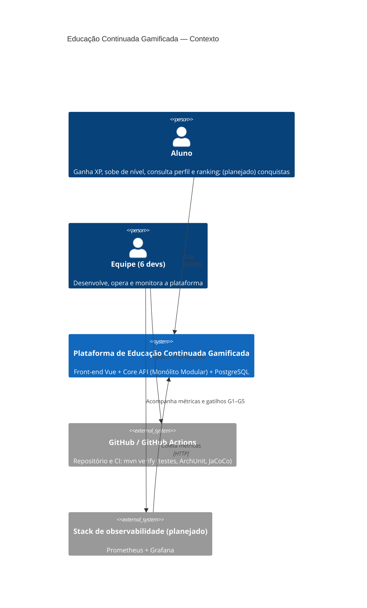

#### 8.2 Container (C4Container)


#### 8.3 Component do Core (C4Component)

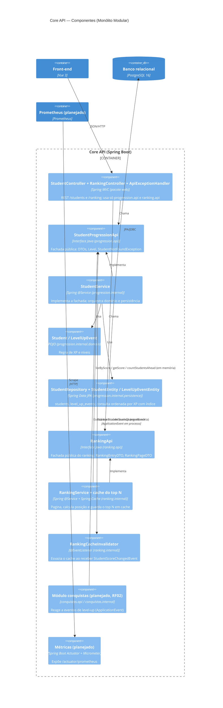

### 9. Evidência

#### 9.1 Como reproduzir e resultado atual

Executado em 2026-11-02, Windows 11, Java 21.0.12, sobre o commit desta branch.

| Evidência | Como reproduzir | Resultado obtido |
|---|---|---|
| Build, testes, ArchUnit e piso de cobertura | `mvnw.cmd -B verify` | Sucesso. **61 testes**, 0 falhas, 0 erros, 0 ignorados. |
| Fronteiras do monólito modular | `mvnw.cmd test -Dtest=ModularArchitectureTest` | **8 regras** verdes. A hipótese "uma violação quebra o build" foi testada com falha simulada (item 9.9). |
| Cobertura | Abrir `target/site/jacoco/index.html` depois do `verify` | **100%**: linhas 172/172, branches 20/20, instruções 785/785, métodos 80/80, em 23 classes. |
| Ranking com 100.000 alunos | `mvnw.cmd test -Dtest=RankingPerformanceTest` | Item 9.4. Tempos no console, com o prefixo `[RankingPerformanceTest]`. |
| Cache do top N | `mvnw.cmd test -Dtest=RankingCacheIntegrationTest` | 2 testes verdes: serve do cache, invalida quando a pontuação muda e não invalida com XP inválido. |

#### 9.2 Implementação

**Implementado:** módulo `progression` (RF03–RF06) e módulo `ranking` (RF01), ambos no padrão
`api/` + `internal/`, consumidos pela camada `web`. O `ranking` usa apenas `StudentProgressionApi` e
recebe `StudentScoreChangedEvent` em processo para invalidar o cache.

**Não implementado ao fim do Desafio 1:** módulo `conquistas` (RF02, entregue no Desafio 2), cursos e recompensas (RF-EVO), observabilidade
(item 9.6). O front-end Vue ainda consome só `/students`; o ranking é acessível pela API e pelo
Swagger.

#### 9.3 Monólito Modular x Camadas

A comparação de critérios está no item 6. O efeito medido da modularização, detalhado no
mini-lab (item 9.8), foi:

| Métrica | Camadas (antes) | Modular (depois) |
|---|---|---|
| Arestas entre pacotes | 9 | 6 |
| Pacotes que `web` conhece | 2 | 1 |
| Dependências de `web` em classe concreta de implementação | 1 | 0 |
| Dependências de fora do módulo para `internal` | sem fronteira | 0, garantido por ArchUnit |

#### 9.4 Ranking para 100.000 usuários

`RankingPerformanceTest` (H2 do `@DataJpaTest`, consulta real do service ao banco, **sem cache**):

| Operação | Execução anterior (AC2) | Execução de 2026-11-02 |
|---|---|---|
| Página 0 (size 20) | 10 ms | 15 ms |
| Página 4999 (size 20, últimas posições) | 25 ms | 49 ms |
| Posição de um aluno | 45 ms | 52 ms |

O plano de execução registrado pelo teste mostra o uso do índice:
`PUBLIC.IDX_STUDENTS_XP_TOTAL ... /* index sorted */`.

**Limites desta evidência:** cada valor é uma medição única e sem concorrência, em H2 em memória. O
teste só falha acima de 1.000 ms, portanto **não comprova o p95 ≤ 300 ms da ASR2**. A medição em PostgreSQL 16, sob carga HTTP, foi feita no [Desafio 6](#desafio-6--cicd-e-observabilidade). O cache do top N é por instância.

#### 9.5 Cobertura de testes

Situação atual no item 9.1: **100%** de linhas, branches, instruções e métodos, com
`Ac1DevOpsApplication` excluída da métrica. O piso de 90% de linhas e branches é verificado por
`jacoco:check` no `verify`. O histórico antes/depois da modularização está no item 9.9.

#### 9.6 Observabilidade

Ao fim do Desafio 1, **não estava implementada**: os gatilhos G1–G5 (item 5) ainda não podiam ser medidos. Foi entregue no
[Desafio 6](#desafio-6--cicd-e-observabilidade), onde o p95 do ranking foi medido em PostgreSQL.

#### 9.7 Teste com Mocks

Os testes unitários usam Mockito para isolar cada unidade de suas dependências, e os mocks dos
consumidores são as fachadas públicas dos módulos, o que reforça a fronteira do ADR-001:

| Teste | Dependência simulada | Testes |
|---|---|---|
| [`StudentServiceTest`](../../src/test/java/org/example/ac1devops/progression/internal/StudentServiceTest.java) | `StudentRepository`, `ApplicationEventPublisher` | 16 |
| [`RankingServiceTest`](../../src/test/java/org/example/ac1devops/ranking/internal/RankingServiceTest.java) | `StudentProgressionApi` | 5 |
| [`RankingControllerTest`](../../src/test/java/org/example/ac1devops/web/RankingControllerTest.java) | `RankingApi` | 5 |
| [`StudentControllerTest`](../../src/test/java/org/example/ac1devops/web/StudentControllerTest.java) | `StudentProgressionApi` | 6 |

`StudentEndpointIntegrationTest` e `RankingCacheIntegrationTest` complementam esses testes sem mocks
nas dependências principais.

> Itens 9.8 a 9.10: retrato do momento do mini-lab (36 testes e 6 regras ArchUnit). Os números atuais estão no item 9.1.

#### 9.8 Mini-lab — modularização do módulo `progression`

Conteúdo produzido no Desafio 1 e mantido como evidência da modularização já aplicada ao código.

**Funcionalidade escolhida:** como Ranking e Conquistas ainda não existiam (item 1), foi
modularizada a funcionalidade real mais próxima: a **progressão do aluno (XP e níveis, US1–US4)**,
que é exatamente a fonte de dados do futuro Ranking e dos eventos que alimentarão Conquistas.

**Comportamento externo inalterado:** mesmos endpoints (`/students`), mesmos DTOs/JSON, mesmas
tabelas (`students`, `level_up_events` — nomes explícitos em `@Table`/`@Column`). Os 26 testes
existentes continuaram passando sem alteração de asserções; só mudaram `package`/`import` e o
`StudentControllerTest` passou a mockar a interface `StudentProgressionApi` no lugar da classe
concreta `StudentService`.

##### Estrutura

ANTES (organização só por camada técnica):

```
org.example.ac1devops
├── web/         StudentController, ApiExceptionHandler
├── service/     StudentService, StudentNotFoundException
├── repository/  StudentRepository
├── entity/      StudentEntity, LevelUpEventEntity
├── dto/         CreateStudentRequestDTO, ReceiveXpRequestDTO, StudentResponseDTO, LevelUpEventDTO
├── domain/      Student, Level, LevelUpEvent
└── config/      OpenApiConfig
```

DEPOIS (módulo por funcionalidade, com API pública e implementação privada):

```
org.example.ac1devops
├── web/                         StudentController, ApiExceptionHandler  → usam só progression.api
├── config/                      OpenApiConfig
└── progression/                 MÓDULO de progressão (alunos, XP, níveis)
    ├── api/                     PÚBLICO: StudentProgressionApi (fachada), DTOs, Level,
    │                            StudentNotFoundException
    └── internal/                PRIVADO ao módulo
        ├── StudentService       implementa StudentProgressionApi
        ├── domain/              Student, LevelUpEvent (POJOs, regra de XP/nível)
        └── persistence/         StudentEntity, LevelUpEventEntity, StudentRepository
```

`Level` ficou em `api/` porque faz parte do contrato publicado (é o tipo do campo `level` e dos
eventos nos DTOs de resposta).

##### Dependências entre pacotes (imports `org.example.ac1devops.*`)

Levantamento feito por script sobre `src/main/java` (cada linha = pacote de origem → pacote
importado, com a quantidade de imports):

| ANTES | | DEPOIS | |
|---|---|---|---|
| `web → service` | 2 | `web → progression.api` | 5 |
| `web → dto` | 3 | `progression.internal → progression.api` | 7 |
| `service → domain` | 3 | `progression.internal → progression.internal.domain` | 2 |
| `service → dto` | 4 | `progression.internal → progression.internal.persistence` | 3 |
| `service → entity` | 2 | `progression.internal.domain → progression.api` | 2 |
| `service → repository` | 1 | `progression.internal.persistence → progression.api` | 2 |
| `repository → entity` | 1 | | |
| `entity → domain` | 2 | | |
| `dto → domain` | 2 | | |

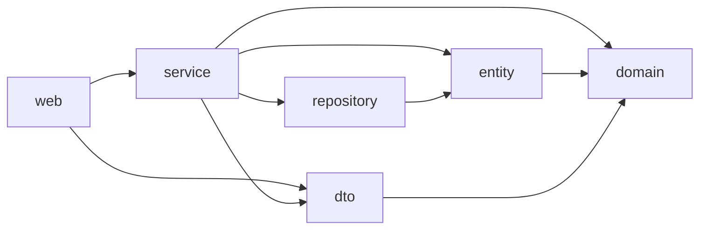

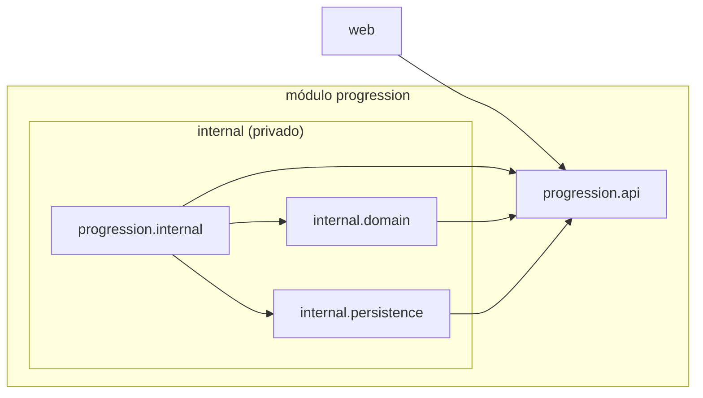

##### Contagem de dependências

| Métrica | ANTES | DEPOIS |
|---|---|---|
| Arestas entre pacotes | 9 | 6 |
| Imports entre pacotes | 20 | 21 (+1: a interface `StudentProgressionApi`) |
| Pacotes que `web` conhece | 2 (`service`, `dto`) | 1 (`progression.api`) |
| Dependências de `web` em classe concreta de implementação | 1 (`StudentService`) | 0 |
| Dependências de fora do módulo para `internal` | — (não havia fronteira; `web` podia importar `entity`/`repository`) | 0 (garantido por ArchUnit) |
| Ciclos entre pacotes | 0 | 0 |

#### 9.9 Evidência de QA

##### Testes que protegem a decisão

| Teste | Tipo | O que garante |
|---|---|---|
| [`ModularArchitectureTest`](../../src/test/java/org/example/ac1devops/architecture/ModularArchitectureTest.java) | ArchUnit (6 regras) | `ninguemForaDoModuloAcessaInternal`, `apiDoModuloNaoDependeDoInternal`, `camadasRespeitadas` (Web → ProgressionApi ← ProgressionInternal; ninguém acessa Web/Config/Internal), `dominioSemFramework` (domínio sem Spring/JPA), `controllersFicamNaCamadaWeb`, `semCiclosEntrePacotes`. |
| [`StudentServiceTest`](../../src/test/java/org/example/ac1devops/progression/internal/StudentServiceTest.java) | Unitário (JUnit 5 + Mockito) | 10 cenários do service do módulo (8 existentes + 2 novos: reconstrução a partir do estado persistido gerando só os eventos novos, e XP inválido mantendo o estado). |
| [`StudentEndpointIntegrationTest`](../../src/test/java/org/example/ac1devops/web/StudentEndpointIntegrationTest.java) | Integração (`@SpringBootTest`, HTTP real + H2) | Fluxo completo `POST /students` → `POST /students/{id}/xp` → `GET /students/{id}` → `GET /students` e o `404` com mensagem: prova que o contrato externo não mudou. |
| `StudentControllerTest`, `StudentRepositoryTest`, `StudentTest`, `LevelTest`, `SwaggerIntegrationTest`, `Ac1DevOpsApplicationTests` | Já existentes | Continuam passando sem mudança de asserções. |

**Prova de que a regra funciona:** uma classe temporária em `web` com um campo do tipo
`progression.internal.persistence.StudentRepository` fez o build **falhar** em 2 regras
(`ninguemForaDoModuloAcessaInternal` e `camadasRespeitadas`); a classe foi removida em seguida.
Saída registrada em [`evidencias/archunit-violacao.txt`](evidencias/archunit-violacao.txt).

##### Resultado dos testes

| | ANTES (`main`, `ecc44f7`) | DEPOIS (fim do mini-lab) |
|---|---|---|
| Testes executados | 26 | 36 |
| Falhas / erros | 0 / 0 | 0 / 0 |
| Regras de arquitetura verificadas | 0 | 6 (ArchUnit) |
| Testes de integração HTTP do módulo (sem mock) | 0 | 2 |
| Piso de cobertura no build | não havia | `jacoco:check` — linhas ≥ 90% e branches ≥ 90% (falha o `verify`) |

##### Cobertura JaCoCo do módulo (classes da funcionalidade de progressão)

| Classe (ANTES → DEPOIS) | Instruções | Linhas | Branches |
|---|---|---|---|
| `service.StudentService` → `progression.internal.StudentService` | 100% → 100% (155) | 100% → 100% (29) | 100% → 100% (4/4) |
| `domain.Student` → `progression.internal.domain.Student` | 100% → 100% (74) | 100% → 100% (22) | 100% → 100% (4/4) |
| `domain.LevelUpEvent` → `progression.internal.domain.LevelUpEvent` | 100% → 100% (15) | 100% → 100% (6) | — |
| `entity.StudentEntity` / `LevelUpEventEntity` → `progression.internal.persistence.*` | 100% → 100% (85) | 100% → 100% (32) | — |
| `domain.Level` → `progression.api.Level` | 100% → 100% (68) | 100% → 100% (14) | 100% → 100% (4/4) |
| DTOs + `StudentNotFoundException` → `progression.api.*` | 100% → 100% (47) | 100% → 100% (6) | — |
| **Total do módulo** | **100% → 100% (444/444)** | **100% → 100% (109/109)** | **100% → 100% (12/12)** |

A cobertura de linhas já era 100% antes (herança do ciclo RED→GREEN→BLUE da AC1) e foi
**mantida** após a refatoração. O ganho de qualidade não está no percentual, mas em **o que** é
verificado: fronteiras do módulo (ArchUnit), fluxo HTTP real sem mocks e um piso de cobertura
que impede regressão. `StudentProgressionApi` é interface e não gera instruções no relatório.

Fontes brutas: [`evidencias/jacoco-antes.csv`](evidencias/jacoco-antes.csv) e
[`evidencias/jacoco-depois.csv`](evidencias/jacoco-depois.csv). Relatório HTML gerado em
`target/site/jacoco/index.html` a cada `./mvnw verify` e publicado como artifact pelo CI
(item 9.10).

#### 9.10 Evidência de DevOps — pipeline de CI

**Run no GitHub (ASR3):** run #1 do workflow `CI`, no commit `4d21fa4` da branch
`feature/b1-architecture-lab`: status **Success**, 1m 13s e 2 artifacts. O aviso de Node.js 20 que
aparece nos prints veio das actions usadas naquele run; o `ci.yml` foi atualizado depois para versões
que rodam em Node 24.

| Lista de runs | Resumo do run | Etapas do job |
|---|---|---|
|  |  |  |

Workflow: [`.github/workflows/ci.yml`](../../.github/workflows/ci.yml) (não havia workflow
anterior no repositório).

| Gatilho | Passos |
|---|---|
| `push` em qualquer branch e `pull_request` para `main` | 1. `actions/checkout` → 2. `actions/setup-java` (Temurin **21**, igual ao `<java.version>` do `pom.xml`, com cache Maven) → 3. `./mvnw -B clean verify` → 4. publica `target/site/jacoco/` como artifact **`jacoco-report`** e `target/surefire-reports/` como **`surefire-reports`** (mesmo se o build falhar). |

##### Como o pipeline protege a decisão arquitetural

1. **A regra modular é código executável.** `ModularArchitectureTest` roda dentro do
   `mvn verify` como qualquer teste; não depende de revisão manual lembrar da regra.
2. **Verificada a cada commit e a cada Pull Request.** Todo `push` dispara o workflow; todo PR
   para a `main` mostra o check `Build, testes, ArchUnit e cobertura`. Um import de
   `progression.internal` fora do módulo deixa o check **vermelho** com a mensagem do ArchUnit
   apontando classe e campo/método infrator (exemplo real em
   [`evidencias/archunit-violacao.txt`](evidencias/archunit-violacao.txt)).
3. **O contrato externo também é protegido.** `StudentEndpointIntegrationTest` falha se a
   refatoração (ou uma futura extração do Ranking) mudar status/JSON de `/students`.
4. **Qualidade não regride em silêncio.** `jacoco:check` falha o build abaixo de 90% de linhas ou
   branches; o relatório fica anexado ao run para auditoria.
5. **Merge só com CI verde.** Recomendado ativar em *Settings → Branches → Branch protection
   rules* da `main`: "Require a pull request before merging" + "Require status checks to pass"
   marcando o check `Build, testes, ArchUnit e cobertura`. Assim a decisão do ADR-001 não pode
   ser violada nem por push direto na `main`.

#### 9.11 Rastreabilidade

| RF | RNF | ASR | RPC | ADR | C4 | Evidência no código |
|---|---|---|---|---|---|---|
| RF01 Ranking (`/ranking`) | Desempenho, Escalabilidade, Observabilidade | ASR2 | RPC3 (banco único), RPC4 (legado) | ADR-001, Decisão itens 4–6 + gatilhos G1–G5 | Component: `RankingController` → `RankingApi` ← `RankingService` → `StudentProgressionApi`; Container: Prometheus/Grafana | [`RankingService`](../../src/main/java/org/example/ac1devops/ranking/internal/RankingService.java), [`StudentRepository`](../../src/main/java/org/example/ac1devops/progression/internal/persistence/StudentRepository.java), índice em [`StudentEntity`](../../src/main/java/org/example/ac1devops/progression/internal/persistence/StudentEntity.java), [`RankingPerformanceTest`](../../src/test/java/org/example/ac1devops/ranking/internal/RankingPerformanceTest.java), [`RankingCacheIntegrationTest`](../../src/test/java/org/example/ac1devops/ranking/internal/RankingCacheIntegrationTest.java) |
| RF02 Conquistas (planejado no Desafio 1; badges implementados no Desafio 2) | Manutenibilidade | ASR1 | RPC1 (Spring) | ADR-001, Decisão item 4 | Component: módulo `conquistas` (planejado) | `StudentScoreChangedEvent` (mecanismo de eventos já usado pelo ranking); `LevelUpEvent` em `progression.internal.domain`; regra `dominioSemFramework` |
| RF03–RF06 Progressão (`/students`, US1–US4) | Manutenibilidade, Testabilidade | ASR1, ASR3 | RPC2 (6 devs), RPC4 (legado) | ADR-001, Decisão itens 1–4 | Component: `StudentController` → `StudentProgressionApi` ← `StudentService` | [`StudentProgressionApi`](../../src/main/java/org/example/ac1devops/progression/api/StudentProgressionApi.java), [`ModularArchitectureTest`](../../src/test/java/org/example/ac1devops/architecture/ModularArchitectureTest.java), [`StudentServiceTest`](../../src/test/java/org/example/ac1devops/progression/internal/StudentServiceTest.java), [`StudentEndpointIntegrationTest`](../../src/test/java/org/example/ac1devops/web/StudentEndpointIntegrationTest.java) |
| (todos) | Testabilidade (cobertura 100%) | ASR3 | RPC4 (cobertura herdada) | ADR-001, Consequências | Context/Container: GitHub Actions | `jacoco:check` no [`pom.xml`](../../pom.xml), [`ci.yml`](../../.github/workflows/ci.yml) |
| (todos) | Observabilidade | ASR2 (meio de verificação) | RPC1 (Actuator/Micrometer da stack) | ADR-001, Decisão item 6 | Container: Prometheus, Grafana; Component: Métricas | Não implementado: item 9.6 |
| (todos) | Complexidade operacional | Restrição | RPC2, RPC3 | ADR-001, Alternativas (C rejeitada) | Container: 1 Core, 1 banco | [`docker-compose.yml`](../../docker-compose.yml), um único [`ci.yml`](../../.github/workflows/ci.yml) |

---

## Desafio 2 — Organização interna do Core

Como proteger o domínio contra dependências técnicas, se as regras de ranking, moedas, badges e
recompensas mudam com frequência.

### 1. RF

| RF | Estado | Classes / endpoints reais | Efeito deste desafio |
|---|---|---|---|
| **RF01 — Ranking** | **Existe.** | `GET /ranking`, `/ranking/top`, `/ranking/students/{id}`; ordenação em `StudentRepository` | Nenhuma mudança: a estrutura foi avaliada e mantida (item 5). |
| **RF02 — Conquistas e regras de gamificação** | **Existe (badges).** Moedas e recompensas seguem planejadas. | `GET /conquistas/students/{id}` → `ConquistasController` → `ConquistasApi`; concessão por `StudentScoreChangedEvent` → `StudentScoreEventListener` → `BadgeAwardService` | Módulo novo `conquistas`. |

O case não define quais badges existem. O catálogo em
[`BadgeRules`](../../src/main/java/org/example/ac1devops/conquistas/internal/domain/BadgeRules.java) é
uma **proposta da equipe**, não um requisito do case:

| Badge | Condição |
|---|---|
| `PRIMEIROS_PASSOS` | XP total ≥ 1 |
| `NIVEL_PRATA`, `NIVEL_OURO`, `NIVEL_DIAMANTE` | Nível alcançado, pela regra existente `Level.fromXp` |
| `MIL_XP` | XP total ≥ 1000 |

### 2. RNF (FURPS+)

| RNF | FURPS+ | Meta mensurável | Resultado |
|---|---|---|---|
| **Modificabilidade** | S (Supportability) | Regra nova sem alterar porta, adapters ou schema | Atendida: cenário `deveAplicarRegraNovaSemAlterarOAdapter` nos dois adapters |
| **Testabilidade** | S (Supportability) | Todos os cenários da regra rodam sem Spring nem banco | Atendida: 9 cenários em 0,3 s, sem contexto Spring |
| **Manutenibilidade** | S (Supportability) | 0 violações das regras do ArchUnit | Atendida: 9 regras verdes |
| **Facilidade de evolução** | S (Supportability) | Módulo novo sem mudar contratos existentes | Atendida: `/students` e `/ranking` mantidos; `progression` não conhece `conquistas` |

### 3. ASR

| ASR | RNF de origem | Como altera a arquitetura (uma frase) |
|---|---|---|
| **ASR4 — Mudar regra de gamificação sem tocar em persistência ou framework** | Modificabilidade | Altera a **estrutura**: a regra fica em um domínio puro e a dependência com a persistência é invertida por uma porta. |
| **ASR5 — Regra de gamificação testável sem Spring nem banco** | Testabilidade | Altera a **operação**: a regra é verificada em todo build por um contrato executado com um adapter em memória, sem subir infraestrutura. |

Manutenibilidade e facilidade de evolução não geram ASR novo: já estão cobertas pela ASR1, e as
fronteiras, pela ASR3.

### 4. RPC

| RPC | Restrição | Impacto na decisão |
|---|---|---|
| **RPC1** | Core continua em Java 21 / Spring Boot. | O Spring permanece nas bordas do módulo; não há troca de framework. |
| **RPC5** | Regras existentes devem ser reaproveitadas. | `Level.fromXp` é reusada, e não reescrita, nas regras de nível. |
| **RPC6** | Proibido reescrever o produto inteiro só para aplicar um padrão. | `progression` e `ranking` mantêm a estrutura atual. |

### 5. Decisão do Tech Lead

**Qual dependência realmente precisa ser invertida?** Apenas **regra de concessão de badges →
persistência**, porque é a única combinação de regra volátil com dependência técnica.

| Dependência | Inverter? | Motivo |
|---|---|---|
| Concessão de badges → persistência | **Sim** | A regra muda com frequência e não pode exigir banco para ser testada. |
| XP e níveis → persistência | Não | A regra já é POJO puro e estável; o `StudentService` faz a ponte. |
| Ordenação do ranking → banco | Não | É uma decisão de desempenho: ordenar no domínio carregaria 100.000 linhas em memória, contrariando a ASR2. |
| Domínio → Spring | Já não existe | Verificado por ArchUnit. O Spring fica nas bordas. |
| Integrações externas | Não | Nenhuma existe no código; uma porta agora seria especulativa. |

**O custo estrutural é proporcional ao problema?** Sim, porque ficou limitado a um módulo. Conquistas tem
15 arquivos e 336 linhas: 6 arquivos de domínio e porta (116 linhas), 4 de adapters (127) e 5 de API,
aplicação e controller (93). Fora do módulo, só mudaram 8 linhas do `StudentService`. O retorno é a regra
testada em 0,3 s e alterável sem tocar nos adapters. Em `progression` o mesmo custo não teria retorno,
pois a regra já é pura e estável.

**DDD, Hexagonal, Clean e Onion são concorrentes ou podem ser combinados?** Podem ser combinados, pois
respondem a perguntas diferentes. DDD trata de **como modelar** o domínio e suas fronteiras. Hexagonal,
Clean e Onion tratam de **para onde apontam as dependências** e, entre si, são variações da mesma ideia:
são alternativas umas às outras, mas não ao DDD. Aqui se usa só o necessário (item 6).

**Decisão:** Ports & Adapters **somente em `conquistas`**, com os demais módulos inalterados. Registro
formal no [ADR-002](adr/ADR-002-ports-and-adapters-em-conquistas.md).

### 6. Alternativas e trade-offs

| Critério | (A) Modular com camadas | (B) Ports & Adapters só em Conquistas | (C) Hexagonal em todo o Core |
|---|---|---|---|
| Mudar uma regra | Possível, mas nada impede a regra de depender do banco | **Alteração só no catálogo do domínio** | Igual a B, inclusive onde a regra não muda |
| Testar a regra | Exige mocks ou banco | **Sem Spring nem banco** | Sem Spring nem banco |
| Custo estrutural | Menor | **Limitado a um módulo** | Alto: reescreve `progression` e `ranking` |
| Desempenho do ranking | Mantido | **Mantido** | Em risco, se a ordenação for ao domínio (ASR2) |
| Aderência às RPCs | Atende | **Atende** | Conflita com a RPC6 |
| Contra principal | Regra acoplada à persistência | Duas organizações internas no Core | Custo sem problema correspondente |

Uso de cada abordagem:

| Abordagem | Usada? | Justificativa |
|---|---|---|
| **Ports & Adapters / Hexagonal** | **Sim, em `conquistas`** | Resolve o problema do case com uma porta e dois adapters. |
| **DDD estratégico** | Parcial | O módulo já funciona como fronteira de contexto, e o código usa a linguagem do domínio. |
| **DDD tático** | Parcial | `Badge` e `StudentProgress` são objetos de valor, e `BadgeAwardService` é um serviço de domínio. Agregados e eventos de domínio próprios não se justificam em uma regra tão pequena. |
| **Clean Architecture** | Não | Casos de uso e presenters como camadas próprias não resolvem problema algum neste módulo. |
| **Onion** | Não | Tem a mesma direção de dependência do Hexagonal, com mais anéis nomeados. |

### 7. ADR

[**ADR-002 — Ports & Adapters só onde a regra muda: módulo Conquistas**](adr/ADR-002-ports-and-adapters-em-conquistas.md)
— status **Aceito**, 2026-11-02. Complementa o [ADR-001](adr/ADR-001-estilo-arquitetural-core.md), sem
substituí-lo.

### 8. C4

Nível afetado: **Component do Core**. Mostra só o módulo `conquistas` e o que o toca; os demais
componentes seguem como no Desafio 1.

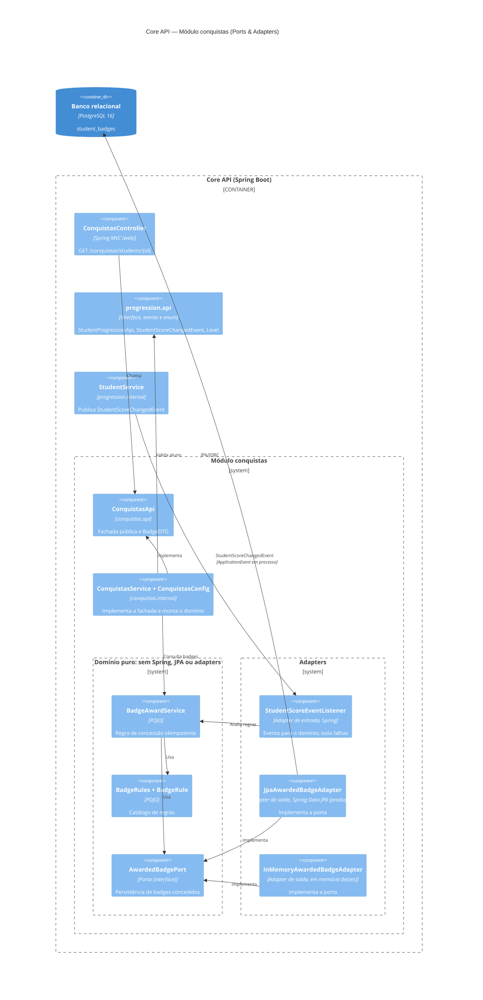

Sentido das dependências: os adapters apontam para o domínio, e o domínio não aponta para nenhum deles.
`Level` é o único tipo externo que o domínio usa.

### 9. Evidência

**Hipótese testada:** isolar a regra atrás de uma porta permite trocar a persistência sem mudar o
comportamento da regra, testá-la sem infraestrutura e alterá-la sem tocar nos adapters, sem afetar os
endpoints existentes.

A microsolução está no próprio Core, em
[`conquistas/`](../../src/main/java/org/example/ac1devops/conquistas/). Resultados de 2026-11-02:

| # | O que se testa | Como reproduzir | Resultado obtido |
|---|---|---|---|
| 1 | Mesma regra nos dois adapters | `mvnw.cmd test -Dtest=BadgeAwardInMemoryTest,BadgeAwardJpaIntegrationTest` | Os **mesmos 9 cenários** de [`BadgeAwardContract`](../../src/test/java/org/example/ac1devops/conquistas/internal/domain/BadgeAwardContract.java) passam nos dois. |
| 2 | Os cenários exercitam mesmo a regra | Trocar temporariamente `xpAtLeast(1, ...)` por `xpAtLeast(2, ...)` e repetir o comando | **Os mesmos 3 cenários falham em cada adapter**: [`d2-mutacao-regra.txt`](evidencias/d2-mutacao-regra.txt). |
| 3 | Teste sem infraestrutura | Rodar cada teste isolado e comparar o log | Em memória: **0,3 s**, sem Spring e sem banco. JPA: **7,9 s**, com Spring e H2. |
| 4 | Regra nova sem tocar nos adapters | Cenário `deveAplicarRegraNovaSemAlterarOAdapter` | Passa nos dois adapters, sem mudança neles. |
| 5 | Fronteira do domínio | Criar no domínio uma classe com `@Component` e um campo `JpaAwardedBadgeAdapter`; rodar `mvnw.cmd test -Dtest=ModularArchitectureTest` | Build **falha em 3 regras**: [`d2-archunit-violacao.txt`](evidencias/d2-archunit-violacao.txt). |
| 6 | Falha em Conquistas não derruba o XP | `mvnw.cmd test -Dtest=ConquistasFailureIsolationTest` | Com a persistência falhando e com a restrição única violada, `POST /students/{id}/xp` responde **200** e salva o XP. |
| 7 | Endpoints existentes e fluxo real | `StudentEndpointIntegrationTest`, `ConquistasEndpointIntegrationTest` e chamadas em PostgreSQL 16 | `/students` e `/ranking` respondem como antes; 350 XP geram 3 badges, sem duplicar no evento seguinte. |
| 8 | Concorrência em PostgreSQL | [`concorrencia_xp.py`](../../labs/desafio-2/concorrencia_xp.py), com os comandos abaixo | **2.000 de 2.000 XP** nas 10 rodadas, 3 level-ups, 5 badges, nada repetido e 400 de 400 POST com 200: [`d2-concorrencia.txt`](evidencias/d2-concorrencia.txt). |
| 9 | Concorrência no build | `mvnw.cmd test -Dtest=XpConcurrencyIntegrationTest` | 40 POST em paralelo, com HTTP real e H2: 2.000 de 2.000 XP. O teste falhava antes da correção, com 350 XP. |
| 10 | Build completo | `mvnw.cmd -B verify` | **88 testes**, 0 falhas. **100%** de cobertura: linhas 259/259, branches 30/30. |

Comandos da linha 8 (PowerShell). A porta 55432 evita conflito com um PostgreSQL local:

```powershell
docker run -d --rm --name d2-pg -e POSTGRES_DB=ac1devops_db -e POSTGRES_USER=postgres -e POSTGRES_PASSWORD=postgres -p 55432:5432 postgres:16
.\mvnw.cmd -B package -DskipTests
$env:SPRING_DATASOURCE_URL="jdbc:postgresql://localhost:55432/ac1devops_db"; $env:SERVER_PORT="18081"
java -jar target\Grupo10_ATDD-0.0.1-SNAPSHOT.jar
# em outro terminal:
python labs\desafio-2\concorrencia_xp.py
docker stop d2-pg
```

#### Defeito encontrado pela evidência

A primeira versão passava em todos os testes com H2 e mocks, mas o teste em PostgreSQL mostrou **2 de 40
requisições com 500** em `POST /students/{id}/xp`. Quando duas requisições disputavam o mesmo badge, o
rollback da restrição única limpava a sessão do open-in-view, e o `StudentService` ainda lia a coleção lazy
depois do evento. A correção foi montar a resposta antes de publicar o evento, com o teste
`violacaoDaRestricaoUnicaNaoDeveAfetarAConcessaoDeXp` reproduzindo a falha antes do ajuste.

#### Correção da perda de XP

Os mesmos testes revelaram um problema anterior a este desafio: `receiveXp` lia e gravava sem controle de
concorrência, e requisições simultâneas sobrescreviam o XP umas das outras.

| 10 rodadas de 40 POST de 50 XP no mesmo aluno, em PostgreSQL 16 | Antes | Depois |
|---|---|---|
| XP aplicado, de 2.000 | 150 a 350 | **2.000 em todas** |
| Level-ups por aluno (correto: 3) | 6 a 13 | **3 em todas** |
| Badges por aluno | 3, em desacordo com os 2.000 XP enviados | **5, nenhum repetido** |
| Respostas | 400 de 400 com 200, mesmo perdendo XP | **400 de 400 com 200, com o XP aplicado** |

- **Como funciona:** `StudentEntity` ganhou `@Version`. Quem perde a disputa lê o estado de novo e repete,
  em até 15 tentativas com espera aleatória crescente. XP, nível e level-ups são gravados juntos, e o evento
  que concede badges só sai depois da gravação que valeu, uma única vez.
- **Se as tentativas acabarem:** a API responde **409** e nenhum XP é aplicado; o cliente fica sabendo, em vez
  de o XP sumir em silêncio. O caso é coberto por teste, mas não ocorreu nas rodadas acima.
- **Banco existente:** testado subindo a versão nova sobre um PostgreSQL com dados da versão antiga. A coluna
  `version` entrou com valor 0, sem perda de dados, e o aluno antigo seguiu recebendo XP.

#### CI no GitHub

Run #2 do workflow `CI`, no commit `03007e1`: **Success**. O **aviso de Node.js 20 foi resolvido**: o run #1 tinha
2 warnings e 1 notice, e o run #2 mostra só 1 notice, sem warnings, com as actions atualizadas.

| Lista de runs | Etapas do job e anotações |
|---|---|
| 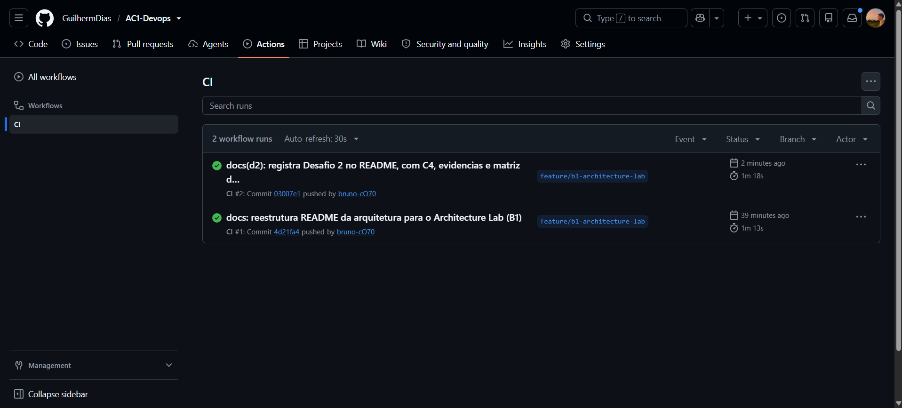 | 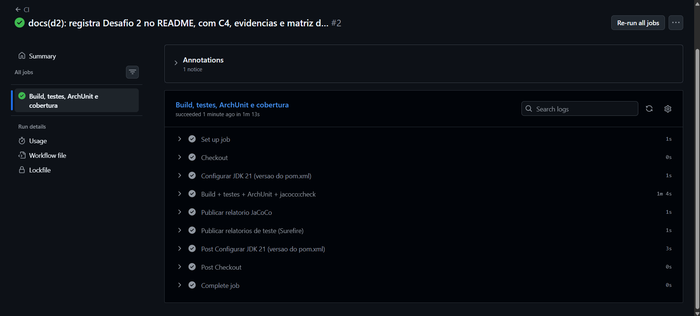 |

#### Limites desta evidência

- **Disputa extrema:** 20 requisições simultâneas no mesmo aluno são improváveis no uso real; o teste mostra
  que nada se perde, mas o tempo extra causado pelas novas tentativas não foi medido.
- **Latência:** o custo da avaliação síncrona em `POST /students/{id}/xp` não foi medido.
- **Tempos da linha 3:** são de uma única execução; o que importa é a ordem de grandeza, não o valor exato.

---

## Desafio 3 — Serviço Python e IA

Onde fica a fronteira de ML e RAG/LLM, se os modelos são feitos em Python, têm ciclo de atualização próprio e
carga variável e podem ficar indisponíveis sem impedir as operações essenciais do Core.

### 1. RF

> **Numeração:** RF03 e RF04 seguem o enunciado deste desafio. Não confundir com os RF03 e RF04 do Desafio 1
> (cadastrar aluno e conceder XP).

| RF | Estado | Classes / endpoints reais | Efeito deste desafio |
|---|---|---|---|
| **RF03 — Recomendação inteligente** | **Existe, com regra simulada.** | Core: `GET /recomendacoes/students/{id}` → `RecomendacaoController` → `RecomendacaoApi` → `RecommendationService` → `RecommendationPort` ← `IaRecommendationAdapter`. Serviço: `POST /recomendacoes` | Módulo novo `recomendacao` e serviço novo em [`labs/desafio-3/ia-service`](../../labs/desafio-3/ia-service/). |
| **RF04 — Assistente educacional** | **Parcial.** Só no serviço, com resposta simulada. | Serviço: `POST /assistente`. O Core ainda não consome. | Define a fronteira; a integração fica para quando houver necessidade. |

A regra de recomendação é determinística: cursos do nível do aluno, depois dos níveis seguintes, sem repetir os
concluídos. O catálogo do serviço e a lista de cursos populares são **propostas da equipe**, porque o Core ainda
não tem cursos nem dados de popularidade.

### 2. RNF (FURPS+)

| RNF | FURPS+ | Meta mensurável | Resultado |
|---|---|---|---|
| **Tolerância a falhas** | R (Reliability) | Serviço fora do ar ou lento: recomendações respondem 200 em até 1,5 s, e o fluxo essencial não muda | Atendida: 0,02 s fora do ar; 0,82 s lento; 0,007 s com o circuito aberto |
| **Desempenho** | P (Performance) | Espera máxima limitada pelo timeout, e sem espera com o circuito aberto | Atendida no ambiente local: 5,03 s direto no serviço lento contra 0,82 s pelo Core |
| **Escalabilidade** | P (Performance: capacidade) | Réplicas da IA sem réplicas do Core | **Só habilitada pela estrutura:** nenhum teste de carga foi feito |
| **Deploy independente** | + (restrição de implantação) | Imagem e pipeline próprios; Core sobe e responde sem a IA | Atendida: imagem própria, job próprio no CI e serviço reiniciado sem reiniciar o Core |
| **Interoperabilidade** | + (requisito de interface) | Contrato verificado pelos dois lados | Atendida: mesmos JSON nos testes pytest e Java |
| **Manutenibilidade** | S (Supportability) | Domínio sem Spring nem HTTP; 0 violações do ArchUnit | Atendida: 10 regras verdes |

### 3. ASR

| ASR | RNF de origem | Como altera a arquitetura (uma frase) |
|---|---|---|
| **ASR6 — Indisponibilidade da IA não bloqueia o Core** | Tolerância a falhas e Desempenho | Altera a **comunicação**: toda chamada à IA tem timeout curto, circuit breaker e uma resposta degradada definida pelo domínio. |
| **ASR7 — IA publicada e escalada sem o Core** | Deploy independente e Escalabilidade | Altera a **implantação**: a IA vira um contêiner próprio, com imagem e job de CI próprios. |
| **ASR8 — Contrato HTTP/JSON verificável pelos dois lados** | Interoperabilidade | Altera a **operação**: o contrato vira arquivos versionados, verificados pelos testes das duas linguagens em todo build. |

Manutenibilidade não gera ASR novo: já está coberta pelas ASR1 e ASR4.

### 4. RPC

| RPC | Restrição | Impacto na decisão |
|---|---|---|
| **RPC1** | Core permanece em Java/Spring Boot. | A IA não entra no processo do Core em outra linguagem. |
| **RPC7** | ML e RAG em Python. | Exige uma fronteira com o Core, seja de processo ou de serviço. |
| **RPC8** | A indisponibilidade da IA não pode bloquear o fluxo essencial. | Limita o quanto o Core pode esperar e o que pode depender da IA. |

### 5. Decisão do Tech Lead

**Python por si só justifica um serviço?** **Não.** A linguagem poderia ser resolvida exportando o modelo para a
JVM ou gerando recomendações em lote. O serviço se justifica por ciclo de atualização próprio, carga variável e
falhas que não podem alcançar o Core.

**ML e RAG precisam da mesma fronteira?** **Não precisam, mas podem compartilhar enquanto nada exigir o contrário.**
Eles têm naturezas diferentes:

| Aspecto | ML (recomendação) | RAG/LLM (assistente) |
|---|---|---|
| Latência esperada | Milissegundos | Segundos |
| Dependências | Modelo treinado | Base vetorial e provedor de LLM |
| Atualização | Novo treino | Novos documentos ou troca de LLM |
| Custo | Principalmente de infraestrutura | Também por uso, se o LLM for externo |
| Sem o serviço | Lista de populares | Aviso de indisponibilidade |

A decisão é **um serviço com rotas separadas e sem estado compartilhado**, porque hoje as duas funções são simulações
e dois serviços trariam custo sem problema medido. No Core, cada função terá timeout e circuit breaker próprios.
Separar será reavaliado por critérios medidos (ver [ADR-003](adr/ADR-003-servico-python-de-ia.md)).

**Quais ASRs justificam autonomia e escala?** As **ASR6 e ASR7**: a IA precisa falhar, ser atualizada e escalar sem o
Core. Isso atende ao critério do ADR-001, que pedia necessidade concreta de deploy e escala independentes. A ASR8 é o
custo dessa autonomia: com dois processos, o contrato precisa ser verificado.

**Qual comportamento degradado é aceitável?**

| Situação | Comportamento | Aceitável? |
|---|---|---|
| Recomendação com a IA fora do ar ou lenta | Cursos populares, com `degraded: true` e HTTP 200 | **Sim** |
| Assistente com a IA fora do ar (quando integrado) | Aviso claro de indisponibilidade | **Sim** |
| XP, level-up, ranking e conquistas | Sem qualquer alteração, pois não chamam a IA | **Obrigatório** |
| Erro 500 ou espera longa para o aluno | — | Não |
| Inventar uma resposta do assistente | — | Não: o aluno tomaria uma simulação por resposta real |
| Esconder que a resposta está degradada | — | Não: o cliente precisa poder distinguir |

**Decisão:** **serviço Python independente**, com comunicação HTTP/JSON, timeouts curtos, circuit breaker e modo
degradado no Core. Registro formal no [ADR-003](adr/ADR-003-servico-python-de-ia.md).

### 6. Alternativas e trade-offs

| Critério | (A) IA embutida no Core | (B) Módulo acoplado | (C) Serviço Python independente |
|---|---|---|---|
| Ciclo de atualização | Modelo novo exige publicar o Core | Publicação única | **Independente** |
| Escala | Do conjunto | Do conjunto | **Da IA, separadamente** |
| Falha da IA | Atinge o processo do Core | Atinge o processo ou contêiner do Core | **Isolada, tratada com timeout e fallback** |
| Python e bibliotecas de ML | Limitado ao que roda na JVM | Atende | **Atende** |
| Latência da chamada | Sem rede | Pequena | Com rede (cerca de 20 ms medidos localmente) |
| Complexidade operacional | Mínima | Média | Maior: 2 imagens, 2 jobs de CI e contrato |
| Aderência às RPCs | Conflita com a RPC7 | Conflita com a RPC8 | **Atende** |

| ML e RAG | Juntos em um serviço (escolhido) | Em dois serviços |
|---|---|---|
| Operação | **1 imagem e 1 job** | 2 imagens e 2 jobs |
| Escala | Do conjunto: uma função pode pressionar a outra | Por função |
| Publicação | Em conjunto | Independente |
| Quando faz sentido | **Enquanto não houver diferença medida** | Quando os critérios do ADR-003 forem atingidos |

### 7. ADR

[**ADR-003 — Serviço Python independente para IA, com modo degradado no Core**](adr/ADR-003-servico-python-de-ia.md)
— status **Aceito**, 2026-11-02.

### 8. C4

Nível afetado: **Container**. Os demais níveis seguem como nos desafios anteriores.

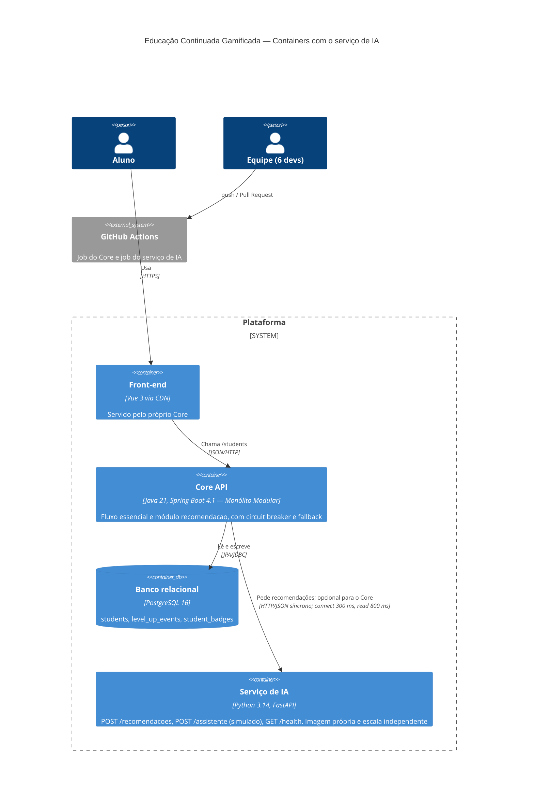

**Protocolo:** HTTP/JSON síncrono, com connect timeout de 300 ms e read timeout de 800 ms. Sem resposta dentro do
limite, o Core usa a lista de populares. Os contratos estão em
[`contract/`](../../labs/desafio-3/ia-service/contract/). O endereço vem de `IA_SERVICE_URL`.

Prometheus e Grafana foram entregues no [Desafio 6](#desafio-6--cicd-e-observabilidade) e estão omitidos aqui para destacar a mudança.

### 9. Evidência

**Hipótese testada:** com a IA fora do Core e o cliente protegido por timeout, circuit breaker e fallback, a queda ou a
lentidão do serviço não bloqueiam o fluxo essencial, e as recomendações seguem respondendo em tempo limitado.

| # | O que se testa | Como reproduzir | Resultado obtido |
|---|---|---|---|
| 1 | Serviço fora do ar (automatizado) | `mvnw.cmd test -Dtest=RecomendacaoEndpointIntegrationTest` | Com o WireMock derrubado, o endpoint responde **200 degradado** em menos de 1,5 s, e XP, aluno, ranking e conquistas seguem com 200. |
| 2 | Lentidão, erro, conexão perdida, resposta inválida | `mvnw.cmd test -Dtest=IaRecommendationAdapterTest` | **7 testes verdes.** Todas as falhas viram indisponibilidade, e o timeout é respeitado. |
| 3 | Circuit breaker | Mesmo comando | Depois de 5 falhas o circuito **abre e o serviço não recebe mais chamadas**; quando volta, o circuito fecha sozinho. |
| 4 | Regra degradada sem Spring | `mvnw.cmd test -Dtest=RecommendationServiceTest` | 3 testes com portas falsas, em 0,01 s. |
| 5 | Os testes detectam a quebra | Remover o fallback ou criar em `ranking` uma dependência de `recomendacao` | Build **falha nos dois casos**: [`d3-falhas-simuladas.txt`](evidencias/d3-falhas-simuladas.txt). |
| 6 | Contrato nos dois lados | `pytest` e `IaRecommendationAdapterTest` | Os mesmos JSON são verificados contra o serviço real e pelo stub. |
| 7 | Serviço em Python | `cd labs\desafio-3\ia-service`, `pip install -r requirements-dev.txt`, `pytest` | **12 testes verdes**. |
| 8 | Roteiro manual, com a imagem real | Comandos abaixo | Tabela abaixo e [`d3-roteiro.txt`](evidencias/d3-roteiro.txt). |
| 9 | Stack completa | `docker compose up -d --build` | App, PostgreSQL e serviço sobem juntos: `degraded: false` e, depois de parar o serviço, `degraded: true`, com XP em 200. Testado em portas alternativas, porque a 5432 está ocupada nesta máquina. |
| 10 | Build completo | `mvnw.cmd -B clean verify` | **101 testes**, 0 falhas. **100%** de cobertura: linhas 334/334, branches 32/32. |

#### Resultados do roteiro

Medidos com `curl` em 2026-11-02, sem carga, em execução única.

| Situação | Tempo de resposta | Resposta |
|---|---|---|
| Serviço no ar, primeira chamada | 0,41 s | Recomendação da IA, `degraded: false` |
| Serviço no ar, chamadas seguintes | 0,02 s | Recomendação da IA, `degraded: false` |
| Serviço fora do ar | 0,01 a 0,03 s | Populares, `degraded: true` |
| XP, aluno, ranking e conquistas com o serviço fora do ar | 0,01 a 0,05 s | HTTP 200, sem alteração |
| Serviço lento (5 s), chamada direta, **sem proteção** | **5,03 s** | — |
| Serviço lento, pelo Core, antes de o circuito abrir | **0,82 s** | Populares, `degraded: true` |
| Serviço lento, pelo Core, com o circuito aberto | **0,007 s** | Populares, `degraded: true` |
| Serviço de volta, circuito ainda aberto | 0,03 s | Populares, `degraded: true` |
| Serviço de volta, depois de 30 s | 0,30 s e depois 0,03 s | Recomendação da IA, `degraded: false` |

Execução do Bruno em 2026-11-02, com os mesmos comandos do roteiro e o log SQL ligado no Core:

| Situação | Tempo de resposta | Resposta | Print |
|---|---|---|---|
| Serviço no ar, primeira chamada | 0,81 s | Recomendação da IA, `degraded: false` | [`d3-02`](evidencias/img/d3-02-core-com-ia.png) |
| Serviço fora do ar | 0,12 s | Populares, `degraded: true` | [`d3-03`](evidencias/img/d3-03-core-ia-fora.png) |
| XP com o serviço fora do ar | 0,14 s | HTTP 200 | [`d3-04`](evidencias/img/d3-04-fluxo-essencial.png) |
| Ranking com o serviço fora do ar | 0,15 s | HTTP 200 | [`d3-04`](evidencias/img/d3-04-fluxo-essencial.png) |

Os tempos absolutos são maiores que os da primeira tabela, mas o resultado é o mesmo: as respostas continuam
com 200, e a recomendação passa a `degraded: true` sem esperar pelo serviço parado.

| Serviço no ar e `/health` | Recomendação com a IA |
|---|---|
| 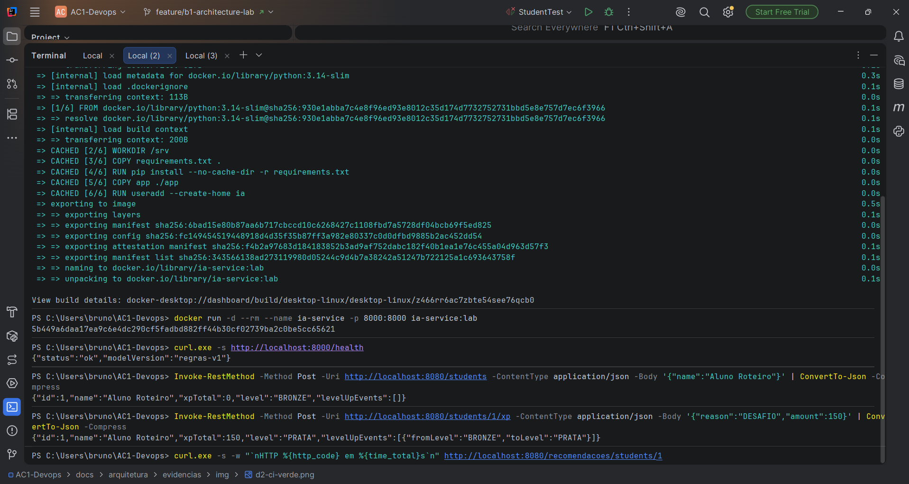 | 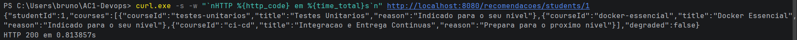 |

| `docker stop` e modo degradado | Fluxo essencial com a IA fora |
|---|---|
| 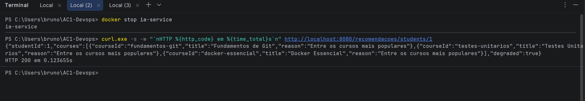 | 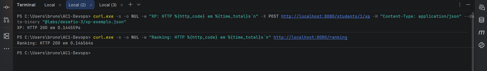 |

O teste do serviço lento (`d3-05`) era opcional e não foi repetido nessa execução.

**CI no GitHub:** os dois jobs ficaram verdes nos runs #3 (`b1a3d3a`) e #4 (`3c3cce2`). O job do serviço de IA executou os
12 testes pytest e o build da imagem, em 25 s, separado do job do Core.

| Run #4 com os 2 jobs verdes | Etapa `Testes pytest` com 12 testes |
|---|---|
| 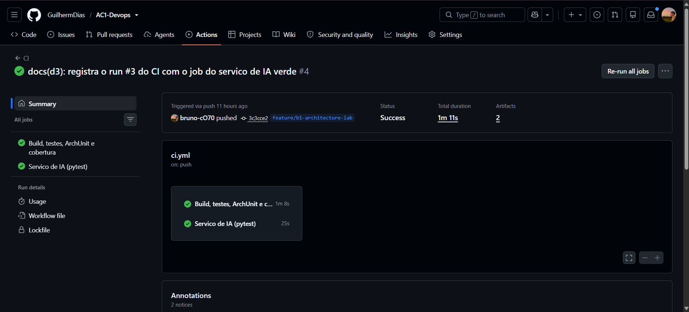 | 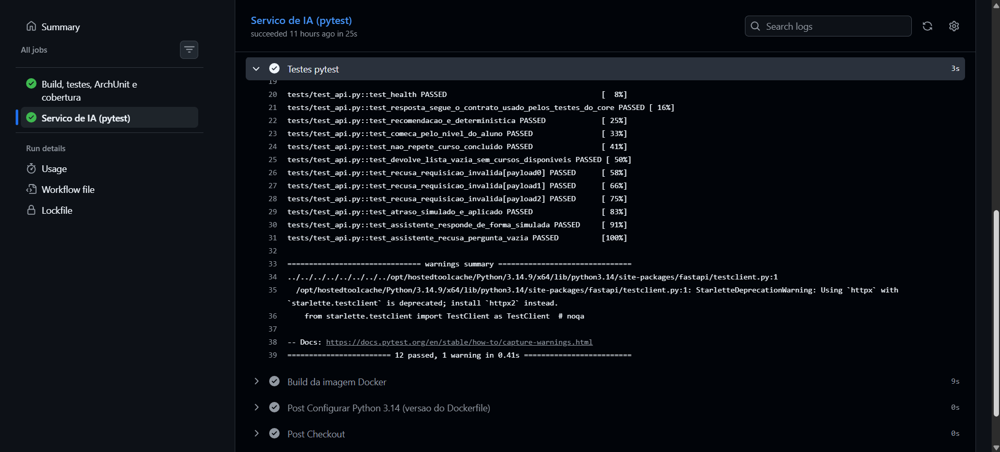 |

#### Roteiro manual

Comandos em PowerShell, na raiz do projeto. Usa o banco H2 e as portas 8000 e 8080.

```powershell
# Terminal 1: sobe o servico de IA
docker build -t ia-service:lab labs/desafio-3/ia-service
docker run -d --rm --name ia-service -p 8000:8000 ia-service:lab
curl.exe -s http://localhost:8000/health

# Terminal 2: sobe o Core
.\mvnw.cmd -B package -DskipTests
$env:SPRING_PROFILES_ACTIVE="h2"; java -jar target\Grupo10_ATDD-0.0.1-SNAPSHOT.jar

# Terminal 1: cria um aluno, da XP e pede recomendacoes com o servico no ar
Invoke-RestMethod -Method Post -Uri http://localhost:8080/students -ContentType application/json -Body '{"name":"Aluno Roteiro"}' | ConvertTo-Json -Compress
Invoke-RestMethod -Method Post -Uri http://localhost:8080/students/1/xp -ContentType application/json -Body '{"reason":"DESAFIO","amount":150}' | ConvertTo-Json -Compress
curl.exe -s -w "`nHTTP %{http_code} em %{time_total}s`n" http://localhost:8080/recomendacoes/students/1

# Derruba o servico e chama de novo: a resposta muda para degraded=true
docker stop ia-service
curl.exe -s -w "`nHTTP %{http_code} em %{time_total}s`n" http://localhost:8080/recomendacoes/students/1

# Fluxo essencial com o servico fora do ar
curl.exe -s -o NUL -w "XP: HTTP %{http_code} em %{time_total}s`n" -X POST http://localhost:8080/students/1/xp -H "Content-Type: application/json" --data-binary "@labs/desafio-3/xp-exemplo.json"
curl.exe -s -o NUL -w "Ranking: HTTP %{http_code} em %{time_total}s`n" http://localhost:8080/ranking

# Opcional: servico lento. Primeiro direto (5 s) e depois pelo Core (depois de 30 s, 5 vezes)
docker run -d --rm --name ia-service -e IA_DELAY_MS=5000 -p 8000:8000 ia-service:lab
curl.exe -s -o NUL -w "Direto: %{time_total}s`n" -X POST http://localhost:8000/recomendacoes -H "Content-Type: application/json" --data-binary "@labs/desafio-3/ia-service/contract/recomendacoes-requisicao.json"
curl.exe -s -o NUL -w "Pelo Core: %{time_total}s`n" http://localhost:8080/recomendacoes/students/1
docker stop ia-service
```

#### Limites desta evidência

- **Simulação:** o serviço usa uma regra determinística, sem modelo, GPU ou LLM. A evidência testa a fronteira, não a
  qualidade das recomendações.
- **Carga variável:** nenhum teste de carga foi feito, e a escala independente foi apenas habilitada pela estrutura.
- **Threads:** não há bulkhead. Antes de o circuito abrir, requisições simultâneas podem ocupar threads do Core por até
  0,8 s cada.
- **Read timeout:** limita a espera até o início da resposta; um corpo enviado muito lentamente não é coberto.
- **Réplicas:** o estado do circuito é por instância do Core.
- **Tempos:** são de uma execução, em ambiente local; valem como ordem de grandeza.
- **Aviso nos testes pytest:** o Starlette avisa que o uso de `httpx` no cliente de testes está depreciado. Não afeta os
  resultados.

---

## Desafio 4 — Comunicação e eventos

O que precisa ser imediato e o que pode ser eventual, se ao concluir um curso o sistema registra a conclusão, calcula
recompensas, atualiza informações e pode disparar notificação e analytics, e a falha de uma notificação não pode impedir a
conclusão.

### 1. RF

> **Numeração:** RF02 é o mesmo do Desafio 2. RF05 segue o enunciado deste desafio; não confundir com o RF05 do Desafio 1
> (consultar perfil).

| RF | Estado | Classes / endpoints reais | Efeito deste desafio |
|---|---|---|---|
| **Eventos de conclusão de atividades** | **Existe.** | `POST /cursos/{courseId}/alunos/{studentId}/conclusao` → `CursosController` → `CursosApi` → `CourseCompletionService`; `GET /cursos/eventos`; `POST /cursos/eventos/{id}/reenvio` | Módulo novo `cursos`, com outbox. |
| **RF05 — Notificações** | **Existe, com canal simulado.** | `CursoConcluidoEvent` → `NotificacaoService` → `NotificationChannel` ← `SimulatedNotificationChannel`; `GET /notificacoes/students/{id}` | Módulo novo `notificacoes`. |
| **RF02 — Conquistas** | **Existe.** | Badges concedidos a partir do XP da conclusão | Reage ao evento de pontuação depois da transação. |

Analytics é citado no cenário, mas **não foi implementado**: seria um segundo consumidor, o que é um dos gatilhos para adotar
um broker (item 5). O catálogo de cursos e as recompensas são **propostas da equipe**, porque o Core não tinha cursos.

### 2. RNF (FURPS+)

| RNF | FURPS+ | Meta mensurável | Resultado |
|---|---|---|---|
| **Tolerância a falhas** | R (Reliability) | Canal fora do ar: conclusão responde 201 | Atendida: 800 de 800 com 201, em PostgreSQL |
| **Disponibilidade** | R (Reliability) | Conclusão não depende do consumidor | Atendida: nenhuma chamada ao canal na requisição, verificado por teste e ArchUnit |
| **Latência** | P (Performance) | Consumidor lento não atrasa a resposta | Atendida: teste com consumidor preso responde em menos de 1,5 s; sob carga, p95 de 784 ms com o canal no ar e de 920 ms fora do ar |
| **Consistência** | R (Reliability) | Conclusão, XP e evento juntos, ou nada | Atendida: falha ao gravar o evento desfaz tudo; 0 alunos com XP divergente |
| **Desacoplamento** | S (Supportability) | Quem conclui não conhece o consumidor | Atendida: regra do ArchUnit |
| **Recuperabilidade** | R (Reliability) | Nenhum evento confirmado se perde, mesmo com queda do processo | Atendida: 1.601 notificações para 1.601 conclusões, sem repetição |

### 3. ASR

| ASR | RNF de origem | Como altera a arquitetura (uma frase) |
|---|---|---|
| **ASR9 — Conclusão independente dos consumidores** | Tolerância a falhas, Disponibilidade, Latência e Desacoplamento | Altera a **comunicação**: a conclusão responde sozinha, e o consumidor recebe o evento em outra thread, depois do commit. |
| **ASR10 — Conclusão e recompensa atômicas e exatamente uma vez** | Consistência | Altera os **dados**: uma única transação, com bloqueio otimista e restrição única por aluno e curso. |
| **ASR11 — Nenhum evento confirmado se perde** | Recuperabilidade | Altera os **dados e a operação**: o evento é gravado na transação, e a operação ganha novas tentativas, estado de falha e reenvio manual. |

### 4. RPC

| RPC | Restrição | Impacto na decisão |
|---|---|---|
| **RPC9** | Operações essenciais do Core devem concluir mesmo com consumidor externo indisponível. | Nenhum consumidor pode participar da transação de conclusão. |
| **RPC10** | Adotar broker exige custo operacional. | O broker precisa responder a um problema real deste fluxo para compensar. |

### 5. Decisão do Tech Lead

**O que precisa ser imediato e o que pode ser eventual?**

| Passo | Quando | Por quê |
|---|---|---|
| Conclusão, XP, nível e level-ups | **Síncrono, mesma transação** | O aluno precisa ver o resultado, e não pode haver recompensa sem conclusão |
| Registro do evento na outbox | **Síncrono, mesma transação** | É o que garante que o aviso não se perde |
| Cache do ranking e badges | Logo depois da transação, na mesma requisição | Dependem do XP gravado; uma falha é registrada e não desfaz a conclusão |
| Notificação | **Eventual** | Depende de um canal externo, e atrasar minutos é aceitável |
| Analytics (futuro) | **Eventual** | Não afeta o aluno |

**Que ASR justificaria mensageria?** Nenhuma das atuais exige um broker: as ASR9 a ASR11 são atendidas com a outbox.
Justificaria um requisito de **alcançar outros processos ou consumidores independentes**, ou de **reprocessar o histórico**.

**RabbitMQ ou Kafka resolvem um problema real deste fluxo?** Hoje, **não**. Há um consumidor, no mesmo processo. E o risco
principal é a escrita dupla: publicar no broker depois do commit perde o evento se o processo cair entre os dois passos, então
um broker **ainda exigiria uma outbox**. Ele acrescentaria um serviço para operar sem eliminar esse risco.

**RabbitMQ x Kafka, pelo problema do case:**

| Critério | RabbitMQ (fila de tarefas com reentrega) | Kafka (log de eventos com replay) |
|---|---|---|
| Modelo | Mensagem é uma tarefa, removida depois de confirmada | Evento é um registro retido, e cada consumidor controla sua posição |
| Notificar o aluno | **Encaixe direto:** uma tarefa, reentrega e dead letter | Possível, mas novas tentativas e dead letter ficam a cargo do consumidor |
| Analytics reprocessando o passado | Não atende, porque a mensagem já saiu da fila | **Encaixe direto** |
| Vários consumidores independentes | Atende, com uma fila por consumidor | Atende, com grupos de consumidores |
| Custo para 6 devs | Um serviço a mais | Maior: partições, retenção e cluster |
| **Se o gatilho surgir** | **Primeira opção**, se a necessidade for entregar tarefas a outro processo | Primeira opção, se a necessidade for replay |

**Decisão:** **outbox transacional com eventos internos**, sem broker, com gatilhos medidos para migrar. Os gatilhos estão no
[ADR-004](adr/ADR-004-eventos-com-outbox-transacional.md), e a migração fica limitada ao `OutboxRelay`.

### 6. Alternativas e trade-offs

| Critério | (A) Síncrono | (B) `@Async` sem persistência | (C) Outbox + eventos internos | (D) RabbitMQ | (E) Kafka |
|---|---|---|---|---|---|
| Consumidor fora do ar | **Falha para o aluno** | Conclui, mas o evento se perde | **Conclui e entrega depois** | Conclui e entrega depois | Conclui e entrega depois |
| Queda logo depois do commit | Sem aviso | **Evento perdido** | **Recuperado** | Perdido, sem outbox | Perdido, sem outbox |
| Serviços novos | 0 | 0 | **0** | 1 | 1 ou mais |
| Consumidor em outro processo | Por chamada direta | Não | Não | **Sim** | **Sim** |
| Replay do histórico | Não | Não | Não | Não | **Sim** |
| Aderência às RPCs | Conflita com a RPC9 | Atende | **Atende** | Custo da RPC10 sem problema correspondente | Custo da RPC10 sem problema correspondente |

### 7. ADR

[**ADR-004 — Eventos internos com outbox transacional, sem broker por enquanto**](adr/ADR-004-eventos-com-outbox-transacional.md)
— status **Aceito**, 2026-11-03.

### 8. C4

Nível afetado: **Container**. Não há container novo: essa é a consequência da decisão. A outbox fica dentro do banco, e os eventos
circulam dentro do Core; o broker aparece só como planejado, condicionado aos gatilhos.

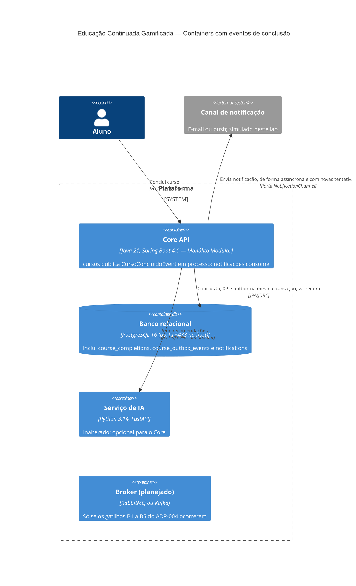

**Fluxo crítico:** a parte síncrona termina no commit; o que vem depois não muda a resposta.

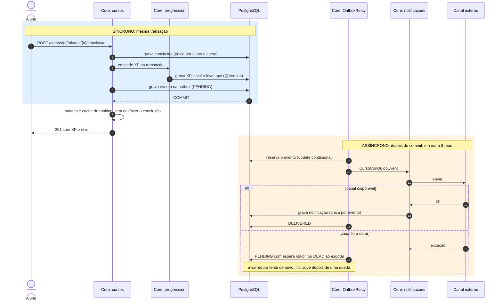

### 9. Evidência

**Hipótese testada:** com o evento gravado na mesma transação, a conclusão não depende do consumidor, e nada se perde mesmo com o
consumidor fora do ar e queda do processo, **sem precisar de broker**.

| # | O que se testa | Como reproduzir | Resultado obtido |
|---|---|---|---|
| 1 | Consumidor fora do ar | `mvnw.cmd test -Dtest=CourseCompletionIntegrationTest` | Conclusão responde **201** com o XP gravado; o evento fica `PENDING` com tentativas e erro; a notificação sai sozinha quando o canal volta. |
| 2 | Consumidor preso | Mesmo comando | Responde em menos de 1,5 s. |
| 3 | Tentativas esgotadas | Mesmo comando | Evento vai para `DEAD`; o reenvio manual entrega. |
| 4 | Queda do processo | Mesmo comando, com evento gravado sem aviso de commit | A varredura entrega; acumulado maior que um lote também é drenado. |
| 5 | Atomicidade | Mesmo comando | Falha ao gravar o evento desfaz conclusão, XP e level-ups. |
| 6 | Uma única recompensa | Mesmo comando | 8 conclusões simultâneas do mesmo curso: uma 201, as demais 200, e XP concedido uma vez. Repetição: 200, sem novo XP nem notificação. |
| 7 | Concorrência e pool | Mesmo comando | 8 cursos simultâneos somam todo o XP; 30 conclusões acima do pool de conexões não travam nem perdem badges. |
| 8 | Os testes detectam a quebra | 4 mudanças temporárias na decisão | Build **falha em todas**: [`d4-falhas-simuladas.txt`](evidencias/d4-falhas-simuladas.txt). |
| 9 | Cenário real em PostgreSQL | Roteiro abaixo | Tabela abaixo e [`d4-postgres.txt`](evidencias/d4-postgres.txt). |
| 10 | Build completo | `mvnw.cmd -B clean verify` | **123 testes**, 0 falhas. **100%** de cobertura: linhas 505/505, branches 54/54. |

#### Resultados em PostgreSQL

Execução única em 2026-11-03, em um computador local, com banco, Core e carga na mesma máquina.

| Cenário | Resultado |
|---|---|
| Conclusão com o canal fora do ar | **201 em 0,13 s**; evento `PENDING`, 1 tentativa e o erro registrado; nenhuma notificação; XP gravado |
| Queda forçada do processo (`Stop-Process -Force`) e volta do canal | 2 eventos pendentes entregues **0,2 s depois de o Core subir**; sem repetição |
| Repetir a conclusão | 200, `alreadyCompleted: true`, XP inalterado |
| Tentativas esgotadas | `DEAD`, mesmo depois de reiniciar; reenvio responde 202, e o evento vai para `DELIVERED` |
| 800 conclusões, 20 threads, canal no ar | 45 por segundo; **800 com 201**; mediana de 393 ms e p95 de 784 ms; 800 notificações em 24,8 s |
| 800 conclusões, 20 threads, canal fora do ar | 40 por segundo; **800 com 201**; mediana de 443 ms e p95 de 920 ms |
| Recuperação do acumulado de 800 | Entregue cerca de 43 s depois de o Core subir |
| Total ao final | 1.601 conclusões e 1.601 notificações; **0 notificações repetidas; 0 alunos com XP divergente** |

#### Execução manual do roteiro

Execução do Bruno em 2026-11-03, com os comandos do roteiro abaixo:

| Passo | Valor observado | Print |
|---|---|---|
| Conclusão com o canal fora do ar | **HTTP 201 em 0,16 s**, 150 XP, nível Prata | [`d4-01`](evidencias/img/d4-01-conclusao-canal-fora.png) |
| Estado depois de 6 s | **`PENDING` com 3 tentativas**, erro `Canal de notificacao indisponivel`, XP 150 gravado, notificações `[]` | [`d4-02`](evidencias/img/d4-02-evento-pendente.png) |
| Queda forçada do Core | PID 24824 encerrado com `Stop-Process -Force` | [`d4-03`](evidencias/img/d4-03-queda-processo.png) |
| Depois de reiniciar com o canal no ar | **`DELIVERED`**, com 5 tentativas no total, e notificação entregue, sem nova chamada | [`d4-04`](evidencias/img/d4-04-recuperado.png) |
| Repetir a conclusão | **HTTP 200 em 0,12 s, `alreadyCompleted: true`**, XP continua 150 | [`d4-04`](evidencias/img/d4-04-recuperado.png) |

A entrega ocorreu na 5ª tentativa, que é o limite padrão. Se o canal tivesse continuado fora do ar, o evento iria para `DEAD`
e dependeria do reenvio manual, que foi verificado no item 9 e no [`d4-postgres.txt`](evidencias/d4-postgres.txt). O print
opcional `d4-05` não foi tirado. O run #4 do CI ficou verde nos dois jobs ([`d4-06`](evidencias/img/d4-06-ci-verde.png)).

| Conclusão com o canal fora do ar | Evento pendente |
|---|---|
| 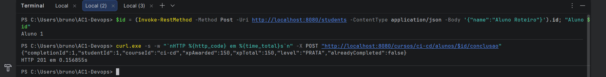 | 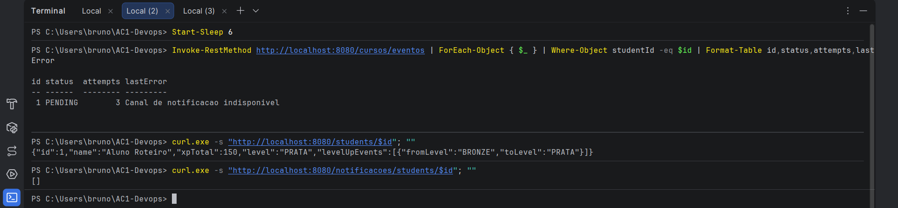 |

| Queda forçada do processo | Recuperação e repetição |
|---|---|
| 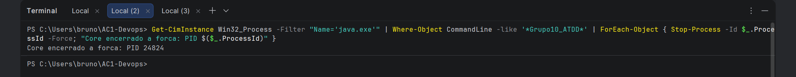 | 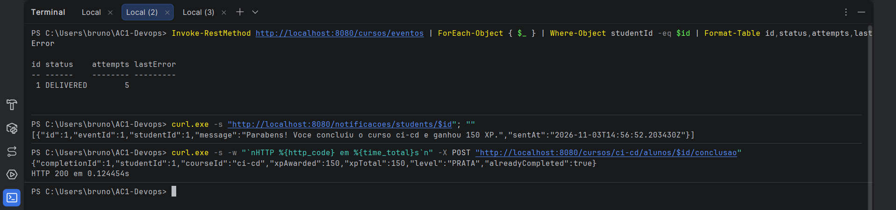 |

#### Defeito encontrado pela evidência

A primeira versão passava em todos os testes, mas a carga em PostgreSQL **travou**: com 20 threads, as requisições ficaram mais
de 60 s sem resposta, e só 44 conclusões foram gravadas. O log mostrou `Connection is not available` (`total=10, active=10`) 74
vezes. Os badges rodavam depois do commit em `REQUIRES_NEW`, pedindo uma segunda conexão enquanto a primeira continuava presa;
acima de 10 requisições, todas esperavam umas pelas outras, e badges se perdiam.

A correção foi publicar o evento de pontuação **depois que a transação termina**. O teste
`conclusoesAcimaDoPoolDeConexoesNaoTravamNemPerdemBadges` falhava antes do ajuste, e a carga repetida teve 0 esgotamentos.

#### Roteiro manual

Comandos em PowerShell, na raiz do projeto. Usa as portas 5433 (PostgreSQL) e 8080 (Core).

```powershell
# Terminal 1: sobe o PostgreSQL e gera o jar
docker compose up -d --wait postgres
.\mvnw.cmd -B package -DskipTests

# Terminal 2: sobe o Core com o canal de notificacao fora do ar
$env:SPRING_DATASOURCE_URL="jdbc:postgresql://localhost:5433/ac1devops_db"; $env:NOTIFICACOES_CANAL_DISPONIVEL="false"; java -jar target\Grupo10_ATDD-0.0.1-SNAPSHOT.jar

# Terminal 1: conclui um curso com o canal fora do ar (print d4-01)
$id = (Invoke-RestMethod -Method Post -Uri http://localhost:8080/students -ContentType application/json -Body '{"name":"Aluno Roteiro"}').id; "Aluno $id"
curl.exe -s -w "`nHTTP %{http_code} em %{time_total}s`n" -X POST "http://localhost:8080/cursos/ci-cd/alunos/$id/conclusao"

# Terminal 1: a conclusao ficou gravada, e a notificacao, pendente (print d4-02)
Start-Sleep 6
Invoke-RestMethod http://localhost:8080/cursos/eventos | ForEach-Object { $_ } | Where-Object studentId -eq $id | Format-Table id,status,attempts,lastError
curl.exe -s "http://localhost:8080/students/$id"; ""
curl.exe -s "http://localhost:8080/notificacoes/students/$id"; ""

# Terminal 1: simula a queda do processo (print d4-03)
Get-CimInstance Win32_Process -Filter "Name='java.exe'" | Where-Object CommandLine -like '*Grupo10_ATDD*' | ForEach-Object { Stop-Process -Id $_.ProcessId -Force; "Core encerrado a forca: PID $($_.ProcessId)" }

# Terminal 2: sobe o Core de novo, agora com o canal no ar
$env:NOTIFICACOES_CANAL_DISPONIVEL="true"; java -jar target\Grupo10_ATDD-0.0.1-SNAPSHOT.jar

# Terminal 1: depois que o Core subir, a notificacao foi recuperada sem nova chamada (print d4-04)
Invoke-RestMethod http://localhost:8080/cursos/eventos | ForEach-Object { $_ } | Where-Object studentId -eq $id | Format-Table id,status,attempts,lastError
curl.exe -s "http://localhost:8080/notificacoes/students/$id"; ""
curl.exe -s -w "`nHTTP %{http_code} em %{time_total}s`n" -X POST "http://localhost:8080/cursos/ci-cd/alunos/$id/conclusao"

# Opcional: tentativas esgotadas e reenvio manual (print d4-05)
# Terminal 2: Ctrl+C e depois:
$env:NOTIFICACOES_CANAL_DISPONIVEL="false"; $env:CURSOS_OUTBOX_MAX_ATTEMPTS="2"; $env:CURSOS_OUTBOX_BASE_BACKOFF="1s"; java -jar target\Grupo10_ATDD-0.0.1-SNAPSHOT.jar
# Terminal 1, depois que o Core subir:
curl.exe -s -o NUL -w "Conclusao: HTTP %{http_code}`n" -X POST "http://localhost:8080/cursos/docker-essencial/alunos/$id/conclusao"
Start-Sleep 9
$evento = Invoke-RestMethod http://localhost:8080/cursos/eventos | ForEach-Object { $_ } | Where-Object { $_.studentId -eq $id -and $_.status -eq 'DEAD' } | Select-Object -First 1; $evento | Format-Table id,status,attempts,lastError
# Terminal 2: Ctrl+C e depois:
$env:NOTIFICACOES_CANAL_DISPONIVEL="true"; Remove-Item Env:CURSOS_OUTBOX_MAX_ATTEMPTS; Remove-Item Env:CURSOS_OUTBOX_BASE_BACKOFF; java -jar target\Grupo10_ATDD-0.0.1-SNAPSHOT.jar
# Terminal 1, depois que o Core subir:
curl.exe -s -o NUL -w "Reenvio: HTTP %{http_code}`n" -X POST "http://localhost:8080/cursos/eventos/$($evento.id)/reenvio"
Start-Sleep 7
Invoke-RestMethod http://localhost:8080/cursos/eventos | ForEach-Object { $_ } | Where-Object studentId -eq $id | Format-Table id,status,attempts,lastError

# Opcional: carga
py labs\desafio-4\carga_conclusoes.py 100 20

# Ao terminar: Ctrl+C no Terminal 2 e depois, no Terminal 1:
docker compose stop postgres
```

#### Limites desta evidência

- **Canal simulado:** não há envio real de e-mail ou push.
- **Medição local:** os números de carga são de uma execução, com tudo na mesma máquina; servem de ordem de grandeza e de base para
  os gatilhos, não como capacidade de produção.
- **Latência sob carga:** o p95 maior com o canal fora do ar pode refletir também o trabalho das falhas na mesma máquina.
- **Uma réplica:** a reserva dos eventos foi pensada para várias réplicas, mas só foi testada com uma.
- **Duplicação possível:** uma queda entre o envio e a gravação da notificação pode repetir o envio; não ocorreu nos testes.
- **Tabela da outbox:** cresce sem limpeza. Eventos `DEAD` passaram a gerar alerta no Prometheus, no Desafio 6, sem envio de notificação.

---

## Desafio 5 — IoT e MQTT

Como eventos de presença, início e conclusão, gerados por dispositivos com poucos recursos e conexão instável, entram na plataforma
sem acoplar o Core a cada dispositivo.

### 1. RF

> **Numeração:** RF06 segue o enunciado deste desafio; não confundir com o RF06 do Desafio 1 (listar alunos).

| RF | Estado | Classes / endpoints reais | Efeito deste desafio |
|---|---|---|---|
| **RF06 — Receber eventos IoT e encaminhá-los ao ecossistema** | **Existe**, com dispositivo simulado. | Tópico `labs/{lab}/devices/{deviceId}/events` → `MqttDeviceEventGateway` → `DeviceEventProcessor` → `ActivityCompletionPort` ← `CursosActivityCompletionAdapter` → `CursosApi`; `GET /iot/eventos` | Módulo novo `iot` e [simulador](../../labs/desafio-5/simulador/simulador.py). |

Conclusão aciona o fluxo do Desafio 4. Presença e início são **apenas registrados**, porque ainda não têm consumidor.

### 2. RNF (FURPS+)

| RNF | FURPS+ | Meta mensurável | Resultado |
|---|---|---|---|
| **Tolerância à conectividade intermitente** | R (Reliability) | Evento confirmado chega depois de queda do dispositivo, do Core ou do broker | Atendida nos três casos |
| **Disponibilidade** | R (Reliability) | Core opera sem o broker | Atendida: sobe, conclui por HTTP e conecta sozinho quando o broker volta |
| **Interoperabilidade** | + (requisito de interface) | Dispositivo só conhece broker, tópico e JSON | Atendida: simulador em Python, sem dependência do Core |
| **Eficiência de comunicação** | P (Performance) | Menos bytes de protocolo que HTTP | Atendida: 42 bytes contra 109 por evento, antes de TLS e autenticação |
| **Escalabilidade** | P (Performance: capacidade) | Vazão do gateway | **Não medida**; um único gateway, uma mensagem por vez |
| **Segurança de integração** | + (restrição) | Rejeitar o que não é do dispositivo; TLS e credenciais | **Parcial:** valida conteúdo, tamanho e tópico; sem TLS nem autenticação |

### 3. ASR

| ASR | RNF de origem | Como altera a arquitetura (uma frase) |
|---|---|---|
| **ASR12 — Evento confirmado sobrevive à conexão instável** | Conectividade intermitente e Disponibilidade | Altera a **comunicação**: dispositivos e Core passam a falar por um broker com QoS 1 e sessão persistente, sem precisar estar no ar ao mesmo tempo. |
| **ASR13 — Um único efeito por evento, mesmo com reentrega** | Consistência da integração | Altera os **dados**: cada `eventId` é registrado com restrição única, e o efeito é aplicado antes do registro. |
| **ASR14 — Core desacoplado dos dispositivos** | Interoperabilidade | Altera a **estrutura e a implantação**: entra um broker no sistema, e só o adapter do módulo `iot` conhece MQTT. |

Eficiência é uma vantagem, mas não gera ASR: a diferença de bytes sozinha não mudaria a arquitetura. Segurança também não gera ASR
**neste laboratório**, mas é pré-requisito para qualquer uso real (item 9).

### 4. RPC

| RPC | Restrição | Impacto na decisão |
|---|---|---|
| **RPC11** | Dispositivos com baixo poder computacional. | Protocolo e cliente precisam ser leves. |
| **RPC12** | Conectividade intermitente. | Nenhum fluxo pode exigir dispositivo e Core no ar ao mesmo tempo. |
| **RPC13** | Protocolo e broker adicionam componentes operacionais. | Cada componente novo precisa de ASR que o justifique. |

### 5. Decisão do Tech Lead

**REST é suficiente?** **Não, para este cenário.** REST funcionaria com rede estável, mas cada dispositivo precisaria guardar eventos,
repetir envios e conhecer o endereço do Core, e o Core teria que estar no ar no momento do envio.

**O que MQTT resolve especificamente?**

| Recurso | Problema que resolve | Evidência |
|---|---|---|
| **Cabeçalho leve** | Menos bytes por evento: 42 contra 109 no HTTP mínimo. É um ganho **modesto** (214 contra 281 bytes por evento); não é o principal motivo | `--modo tamanho` |
| **QoS 1** | O dispositivo sabe que o broker recebeu, e quem não recebeu a confirmação reenvia | Modos `normal`, `reenvio` e `offline` |
| **Sessão persistente** | O broker guarda eventos com o Core fora do ar, inclusive depois de reiniciar | Testes com Core e broker reiniciados |
| **Retained** | Quem assinar depois recebe o último estado do dispositivo | `mosquitto_sub` recebeu o status guardado |
| **LWT** | O broker avisa quando um dispositivo some sem se despedir | **Configurado**, mas a queda abrupta não foi exercitada |

**Depois do MQTT, existe motivo para outro broker?** **Não.** O Mosquitto leva o evento até o gateway; a partir daí, a conclusão usa a
outbox do Desafio 4. RabbitMQ ou Kafka só entrariam com uma ASR própria, como um consumidor externo dos eventos.

**Como impedir duplicidade ou perda relevante?**

| Risco | Proteção |
|---|---|
| Reentrega do QoS 1 ou reenvio do dispositivo | `eventId` único em `iot_events`; a repetição é descartada e contada |
| Queda entre aplicar o efeito e registrar o evento | Efeito **antes** do registro, e conclusão idempotente por aluno e curso: a reentrega conclui de novo sem efeito |
| Falha temporária no Core | Exceção impede a confirmação; o broker reentrega na reconexão |
| Evento inválido | Log e confirmação, para não travar a fila |
| Core fora do ar | Sessão persistente, com mensagens em disco no broker |

**Decisão:** **MQTT + consumidor (alternativa B)**, com Paho direto, sem Spring Integration, por ser uma única rota de entrada. Registro
formal no [ADR-005](adr/ADR-005-iot-com-mqtt-e-gateway.md).

### 6. Alternativas e trade-offs

| Critério | (A) REST direto | (B) MQTT + consumidor | (C) MQTT + mensageria interna |
|---|---|---|---|
| Core fora do ar | Dispositivo precisa guardar e repetir | **Broker guarda** | Broker guarda |
| Dispositivo conhece | Endereço e API do Core | **Só broker e tópico** | Só broker e tópico |
| Confirmação de recebimento | Resposta HTTP, com o Core no ar | **QoS 1, com o broker** | QoS 1, com o broker |
| Bytes de protocolo por evento | 109, no mínimo | **42** | 42 |
| Serviços novos | 0 | **1** | 2 |
| Consumidores externos | Não | Só com novos gatilhos | **Sim** |
| Aderência às RPCs | Conflita com a RPC12 | **Atende** | Custo da RPC13 sem ASR |

### 7. ADR

[**ADR-005 — Eventos de dispositivos por MQTT, com gateway no Core e sem segundo broker**](adr/ADR-005-iot-com-mqtt-e-gateway.md)
— status **Aceito**, 2026-11-03.

### 8. C4

Nível afetado: **Container**. O gateway é um módulo no mesmo processo do Core, destacado para mostrar a fronteira.

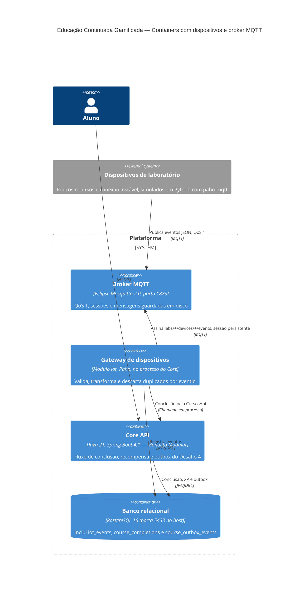

**Fluxo do evento**, com reentrega e dispositivo ou Core fora do ar:

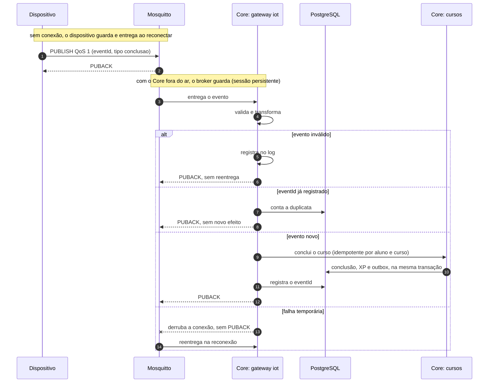

### 9. Evidência

**Hipótese testada:** com QoS 1, sessão persistente e idempotência por `eventId`, um evento confirmado chega exatamente com um efeito, mesmo com
dispositivo, Core ou broker fora do ar, sem acoplar o Core aos dispositivos e sem um segundo broker.

| # | O que se testa | Como reproduzir | Resultado obtido |
|---|---|---|---|
| 1 | Transformação e validação, sem broker | `mvnw.cmd test -Dtest=DeviceEventTest,MqttDeviceEventGatewayTest` | Campos viram o modelo da aplicação; JSON inválido, campo ausente, tipo desconhecido e `deviceId` diferente do tópico são descartados. |
| 2 | Duplicado e ordem do efeito, sem broker | `mvnw.cmd test -Dtest=DeviceEventProcessorTest` | Repetição não aciona a conclusão; falha temporária não registra o evento, e a nova entrega conclui. |
| 3 | Broker real, com Testcontainers | `mvnw.cmd test -Dtest=MqttBrokerIntegrationTest` | 4 testes em cerca de 32 s: reentrega descartada, sessão persistente, falha temporária reentregue e referência desconhecida sem travar a fila. |
| 4 | Fronteira do MQTT | `mvnw.cmd test -Dtest=ModularArchitectureTest` | Só `iot.internal.adapter.mqtt` conhece o Paho. |
| 5 | Simulador | `cd labs\desafio-5\simulador`, `py -m pytest` | **9 testes verdes**, também em um job próprio no CI. |
| 6 | Fluxo real | Roteiro abaixo | Tabela abaixo e [`d5-fluxo-real.txt`](evidencias/d5-fluxo-real.txt). |
| 7 | Build completo | `mvnw.cmd -B clean verify` | **159 testes**, 0 falhas. Cobertura: linhas 666/668 (99,7%) e branches 82/82; faltam as 2 linhas do tratamento de erro ao desconectar do broker. |

#### Resultados do fluxo real

Mosquitto real, Core em jar, simulador em Python e o PostgreSQL 16 do projeto. Execução única, em 2026-11-03.

| Cenário | Resultado |
|---|---|
| Modo normal | 3 eventos `ACCEPTED`; a conclusão deu 150 XP |
| Reenvio do mesmo `eventId` | 1 registro, `duplicatesDiscarded: 1`; 100 XP, uma vez |
| Dispositivo offline | 2 eventos guardados e entregues ao reconectar; 200 XP |
| Mensagens inválidas | 3 descartadas no log: JSON inválido, `alunoId` ausente e `deviceId` diferente do tópico |
| Core fora do ar | Broker confirmou 3 eventos; todos processados quando o Core voltou; 150 XP e notificação pela outbox |
| Broker reiniciado, com o Core fora | Mensagens guardadas em disco; todos os 3 eventos processados |
| Core sem broker | Core subiu e concluiu por HTTP com 201; conectou sozinho quando o broker voltou |
| Total | 16 eventos e 7 conclusões do aluno testado: **0 `eventId` repetidos, 0 conclusões repetidas e 0 alunos com XP divergente** (900 XP) |

#### Execução manual do roteiro

Execução do Bruno em 2026-11-03, com os comandos do roteiro abaixo e o aluno 3:

| Passo | Valor observado | Print |
|---|---|---|
| Modo normal | 3 eventos publicados e confirmados com QoS 1; **3 `ACCEPTED`; 150 XP**, nível Prata | [`d5-01`](evidencias/img/d5-01-eventos-normais.png) |
| Reenvio | Mesmo `eventId` nos 2 envios; **`duplicatesDiscarded: 1`; 250 XP**, somando 100 uma vez | [`d5-02`](evidencias/img/d5-02-reenvio-duplicado.png) |
| Dispositivo offline | `conexao perdida`, 2 eventos guardados, `reconectado`, 3 confirmados e **3 `ACCEPTED`** | [`d5-03`](evidencias/img/d5-03-dispositivo-offline.png) |
| Core fora do ar | PID 27696 encerrado; 3 eventos confirmados pelo broker com o Core fora; depois de voltar, **3 `ACCEPTED`, 600 XP**, nível Ouro | [`d5-04`](evidencias/img/d5-04-core-fora.png) |
| CI | Run #5, commit `49ab6b2`: **Success, 3 jobs verdes**, em 1m 36s | [`d5-05`](evidencias/img/d5-05-ci-verde.png) |

Os 600 XP do último passo somam as conclusões dos quatro cenários: 150, 100, 200 e 150.

| Eventos normais | Reenvio descartado |
|---|---|
| 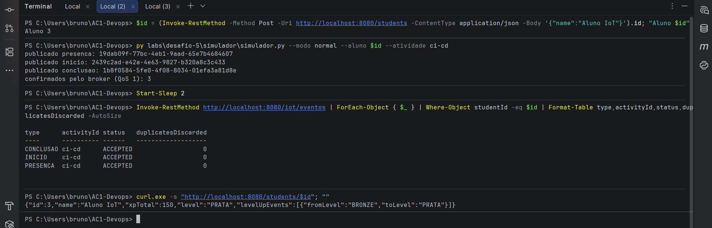 | 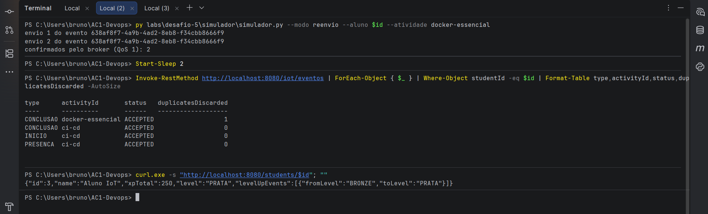 |

| Dispositivo offline | Core fora do ar |
|---|---|
| 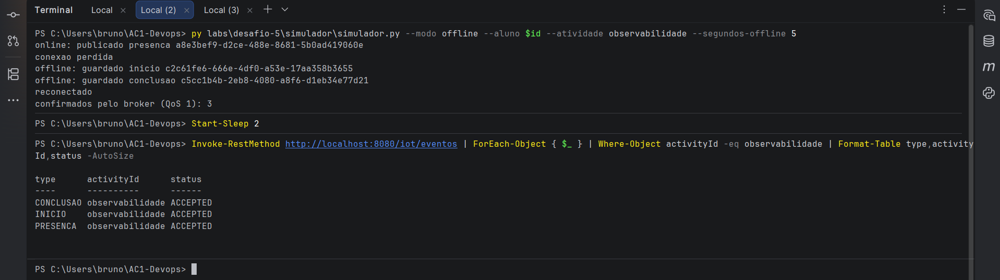 | 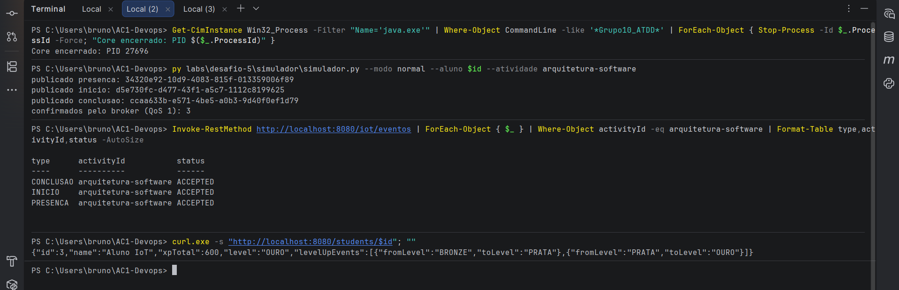 |

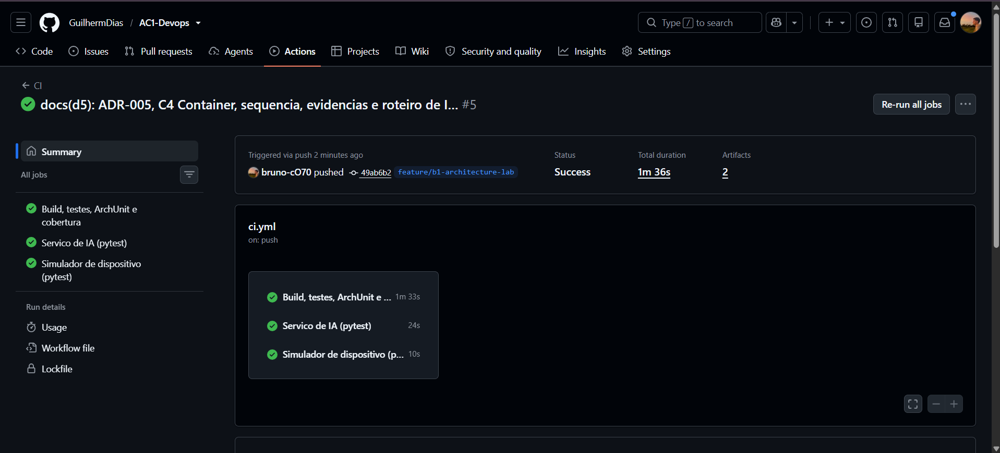

#### Roteiro manual

Comandos em PowerShell, na raiz do projeto. Usa as portas 1883 (Mosquitto), 5433 (PostgreSQL) e 8080 (Core).

```powershell
# Terminal 1: sobe PostgreSQL e Mosquitto, instala o cliente MQTT e gera o jar
docker compose up -d --wait postgres mosquitto
py -m pip install -r labs\desafio-5\simulador\requirements.txt
.\mvnw.cmd -B package -DskipTests

# Terminal 2: sobe o Core
$env:SPRING_DATASOURCE_URL="jdbc:postgresql://localhost:5433/ac1devops_db"; java -jar target\Grupo10_ATDD-0.0.1-SNAPSHOT.jar

# Terminal 1: cria um aluno e publica presenca, inicio e conclusao (print d5-01)
$id = (Invoke-RestMethod -Method Post -Uri http://localhost:8080/students -ContentType application/json -Body '{"name":"Aluno IoT"}').id; "Aluno $id"
py labs\desafio-5\simulador\simulador.py --modo normal --aluno $id --atividade ci-cd
Start-Sleep 2
Invoke-RestMethod http://localhost:8080/iot/eventos | ForEach-Object { $_ } | Where-Object studentId -eq $id | Format-Table type,activityId,status,duplicatesDiscarded -AutoSize
curl.exe -s "http://localhost:8080/students/$id"; ""

# Terminal 1: reenvia o mesmo evento: 1 registro, duplicatesDiscarded=1 e XP uma vez (print d5-02)
py labs\desafio-5\simulador\simulador.py --modo reenvio --aluno $id --atividade docker-essencial
Start-Sleep 2
Invoke-RestMethod http://localhost:8080/iot/eventos | ForEach-Object { $_ } | Where-Object studentId -eq $id | Format-Table type,activityId,status,duplicatesDiscarded -AutoSize
curl.exe -s "http://localhost:8080/students/$id"; ""

# Terminal 1: dispositivo perde a conexao, guarda eventos e entrega ao reconectar (print d5-03)
py labs\desafio-5\simulador\simulador.py --modo offline --aluno $id --atividade observabilidade --segundos-offline 5
Start-Sleep 2
Invoke-RestMethod http://localhost:8080/iot/eventos | ForEach-Object { $_ } | Where-Object activityId -eq observabilidade | Format-Table type,activityId,status -AutoSize

# Terminal 1: mensagens invalidas; veja os avisos "Evento IoT invalido descartado" no Terminal 2
py labs\desafio-5\simulador\simulador.py --modo invalido --aluno $id

# Terminal 1: encerra o Core, e o dispositivo publica com o Core fora do ar (print d5-04)
Get-CimInstance Win32_Process -Filter "Name='java.exe'" | Where-Object CommandLine -like '*Grupo10_ATDD*' | ForEach-Object { Stop-Process -Id $_.ProcessId -Force; "Core encerrado: PID $($_.ProcessId)" }
py labs\desafio-5\simulador\simulador.py --modo normal --aluno $id --atividade arquitetura-software

# Terminal 2: sobe o Core de novo
java -jar target\Grupo10_ATDD-0.0.1-SNAPSHOT.jar

# Terminal 1, depois que o Core subir: os eventos guardados pelo broker chegaram (ainda print d5-04)
Invoke-RestMethod http://localhost:8080/iot/eventos | ForEach-Object { $_ } | Where-Object activityId -eq arquitetura-software | Format-Table type,activityId,status -AutoSize
curl.exe -s "http://localhost:8080/students/$id"; ""

# Opcional: tamanho do evento em MQTT e em HTTP
py labs\desafio-5\simulador\simulador.py --modo tamanho

# Ao terminar: Ctrl+C no Terminal 2 e depois, no Terminal 1:
docker compose stop postgres mosquitto
```

#### Limites desta evidência

- **Segurança:** sem TLS nem autenticação no laboratório. A porta só é publicada em `localhost`. Antes de qualquer uso real: TLS, credencial por
  dispositivo e ACL por tópico.
- **Escalabilidade e vazão:** não foram medidas. Há um único gateway, e duas réplicas do Core com o mesmo identificador derrubariam uma à outra.
- **LWT:** configurado, mas a queda abrupta do dispositivo não foi exercitada; verificado apenas o status guardado (retained).
- **Dispositivo real:** a fila do simulador fica em memória e não sobrevive a um reinício do dispositivo.
- **Sem fila de mensagens mortas:** um erro permanente inesperado seria reentregue sem fim, e mensagens inválidas ficam só no log.
- **Limite do broker:** até 10.000 mensagens por cliente desconectado.
- **Presença e início:** registrados sem consultar se o aluno existe, porque ainda não têm consumidor.

---

## Desafio 6 — CI/CD e observabilidade

Como testar, implantar e observar com segurança uma solução com Core em Java, serviço de IA em Python, Mosquitto, simulador de dispositivo e
PostgreSQL.

### 1. RF

Este desafio não cria funcionalidade: atua sobre **todos os RFs**, na operação e na evolução. O estado final dos RFs está na
[Síntese final](#síntese-final-decisões-levadas-para-a-poc-da-af).

| RF impactado | Efeito deste desafio |
|---|---|
| Ranking | Métrica `ranking_query_seconds`, com p95 no Prometheus |
| Conquistas | Métrica `conquistas_badges_awarded_total` |
| Recomendação | Métrica `ia_recommendations_total{outcome}` |
| Conclusão e notificações | Métrica `outbox_events{status}` |
| Eventos IoT | Métrica `iot_events_total{result}` |
| Todos | Gates na esteira, métricas HTTP e painel de operação |

### 2. RNF (FURPS+)

| RNF | FURPS+ | Meta mensurável | Resultado |
|---|---|---|---|
| **Observabilidade** | S (Supportability: serviceability) | Latência, 5xx, throughput e uma métrica por ASR de execução em um painel | Atendida: 10 painéis, todos com dados no teste |
| **Testabilidade** | S (Supportability) | Todos os gates automatizados | Atendida: 161 testes no Core, 12 e 9 nos componentes Python |
| **Confiabilidade** | R (Reliability) | Artefato só com todos os gates verdes | Atendida: build #1 no Jenkins com todos os estágios verdes |
| **Deploy independente** | + (restrição de implantação) | Artefatos separados, verificados por componente | Atendida: jar e imagem separados; sem publicação automática |
| **Recuperabilidade** | R (Reliability) | Ambiente de observação recriado com um comando | Atendida: compose com tudo versionado, recriado do zero no teste |
| **Desempenho** | P (Performance) | p95 do ranking ≤ 300 ms, com 100.000 alunos | Top 100: 114 ms. Posição: 79 ms. Página aleatória: 317 ms sob 10 threads |

### 3. ASR

| ASR | RNF de origem | Como altera a arquitetura (uma frase) |
|---|---|---|
| **ASR15 — Nenhum artefato sai sem passar pelos gates** | Testabilidade e Confiabilidade | Altera a **operação**: testes, ArchUnit, JaCoCo e pytest viram estágios que impedem o arquivamento do artefato. |
| **ASR16 — ASRs de execução observáveis em operação** | Observabilidade e Desempenho | Altera a **estrutura e a operação**: os módulos publicam métricas, e entram no sistema Prometheus e Grafana, fora do fluxo das requisições. |
| **ASR17 — Operação reproduzível a partir do repositório** | Recuperabilidade | Altera a **implantação**: esteira, fonte de dados, painel e alertas passam a ser arquivos versionados. |

Deploy independente não gera ASR novo: já está na ASR7.

### 4. RPC

| RPC | Restrição | Impacto na decisão |
|---|---|---|
| **RPC14** | Jenkins é a base da esteira. | O Jenkinsfile é a referência; o GitHub Actions continua como verificação adicional. |
| **RPC15** | Prometheus e Grafana são as ferramentas do laboratório. | Métricas no formato do Prometheus, com Actuator e Micrometer. |
| **RPC16** | Artefatos e configurações devem ser versionados. | Painel, alertas e fonte de dados em arquivos, sem configuração manual. |

Restrição do ambiente: a porta 9090 é do Jenkins, então o Prometheus usa a **9091**.

### 5. Decisão do Tech Lead

**Serviços independentes exigem pipelines independentes?** **Não necessariamente.** Eles exigem artefatos e verificações independentes. Com um repositório,
6 pessoas, nenhuma publicação automática e uma esteira de cerca de 3 minutos, um pipeline com estágios por componente atende. Os gatilhos para separar estão
no [ADR-006](adr/ADR-006-esteira-unica-e-observabilidade.md).

**O que deve bloquear o deploy?**

| Gate | Protege | Bloqueia? |
|---|---|---|
| Compilação e testes do Core | RFs e contratos | **Sim** |
| ArchUnit | ASR1, ASR3, ASR5, ASR14 | **Sim**, e roda primeiro, por ser o mais rápido |
| JaCoCo, piso de 90% de linhas e branches | ASR3 | **Sim** |
| pytest do serviço de IA | ASR7, ASR8 | **Sim** |
| pytest do simulador | ASR12 | **Sim** |
| Alertas do Prometheus | ASRs em execução | Não: são da operação, não do build |

**Quais métricas validam ASRs anteriores, e o que é métrica técnica e o que é evidência arquitetural?** A **métrica técnica** diz o que está acontecendo. A
**evidência arquitetural** liga isso a uma decisão: precisa de meta, de uma hipótese que poderia ser falsa e de uma condição que a exercite.

| ASR | Métrica técnica | Como vira evidência arquitetural | Medido no teste |
|---|---|---|---|
| **ASR2** (D1) | `ranking_query_seconds` | p95 comparado à meta de 300 ms, com 100.000 alunos e carga; decide o gatilho G1 de extração | Top 100: 114 ms; posição: 79 ms |
| **ASR6** (D3) | `ia_recommendations_total{outcome}` | Derrubar a IA: o fallback sobe, e `http_server_requests` permite conferir que não há 5xx nem mudança no fluxo essencial | 90,8% de fallback e alerta `FallbackDaIaAlto` ativo; as respostas com HTTP 200 foram verificadas no D3 |
| **ASR11** (D4) | `outbox_events{status}` | `PENDING` volta a 0 depois de o consumidor voltar; `DEAD` igual a 0 sem intervenção | 40 `DELIVERED`, 0 `PENDING`, 0 `DEAD` |
| **ASR12, ASR13** (D5) | `iot_events_total{result}` | Reenvio gera `DUPLICATE`, sem novo efeito; só faz sentido com o XP conferido | 4 `ACCEPTED`, 1 `DUPLICATE`, 3 `INVALID` |
| Defeito do D4 | `hikaricp_connections_pending` | Conexões aguardando sob carga indicam a volta do esgotamento do pool | 0 durante a carga |

**O que métrica não valida:** ASR1, ASR3, ASR4, ASR5, ASR10 e ASR14 são propriedades da estrutura ou da transação. Elas são provadas por ArchUnit, testes e falhas simuladas.
O contador de badges (`conquistas_badges_awarded_total`) mostra a regra do D2 em uso, mas **não prova** a modificabilidade da ASR4.

**Decisão:** **pipeline único com estágios paralelos por componente** e observabilidade em compose próprio. Registro formal no
[ADR-006](adr/ADR-006-esteira-unica-e-observabilidade.md).

### 6. Alternativas e trade-offs

| Critério | (A) Único sequencial | (B) Único com paralelos | (C) Um Jenkinsfile por componente | (D) Detecção de mudança por pasta |
|---|---|---|---|---|
| Configuração no Jenkins | 1 job | **1 job** | 3 jobs | 1 job, com regras por pasta |
| Tempo | Maior | **Cerca de 3 min** | Menor por componente | Menor na maioria das mudanças |
| Contrato entre Core e IA | Sempre verificado | **Sempre verificado** | Depende de coordenar os jobs | Pode ser pulado |
| Publicação independente | Não | Não, mas com artefatos separados | **Sim** | Parcial |
| Um único resultado para o commit | Sim | **Sim** | Não | Sim |
| Contra principal | Desperdiça tempo | Toda mudança roda tudo | Custo para 6 pessoas | Falsa sensação de verificação |

### 7. ADR

[**ADR-006 — Esteira única no Jenkins e observabilidade que valida os ASRs**](adr/ADR-006-esteira-unica-e-observabilidade.md) — status **Aceito**, 2026-11-03.

### 8. C4

Nível afetado: **Deployment**, com os elementos de operação. A versão final dos demais níveis está na
[Síntese final](#síntese-final-decisões-levadas-para-a-poc-da-af).

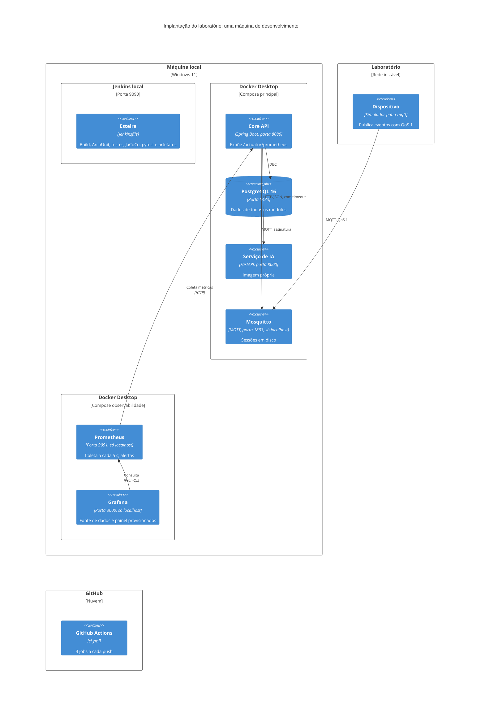

### 9. Evidência

**Hipótese testada:** um único pipeline consegue barrar artefatos em todos os componentes, e as métricas permitem ver em execução se os ASRs continuam valendo, inclusive provocando uma falha.

| # | O que se testa | Como reproduzir | Resultado obtido |
|---|---|---|---|
| 1 | Comandos de cada estágio do [`Jenkinsfile`](../../Jenkinsfile) | Os mesmos comandos, na mesma ordem, em 2026-11-03 | Todos com sucesso em cerca de 3 min: build 12 s, ArchUnit 27 s, testes 108 s, JaCoCo 6 s, IA 28 s, simulador 11 s e empacotamento 12 s. Relatórios XML e jar gerados. |
| 2 | Métricas expostas | `mvnw.cmd test -Dtest=ObservabilityIntegrationTest` | As métricas dos ASRs aparecem em `/actuator/prometheus`; `/actuator/env` responde 404. |
| 3 | Domínio sem métricas | `mvnw.cmd test -Dtest=ModularArchitectureTest` | Regra `dominioSemFrameworkNemAdapters` inclui Micrometer. |
| 4 | Fluxo real, com falha provocada | Roteiro abaixo | Tabela abaixo e [`d6-observabilidade.txt`](evidencias/d6-observabilidade.txt). |
| 5 | Esteira no Jenkins | Job `ac1devops-b1`, passo a passo abaixo | **Build #1 verde em 5 min 15 s; 182 testes, 0 falhas**; jar e relatório do JaCoCo arquivados. |
| 6 | GitHub Actions | Push na branch | Run #7 (`9552ea7`): **Success, 3 jobs verdes**, em 1m 52s. |
| 7 | Build completo | `mvnw.cmd -B clean verify` | **161 testes**, 0 falhas. Cobertura: linhas 693/695 (99,7%) e branches 86/86. |

#### Resultados do fluxo real

PostgreSQL 16 descartável, Core em jar, serviço de IA e Mosquitto reais, Prometheus e Grafana provisionados. Tudo na mesma máquina, em 2026-11-03.

**ASR2: primeira medição de p95 em PostgreSQL, com 100.000 alunos** (carga de [`carga_ranking.py`](../../labs/desafio-6/carga_ranking.py), sem cache, execução única):

| Operação | 3 threads, p95 | 10 threads, p95 | Meta |
|---|---|---|---|
| Top 100 | 44 ms | **114 ms** | ≤ 300 ms |
| Posição do aluno | 32 ms | **79 ms** | ≤ 300 ms |
| Página aleatória, 20 alunos | 165 ms | **317 ms** | Fora da meta original; **no limite** sob 10 threads |

Numa primeira rodada, sem o top 100 na carga, o Prometheus e o cliente concordaram na ordem de grandeza: página com 323 ms e 316 ms; posição com 61 ms e 74 ms.

A página aleatória fica lenta por causa do deslocamento (`OFFSET`) e da contagem total a cada consulta. Como o ranking é consultado principalmente no topo e pela posição do aluno, **não alterei a consulta**: se o gatilho G1 ocorrer em uso real, o caminho é paginação por cursor e cache da contagem.

**Condições provocadas:**

| Condição | Resultado observado |
|---|---|
| Serviço de IA derrubado, com requisições contínuas | 20 respostas da IA e depois 112 de fallback; **taxa de 90,8%**; alerta `FallbackDaIaAlto` **ativo**. O status HTTP dessas chamadas não foi registrado aqui: o teste automatizado do D3 cobre esse ponto |
| 40 conclusões, com o canal no ar | 40 `DELIVERED`, 0 `PENDING`, 0 `DEAD`; 25 badges |
| Eventos IoT, com reenvio e inválidos | 4 `ACCEPTED`, 1 `DUPLICATE`, 3 `INVALID` |
| Carga no ranking | 0 conexões aguardando no pool; 0 erros 5xx |
| Operação | Alvo do Prometheus `up`; 5 regras de alerta válidas; Grafana com fonte de dados e painel provisionados |

#### Execução manual

Execução do Bruno em 2026-11-03, no Jenkins 2.582 local e com o roteiro abaixo:

| Item | Valor observado | Print |
|---|---|---|
| Esteira no Jenkins, build #1 | **Todos os estágios verdes, em 5 min 15 s**: Build 16 s, ArchUnit 25 s, Testes 2 min 29 s, JaCoCo 6 s, Python em paralelo 1 min 13 s, Artefatos 17 s | [`d6-01`](evidencias/img/d6-01-jenkins-verde.png) |
| Testes no Jenkins | **182 testes, 0 falhas** | [`d6-02a`](evidencias/img/d6-02a-jenkins-testes.png) |
| Artefatos no Jenkins | `Grupo10_ATDD-0.0.1-SNAPSHOT.jar`, 63,42 MiB, e `site/jacoco` | [`d6-02b`](evidencias/img/d6-02b-jenkins-artefatos.png) |
| Prometheus | Alvo `core`: **1/1 UP** | [`d6-03`](evidencias/img/d6-03-prometheus-alvos.png) |
| Painel no Grafana, antes da queda | Core no ar, 0 req/s de 5xx, e dados nos 10 painéis | [`d6-04`](evidencias/img/d6-04-grafana-painel.png) |
| Queda do serviço de IA | Fallback de **0% para 100%** | [`d6-05a`](evidencias/img/d6-05a-fallback.png) |
| Alerta | `FallbackDaIaAlto` **FIRING**; os outros 4 inativos | [`d6-05b`](evidencias/img/d6-05b-alerta.png) |
| GitHub Actions | Run #7: 3 jobs verdes | [`d6-06`](evidencias/img/d6-06-ci-verde.png) |

Os 182 testes do Jenkins somam os 161 do Core, os 12 do serviço de IA e os 9 do simulador. Essa execução usou banco H2 e poucos dados: os tempos do painel não
substituem a medição com 100.000 alunos.

| Esteira no Jenkins | Resultado dos testes |
|---|---|
| 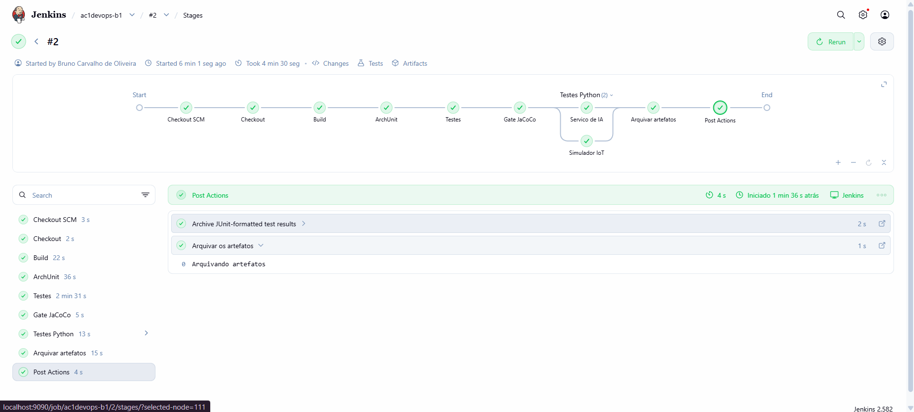 | 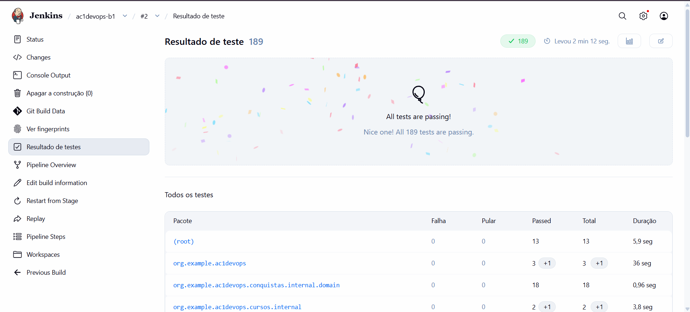 |

| Artefatos arquivados | Alvo no Prometheus |
|---|---|
| 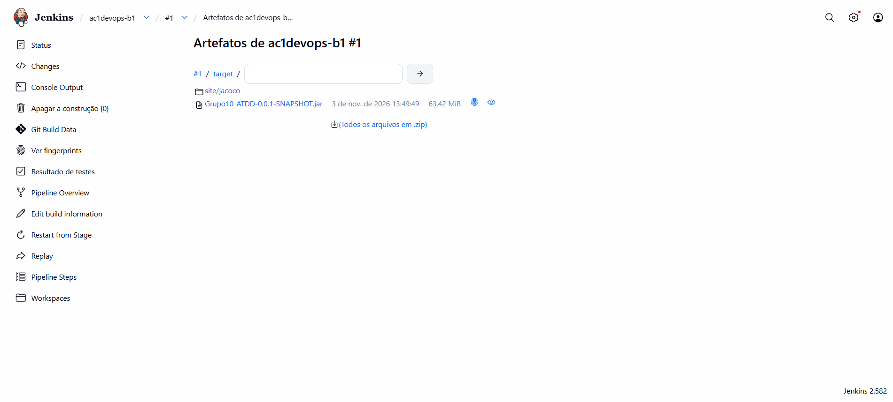 | 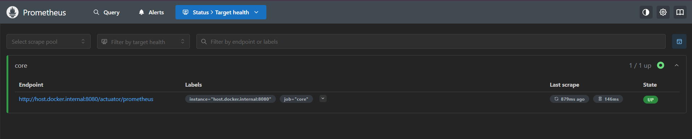 |

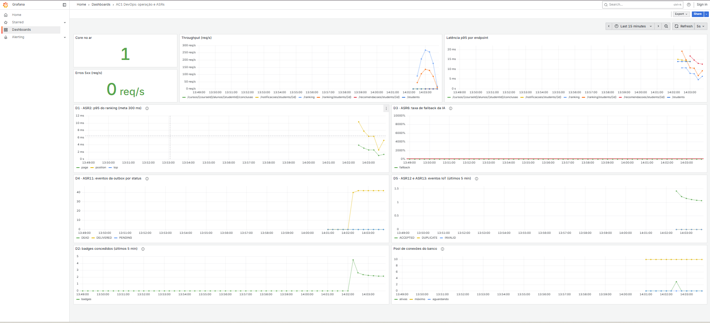

| Fallback de 0% para 100% | Alerta ativo |
|---|---|
| 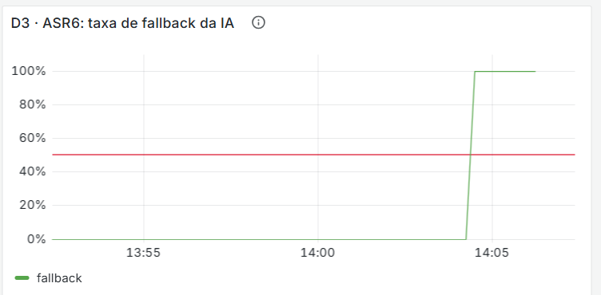 | 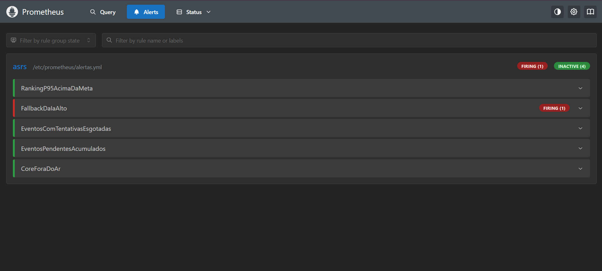 |

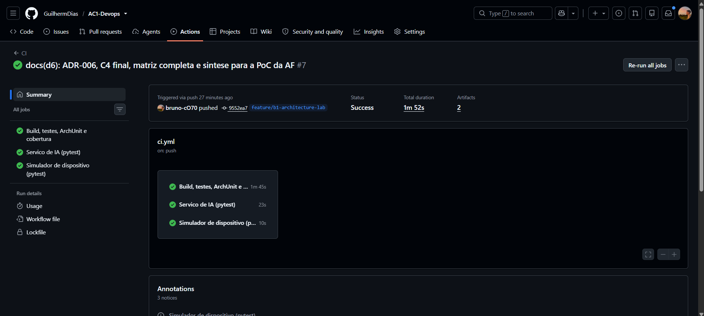

#### Como criar o job no Jenkins

O Jenkins baixa o código do GitHub, então **faça o `git push` antes**.

1. Abra <http://localhost:9090> e faça login.
2. Clique em **Nova tarefa** (*New Item*), dê o nome `ac1devops-b1`, escolha **Pipeline** e clique em **OK**.
3. Em **Pipeline**, no campo **Definition**, escolha **Pipeline script from SCM**.
4. Em **SCM**, escolha **Git**.
5. Em **Repository URL**, informe `https://github.com/GuilhermDias/AC1-Devops.git`. O repositório aceita leitura sem login; se o Jenkins recusar, cadastre uma credencial.
6. Em **Branch Specifier**, troque para `*/feature/b1-architecture-lab`.
7. Em **Script Path**, confirme `Jenkinsfile`.
8. Clique em **Salvar** e depois em **Construir agora** (*Build Now*).

São necessários os plugins **Pipeline**, **Git** e **JUnit**, que fazem parte da instalação sugerida. Se o build falhar por causa do ambiente:

| Erro | Causa provável | Solução |
|---|---|---|
| `'py' não é reconhecido` | O Jenkins não enxerga o Python | Em *Gerenciar Jenkins* → *System* → *Variáveis de ambiente*, crie `PYTHON_CMD` com o caminho completo do `python.exe` |
| `JAVA_HOME` ou versão do Java | O Jenkins não usa o Java 21 | Crie a variável `JAVA_HOME` da mesma forma, apontando para o JDK 21 |
| `MqttBrokerIntegrationTest` ignorado | O Jenkins não acessa o Docker | Não falha o build: esses 4 testes são ignorados sem Docker, e o GitHub Actions continua a executá-los |

#### Roteiro manual

Comandos em PowerShell, na raiz do projeto. Usa as portas 1883, 3000, 8000, 8080 e 9091, com banco H2, para não tocar nos seus dados.

```powershell
# Terminal 1: sobe Prometheus, Grafana, Mosquitto e o servico de IA, e gera o jar
docker compose -f observabilidade\docker-compose.yml up -d
docker compose up -d mosquitto
docker build -t ia-service:lab labs/desafio-3/ia-service
docker run -d --rm --name ia-service -p 8000:8000 ia-service:lab
.\mvnw.cmd -B package -DskipTests

# Terminal 2: sobe o Core
$env:SPRING_PROFILES_ACTIVE="h2"; java -jar target\Grupo10_ATDD-0.0.1-SNAPSHOT.jar

# Terminal 1: confere as metricas e o alvo do Prometheus (http://localhost:9091/targets)
(curl.exe -s http://localhost:8080/actuator/prometheus) | Select-String 'ranking_query_seconds_count|outbox_events'
Start-Process http://localhost:9091/targets

# Terminal 1: gera dados para todos os paineis e abre o painel
py labs\desafio-4\carga_conclusoes.py 5 5
$id = (Invoke-RestMethod -Method Post -Uri http://localhost:8080/students -ContentType application/json -Body '{"name":"Aluno Observado"}').id
py labs\desafio-5\simulador\simulador.py --modo normal --aluno $id --atividade ci-cd
py labs\desafio-5\simulador\simulador.py --modo reenvio --aluno $id --atividade docker-essencial
py labs\desafio-5\simulador\simulador.py --modo invalido --aluno $id
py labs\desafio-6\carga_ranking.py 30 10
1..30 | ForEach-Object { curl.exe -s -o NUL "http://localhost:8080/recomendacoes/students/$id"; Start-Sleep -Milliseconds 500 }
Start-Process "http://localhost:3000/d/ac1devops"
# Espere cerca de 30 s para o painel atualizar

# Terminal 1: provoca a falha, derrubando o servico de IA, e gera requisicoes por 1 minuto
docker stop ia-service
1..120 | ForEach-Object { curl.exe -s -o NUL -w "%{http_code} " "http://localhost:8080/recomendacoes/students/$id"; Start-Sleep -Milliseconds 500 }; ""
Start-Process http://localhost:9091/alerts
# Resultado esperado: painel "taxa de fallback da IA" perto de 100% e, em /alerts, FallbackDaIaAlto ativo

# Opcional: p95 com 100.000 alunos, em um banco descartavel que NAO toca nos seus dados
# Terminal 2: Ctrl+C e depois:
docker run -d --rm --name d6-pg -e POSTGRES_DB=ac1devops_db -e POSTGRES_USER=postgres -e POSTGRES_PASSWORD=postgres -p 127.0.0.1:55432:5432 postgres:16
$env:SPRING_PROFILES_ACTIVE="postgres"; $env:SPRING_DATASOURCE_URL="jdbc:postgresql://localhost:55432/ac1devops_db"; java -jar target\Grupo10_ATDD-0.0.1-SNAPSHOT.jar
# Terminal 1, depois que o Core subir:
Get-Content labs\desafio-6\seed_ranking.sql -Raw | docker exec -i d6-pg psql -q -U postgres -d ac1devops_db
py labs\desafio-6\carga_ranking.py 40 10

# Ao terminar: Ctrl+C no Terminal 2 e depois, no Terminal 1:
docker stop d6-pg
docker compose stop mosquitto
docker compose -f observabilidade\docker-compose.yml down
```

#### Limites desta evidência

- **Gates:** a falha dos testes, do ArchUnit e do JaCoCo interrompe os comandos, como mostram as falhas simuladas dos desafios anteriores. No Jenkins, houve um build verde: a interrupção por um gate com falha **não foi provocada lá**.
- **5xx durante a queda da IA:** o print do painel é anterior à queda, e o status dessas chamadas não foi registrado no fluxo real. O HTTP 200 do modo degradado é provado pelo teste automatizado do D3.
- **Medições:** execução única, com tudo na mesma máquina. Servem de ordem de grandeza, não como capacidade de produção. 100.000 alunos cadastrados não significam 100.000 simultâneos.
- **Sem implantação automática:** a esteira entrega o artefato.
- **Sem métricas no Python:** o serviço de IA é observado pelo Core; o simulador é só um dispositivo de teste.
- **Sem notificação:** alertas ficam no Prometheus, e o endpoint de métricas não tem autenticação.
- **Sem idade dos eventos:** a métrica conta os eventos por status, mas não informa há quanto tempo estão pendentes, o que o gatilho B5 do ADR-004 pediria.

---

## Síntese final: decisões levadas para a PoC da AF

**Em uma frase:** um Monólito Modular em Spring Boot, com hexagonal só onde a regra muda ou a dependência falha, um serviço Python opcional para IA, eventos
internos com outbox, MQTT para dispositivos e uma esteira que barra o artefato e métricas que mostram os ASRs em execução. Nenhum broker foi adicionado sem ASR
que o justificasse.

### Quais ADRs entram na PoC e por quê

| ADR | Entra na PoC? | Por quê | O que fica de fora |
|---|---|---|---|
| [ADR-001](adr/ADR-001-estilo-arquitetural-core.md) Monólito Modular | **Sim, é a base** | Dá baixo acoplamento com 1 artefato principal, para 6 pessoas. O p95 medido não pede extração. | Extração do Ranking, até os gatilhos G1–G5 |
| [ADR-002](adr/ADR-002-ports-and-adapters-em-conquistas.md) Ports & Adapters seletivo | **Sim** | Regra de gamificação muda muito e é testada em 0,3 s, sem infraestrutura. | Hexagonal em todo o Core |
| [ADR-003](adr/ADR-003-servico-python-de-ia.md) Serviço Python de IA | **Sim, com regra simulada** | Prova a fronteira: IA fora do ar não afeta o fluxo essencial. | Modelo real, RAG/LLM e assistente no Core |
| [ADR-004](adr/ADR-004-eventos-com-outbox-transacional.md) Outbox transacional | **Sim** | Conclusão não depende do consumidor, e nenhum evento se perde, inclusive com queda do processo. | RabbitMQ e Kafka, até os gatilhos B1–B5 |
| [ADR-005](adr/ADR-005-iot-com-mqtt-e-gateway.md) MQTT com gateway | **Sim, se a PoC incluir laboratórios** | É o que tolera a conexão instável. Se a AF não pedir dispositivos, é o primeiro corte: o restante não depende dele. | Segundo broker; TLS e autenticação ficam como pendência |
| [ADR-006](adr/ADR-006-esteira-unica-e-observabilidade.md) Esteira e observabilidade | **Sim** | Sem ela, nada garante que os ASRs continuem valendo depois da entrega. | Pipelines separados e implantação automática |

**Premissa:** o enunciado da AF não está no repositório. Revisar esta tabela quando o escopo da AF for definido.

### Pendências antes de um uso real

| Pendência | ASR afetada | Situação |
|---|---|---|
| TLS, autenticação e ACL no MQTT; autenticação na API e nas métricas | ASR14, ASR16 | Não implementado |
| Teste de carga da escala independente da IA e da vazão do gateway | ASR7, ASR12 | Não medido |
| Mais de uma réplica do Core: outbox, cache e gateway MQTT | ASR2, ASR11, ASR12 | Só testado com uma réplica |
| Limpeza da outbox e dos eventos IoT | ASR11, ASR13 | Não implementado |
| Paginação por cursor no ranking | ASR2 | Só se o gatilho G1 ocorrer |
| Autenticação dos alunos na API | Todas | Fora do escopo do Lab |

### Numeração dos RFs

Os enunciados reaproveitam números. A tabela mostra o significado de cada um, e o estado final.

| RF | Desafio | Significado | Estado final |
|---|---|---|---|
| RF01 | D1, D2 | Ranking | Existe |
| RF02 | D1, D2, D4 | Conquistas | Existe (badges) |
| RF03, RF04, RF05, RF06 | D1 | Cadastrar aluno, conceder XP, consultar perfil, listar alunos | Existem |
| RF03 | D3 | Recomendação inteligente | Existe, com regra simulada |
| RF04 | D3 | Assistente educacional | Parcial: resposta simulada, só no serviço |
| RF05 | D4 | Notificações | Existe, com canal simulado |
| — | D4 | Eventos de conclusão de atividades | Existe |
| RF06 | D5 | Receber eventos IoT | Existe, com dispositivo simulado |
| RF-EVO | D1 | Cursos e recompensas | Cursos: catálogo fixo, sem gestão. Recompensa: XP. Moedas: não existem |

### C4 final

**Contexto:**

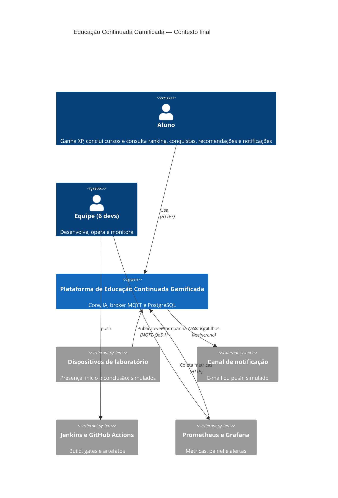

**Container, com todas as decisões e os elementos de operação:**

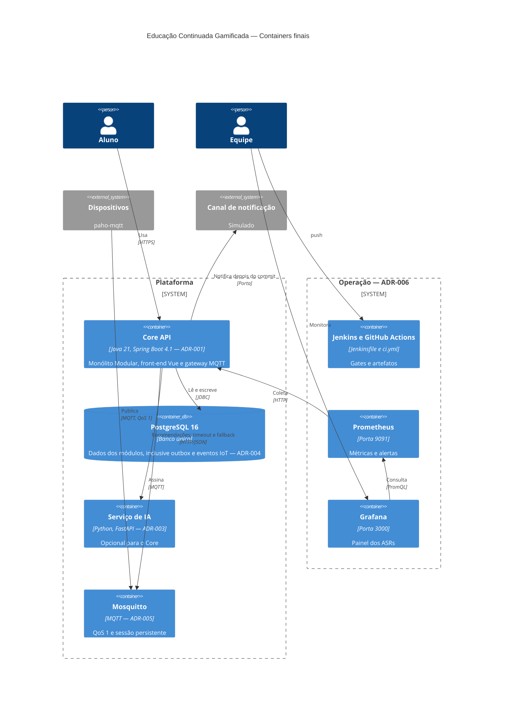

**Component do Core, por módulo:**

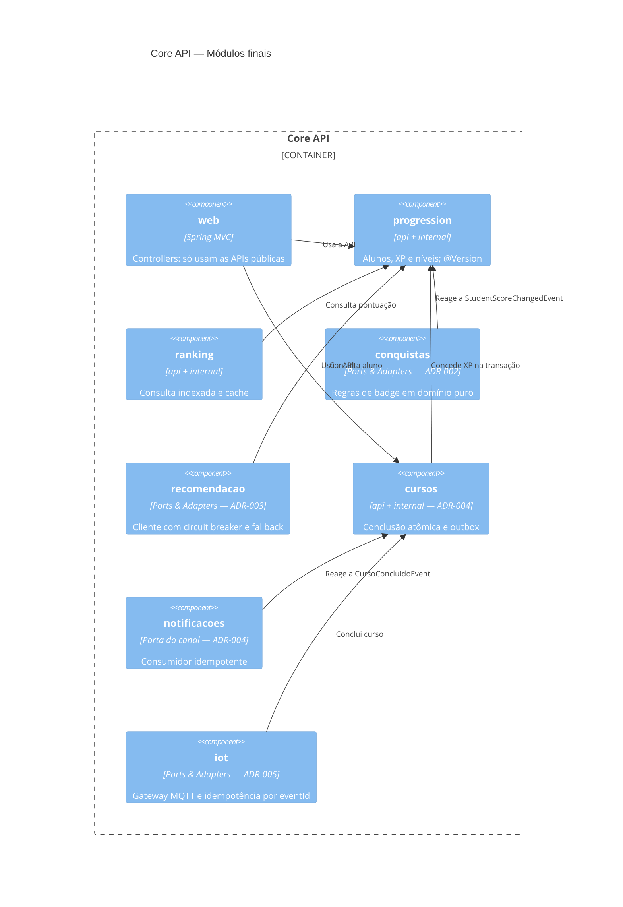

O nível Deployment está no [item 8 do Desafio 6](#desafio-6--cicd-e-observabilidade).

### Regra de ouro: cada desafio lido de trás para frente

| Desafio | C4 mostra | ← ADR decide | ← ASRs e RPCs exigem | ← RF e RNF originam | Evidência sustenta |
|---|---|---|---|---|---|
| **D1** | Módulos com API pública | ADR-001: Monólito Modular | ASR1–3; RPC1–4 | RF01–RF06; manutenibilidade, desempenho, testabilidade | ArchUnit, falha simulada e, no D6, p95 em PostgreSQL |
| **D2** | Domínio, porta e adapters | ADR-002: hexagonal só em Conquistas | ASR4–5; RPC1, 5, 6 | RF01, RF02; modificabilidade, testabilidade | Mesmo contrato em 2 adapters, mutação da regra |
| **D3** | Serviço de IA e protocolo com timeout | ADR-003: serviço independente | ASR6–8; RPC1, 7, 8 | RF03, RF04; tolerância a falhas, deploy independente | Queda e lentidão reais, circuit breaker, contrato em 2 linguagens |
| **D4** | Sem container novo; sequência síncrono x assíncrono | ADR-004: outbox, sem broker | ASR9–11; RPC9, 10 | Conclusão, RF02, RF05; recuperabilidade, consistência | Queda forçada, carga, 1.601 de 1.601 notificações |
| **D5** | Dispositivos, broker e gateway | ADR-005: MQTT, sem segundo broker | ASR12–14; RPC11–13 | RF06; conectividade intermitente, interoperabilidade | Broker real, reenvio, Core e broker reiniciados |
| **D6** | Implantação e operação | ADR-006: esteira única e métricas | ASR15–17; RPC14–16 | Todos os RFs; observabilidade, recuperabilidade | Build verde no Jenkins, queda da IA observada com alerta, p95 medido |

**O que não fechava e foi corrigido nesta conferência:**

| Problema | Correção |
|---|---|
| ASR2 "parcial", sem p95 em PostgreSQL | Medida no D6: atendida para top 100 e posição, com o limite da página aleatória registrado |
| ADR-001 e D1 citavam a observabilidade como planejada | ADR-001 e item 9.6 do D1 passam a apontar para o D6, e o compose próprio foi registrado como mudança |
| D3 dizia que Prometheus e Grafana seguiam planejados | Texto atualizado, apontando para o D6 |
| ADR-004 e D4 diziam que `DEAD` não gerava alerta | Alerta adicionado no D6, ainda sem envio de notificação |
| RFs com número repetido entre desafios | Tabela de numeração acima |

### Microsoluções e evidências

| Desafio | Microsolução | Evidências |
|---|---|---|
| **D1** | [`progression`](../../src/main/java/org/example/ac1devops/progression/), [`ranking`](../../src/main/java/org/example/ac1devops/ranking/), [`ModularArchitectureTest`](../../src/test/java/org/example/ac1devops/architecture/ModularArchitectureTest.java) | [`archunit-violacao.txt`](evidencias/archunit-violacao.txt), [`jacoco-antes.csv`](evidencias/jacoco-antes.csv), [`jacoco-depois.csv`](evidencias/jacoco-depois.csv), prints [`d1-ci-*`](evidencias/img/d1-ci-verde.png) |
| **D2** | [`conquistas`](../../src/main/java/org/example/ac1devops/conquistas/), [`BadgeAwardContract`](../../src/test/java/org/example/ac1devops/conquistas/internal/domain/BadgeAwardContract.java), [`concorrencia_xp.py`](../../labs/desafio-2/concorrencia_xp.py) | [`d2-archunit-violacao.txt`](evidencias/d2-archunit-violacao.txt), [`d2-mutacao-regra.txt`](evidencias/d2-mutacao-regra.txt), [`d2-concorrencia.txt`](evidencias/d2-concorrencia.txt), prints [`d2-ci-*`](evidencias/img/d2-ci-verde.png) |
| **D3** | [`ia-service`](../../labs/desafio-3/ia-service/), [`recomendacao`](../../src/main/java/org/example/ac1devops/recomendacao/) | [`d3-roteiro.txt`](evidencias/d3-roteiro.txt), [`d3-falhas-simuladas.txt`](evidencias/d3-falhas-simuladas.txt), prints [`d3-*`](evidencias/img/d3-01-ia-health.png) |
| **D4** | [`cursos`](../../src/main/java/org/example/ac1devops/cursos/), [`notificacoes`](../../src/main/java/org/example/ac1devops/notificacoes/), [`carga_conclusoes.py`](../../labs/desafio-4/carga_conclusoes.py) | [`d4-postgres.txt`](evidencias/d4-postgres.txt), [`d4-falhas-simuladas.txt`](evidencias/d4-falhas-simuladas.txt), prints [`d4-*`](evidencias/img/d4-01-conclusao-canal-fora.png) |
| **D5** | [`iot`](../../src/main/java/org/example/ac1devops/iot/), [`labs/desafio-5`](../../labs/desafio-5/) | [`d5-fluxo-real.txt`](evidencias/d5-fluxo-real.txt), prints [`d5-*`](evidencias/img/d5-01-eventos-normais.png) |
| **D6** | [`Jenkinsfile`](../../Jenkinsfile), [`observabilidade`](../../observabilidade/), [`labs/desafio-6`](../../labs/desafio-6/) | [`d6-observabilidade.txt`](evidencias/d6-observabilidade.txt), prints [`d6-*`](evidencias/img/d6-01-jenkins-verde.png) |

As evidências da AC1 (ciclo RED/GREEN/BLUE, Docker, front-end) ficam em [`evidencias/`](../../evidencias/), na raiz, separadas de propósito.

### Histórico do CI

GitHub Actions, branch `feature/b1-architecture-lab`: 7 runs, todos com sucesso: #1 (`4d21fa4`), #2 (`03007e1`), #3 (`b1a3d3a`), #4 (`3c3cce2`), #5 (`49ab6b2`), #6 (`7b72aa1`)
e #7 (`9552ea7`).

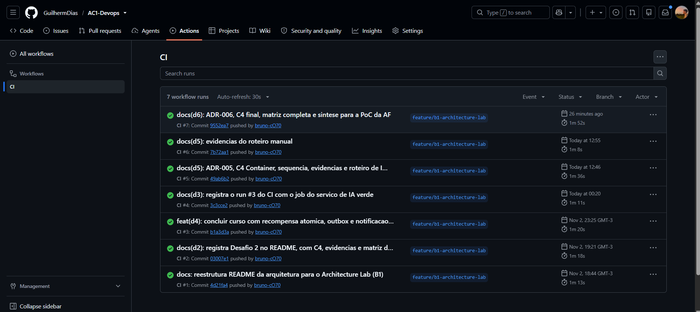

## Equipe e links

**Equipe: Grupo 10**

| Integrante | RA |
|---|---|
| Bruno Carvalho de Oliveira | 235537 |
| Leonardo Vergilio Luz | 234674 |
| Guilherme Dias Thomaz de Oliveira | 235128 |
| Vinicius Alegre de Oliveira | 211902 |

A equipe de 6 desenvolvedores da RPC2 é a premissa usada nas decisões de arquitetura, não o tamanho do Grupo 10.

| Artefato | Caminho |
|---|---|
| Repositório | <https://github.com/GuilhermDias/AC1-Devops> |
| Branch da entrega | `feature/b1-architecture-lab` |
| ADRs | [ADR-001](adr/ADR-001-estilo-arquitetural-core.md), [ADR-002](adr/ADR-002-ports-and-adapters-em-conquistas.md), [ADR-003](adr/ADR-003-servico-python-de-ia.md), [ADR-004](adr/ADR-004-eventos-com-outbox-transacional.md), [ADR-005](adr/ADR-005-iot-com-mqtt-e-gateway.md), [ADR-006](adr/ADR-006-esteira-unica-e-observabilidade.md) |
| Esteira | [`Jenkinsfile`](../../Jenkinsfile), [`.github/workflows/ci.yml`](../../.github/workflows/ci.yml) |
| Observabilidade | [`observabilidade/`](../../observabilidade/) |
| Laboratórios | [`labs/`](../../labs/) |
| Regras de arquitetura | [`ModularArchitectureTest`](../../src/test/java/org/example/ac1devops/architecture/ModularArchitectureTest.java) |
| Relatório de cobertura | Local em `target/site/jacoco/index.html`; artefato de cada run do CI |
