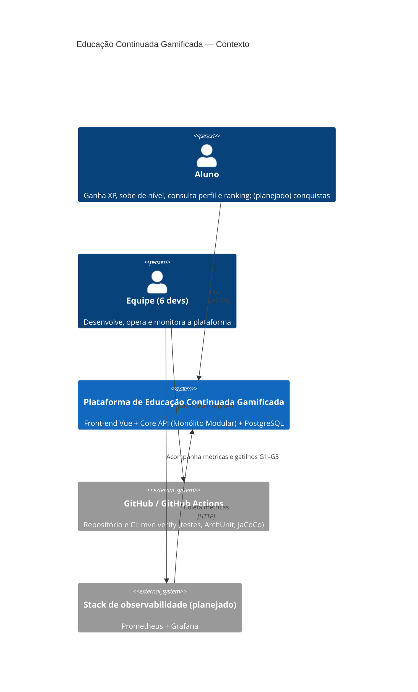
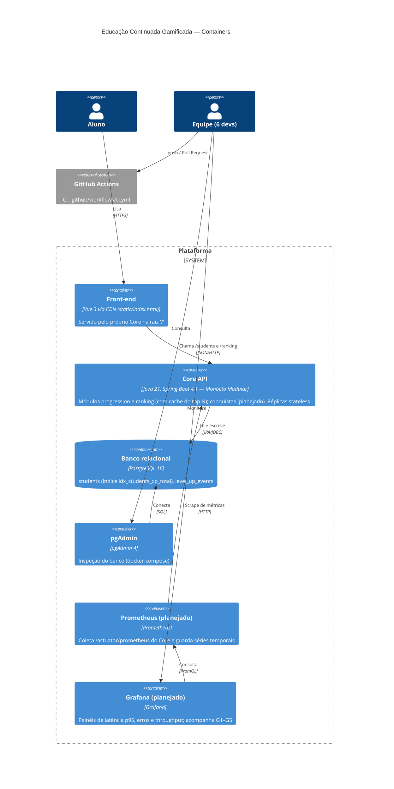
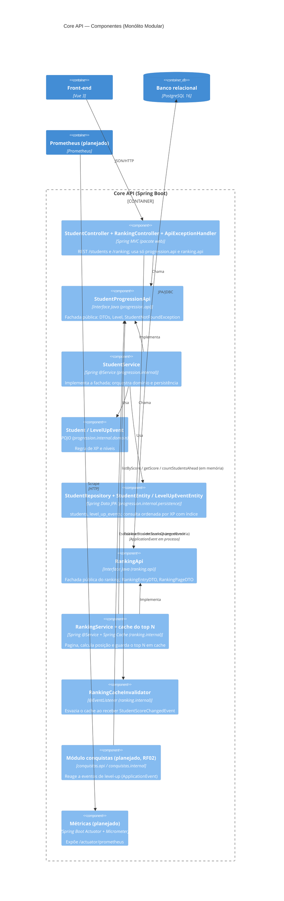
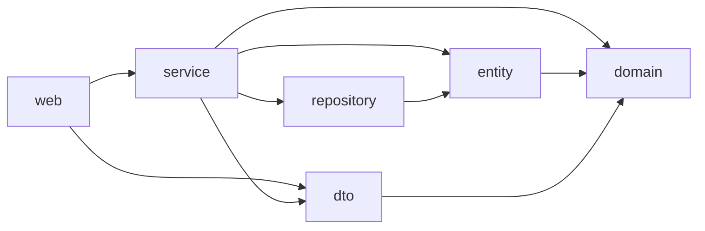
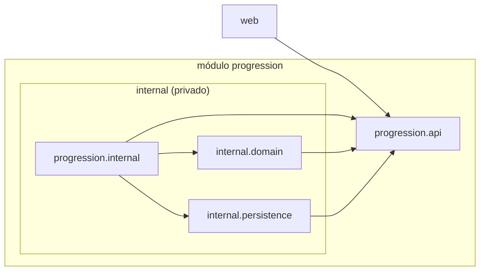

# Estudo de Caso: Educação Continuada Gamificada

Documento de arquitetura do Core da plataforma de Educação Continuada Gamificada (AC1, Grupo 10),
atualizado para o exercício **ExB1 — Arquitetura de Software (AC2, DevOps e QA)** a partir do
documento do Desafio 1.

**Cenário:** o MVP cresceu de **1.000 para até 100.000 usuários**; o **Ranking** cresce mais que
as outras funcionalidades; cursos, conquistas e recompensas continuam evoluindo.

Cadeia de rastreabilidade seguida neste documento:

```
RF → RNF → ASR → RPC (trade-offs) → ADR → C4 → evidência no código
```

**Resumo da decisão:** **Monólito Modular.** Não há necessidade comprovada de escala ou deploy
independente, e a complexidade distribuída não se justifica para 6 devs com um banco relacional
único. O Ranking já é um módulo com API própria (`ranking`) e Conquistas entrará no mesmo padrão; a
extração do Ranking como serviço tem gatilhos mensuráveis (§4.2). Tabela completa em
**[Rastreabilidade](#rastreabilidade)**; registro formal no
[ADR-001](adr/ADR-001-estilo-arquitetural-core.md).

> **Legenda de estado:** **Existe** = implementado e testado nesta branch. **Planejado** = desenho-alvo
> das próximas etapas; nenhum código correspondente existe ainda.

---

## 1. RF — Requisitos Funcionais

| RF | Estado | Classes / endpoints reais | Onde entra na arquitetura |
|---|---|---|---|
| **RF01 — Ranking** | **Existe.** | `GET /ranking?page&size`, `GET /ranking/top?n`, `GET /ranking/students/{id}` → `RankingController` → `RankingApi` (impl. `RankingService`) → `StudentProgressionApi.listByScore` / `getScore` / `countStudentsAhead` → `StudentRepository.findScoresOrderedByXp` / `countAhead`. DTOs `RankingEntryDTO`, `RankingPageDTO`; `400` via `InvalidRankingQueryException`. | Módulo `ranking` (`ranking.api` + `ranking.internal`), que consome **apenas** `StudentProgressionApi`; ordenação e paginação no banco, índice `idx_students_xp_total` e cache do top N (§7). |
| **RF02 — Conquistas** | **Planejado.** Não implementado nesta etapa (ver §7, Implementação). | Conceito mais próximo: histórico de level-up — `LevelUpEvent` (domínio) / `LevelUpEventEntity` (tabela `level_up_events`), gerado em `Student.receiveXp`. | Novo módulo `conquistas` que reage a eventos de progressão em processo (Spring `ApplicationEvent`), sem chamada remota. |
| **RF03 — Cadastrar aluno** (US4) | **Existe.** | `POST /students` → `StudentController.createStudent` → `StudentProgressionApi.createStudent` (impl. `StudentService`) → `StudentRepository.save`. DTO `CreateStudentRequestDTO`. | Módulo `progression`. |
| **RF04 — Conceder XP e subir de nível** (US1, US2, US3) | **Existe.** | `POST /students/{id}/xp` → `StudentController.receiveXp` → `StudentService.receiveXp`; regra em `Student.receiveXp` + `Level.fromXp` (BRONZE 0, PRATA 100, OURO 300, DIAMANTE 700); um `LevelUpEvent` por faixa atravessada. DTO `ReceiveXpRequestDTO`. | Módulo `progression` (domínio em `progression.internal.domain`). |
| **RF05 — Consultar perfil do aluno** (US4) | **Existe.** | `GET /students/{id}` → `StudentController.getStudent` → `StudentService.getStudent`; `404` via `StudentNotFoundException` + `ApiExceptionHandler`. DTOs `StudentResponseDTO`, `LevelUpEventDTO`. | Módulo `progression`. |
| **RF06 — Listar alunos** | **Existe.** | `GET /students` → `StudentController.listStudents` → `StudentService.listStudents` (`findAll()` sem paginação, mantido por compatibilidade com o front-end). | Módulo `progression`. Para volume, o caminho é o `GET /ranking` paginado. |
| **RF-EVO — Cursos e recompensas** | **Planejado.** Não existem no código. | — | Módulos irmãos (`cursos`, `recompensas`) no mesmo padrão `api/` + `internal/`. |

Interfaces de apoio que já existem: front-end Vue 3 em `src/main/resources/static/index.html`
(consome `/students`) e documentação OpenAPI (`OpenApiConfig`, `/swagger-ui.html`, `/v3/api-docs`).

## 2. RNF — Requisitos Não-Funcionais

| RNF | Análise no contexto da AC1 | Meta mensurável | Situação hoje |
|---|---|---|---|
| **Manutenibilidade** | Com Ranking, Conquistas, Cursos e Recompensas entrando, uma organização só por camada técnica espalharia cada funcionalidade por todos os pacotes e permitiria qualquer import. | 0 violações das regras de `ModularArchitectureTest`; um novo módulo não exige alterar classes de `progression.internal`. | Existe: 6 regras ArchUnit verdes no `mvn verify`. |
| **Desempenho** | O risco é de consulta, não de processo: `GET /students` faz `findAll()` sem paginação e carrega `levelUpEvents` em modo lazy (N+1). Um Ranking ingênuo em cima disso degradaria. | Ranking (top 100 e posição do aluno) com **p95 ≤ 300 ms** e **base de 100.000 alunos**; `POST /students/{id}/xp` com p95 ≤ 200 ms. | Ranking com 100.000 alunos no H2 de teste: página 0 em **10 ms**, última página em **25 ms**, posição de um aluno em **45 ms** (§7). Falta medir em PostgreSQL sob carga HTTP. |
| **Escalabilidade** | Ranking é *read-heavy* e cresce mais que o resto. Monólito *stateless* escala horizontalmente; o ranking pode vir de cache. | Atender 100.000 usuários escalando réplicas do Core sem mudar código; nenhuma sessão em memória. | Core *stateless* (sem sessão HTTP); 1 réplica no `docker-compose.yml`. O cache do top N é por instância: com várias réplicas, trocar por um cache compartilhado (ex.: Redis), sem mudar o código do módulo. |
| **Testabilidade** | Domínio em POJO e regra de fronteira verificável por teste. | **Cobertura de 100%** de linhas e branches; piso de **90%** que quebra o build (`jacoco:check`). | Existe: 100% instruções/linhas/branches/métodos; piso de 90% no `pom.xml`. |
| **Observabilidade** | Sem métricas não há como saber se os gatilhos de extração do Ranking (§4.2) foram atingidos — a decisão depende disso. | Latência p95, taxa de erro e throughput por endpoint expostos em formato Prometheus e visualizados no Grafana; alerta se p95 do ranking > 300 ms. | **Não existe:** sem Actuator, Micrometer, Prometheus ou Grafana no projeto. Será implementado na §7. |
| **Complexidade operacional** | Hoje: 1 jar, 1 imagem Docker, 1 PostgreSQL, 1 `docker-compose.yml`, 1 workflow de CI. Serviços separados trariam múltiplos pipelines, contratos versionados, rede e dados distribuídos. | Continuar com **1 artefato, 1 banco e 1 pipeline**; ambiente completo sobe com um único `docker compose up`. | Atendido. |

## 3. ASR — Os drivers (máx. 3)

| ASR | RNF de origem | Como altera a arquitetura (uma frase) |
|---|---|---|
| **ASR1 — Evoluir funcionalidades com baixo acoplamento** | Manutenibilidade | Altera a **estrutura**: o Core é dividido em módulos por funcionalidade (`api/` público + `internal/` privado) e só a API de um módulo pode ser usada pelo restante do sistema. |
| **ASR2 — Ranking com p95 ≤ 300 ms para 100.000 usuários** | Desempenho + Escalabilidade (medido via Observabilidade) | Altera **dados e implantação**: o Ranking ganha consulta indexada/paginada e cache próprios, o Core roda em réplicas *stateless* e expõe métricas que dizem quando escalar ou extrair. |
| **ASR3 — Fronteiras verificáveis automaticamente** | Testabilidade | Altera a **operação** (pipeline): as regras de dependência viram testes ArchUnit que rodam em todo commit e Pull Request, bloqueando o merge quando violadas. |

Observabilidade não é um driver isolado: é o meio de verificar a ASR2 e os gatilhos da §4.2.
Complexidade operacional entra como **restrição** na escolha (§4), não como requisito a maximizar.

## 4. RPC — Restrições, premissas e trade-offs

| RPC | Restrição / premissa | Impacto na decisão |
|---|---|---|
| **RPC1** | Core em **Java 21 / Spring Boot 4.1** (stack atual). | Modularização com recursos da própria stack (pacotes, interfaces, `ApplicationEvent`), sem nova linguagem ou runtime. |
| **RPC2** | Equipe de **6 desenvolvedores**. | Um único time; não há times independentes que justifiquem deploys independentes (lei de Conway). |
| **RPC3** | **Banco relacional único** (PostgreSQL 16). | Dividir o banco por serviço exigiria migração de dados e consistência eventual. |
| **RPC4** | **Legado da AC1**: tabelas `students` e `level_up_events`, endpoints `/students` consumidos pelo front-end Vue, 100% de cobertura herdada do ciclo RED→GREEN→BLUE. | Contratos HTTP, JSON e schema não podem quebrar (protegido por `StudentEndpointIntegrationTest`). |

**Premissas:** não há medição de carga em produção; 100.000 usuários cadastrados não significam
100.000 simultâneos; o Ranking pode tolerar alguns segundos de defasagem (cache).

### 4.1 Comparação das alternativas

| Critério | (A) Monólito em Camadas | (B) Monólito Modular | (C) Decomposição em serviços (Ranking como serviço) |
|---|---|---|---|
| Manutenibilidade | Baixa com o crescimento: funcionalidades espalhadas pelas camadas, acoplamento livre. | **Alta**: cada funcionalidade isolada atrás de uma API; mudanças locais ao módulo. | Alta para o Ranking, mas exige versionar contrato HTTP/eventos entre Core e serviço. |
| Desempenho | Adequado com índice e cache. | Adequado com índice e cache (chamadas em memória, igual a A). | Ganho só se o Ranking for gargalo isolado; adiciona latência de rede e serialização. |
| Escalabilidade | Horizontal, do sistema inteiro. | Horizontal, do sistema inteiro; `ranking` já fica pronto para extração. | Escala o Ranking de forma independente (único benefício real, ainda não necessário). |
| Testabilidade | Testes unitários bons, sem verificação de fronteiras. | **Fronteiras testáveis** (ArchUnit) + testes por módulo. | Exige testes de contrato e ambientes integrados; mais difícil reproduzir localmente. |
| Observabilidade | Simples: um processo, um `/actuator/prometheus`. | Simples: um processo; métricas por endpoint/módulo com tags. | Distribuída: métricas por serviço, *tracing* entre serviços para seguir uma requisição. |
| Complexidade operacional | Mínima (1 jar, 1 banco). | **Mínima** (1 jar, 1 banco, 1 pipeline). | Alta: 2+ pipelines e deploys, rede, *service discovery*, dados duplicados ou banco compartilhado (antipadrão). |
| Aderência às RPCs | Atende RPC1–4. | Atende RPC1–4. | Conflita com RPC2 (6 devs) e RPC3 (banco único). |
| **Prós** | Simples, já existia. | Baixo acoplamento com custo operacional de monólito; prepara extração futura. | Escala e deploy independentes do Ranking. |
| **Contras** | Degrada a cada nova funcionalidade; não protege fronteiras. | Exige disciplina (garantida por ArchUnit no CI); a escala ainda é do conjunto. | Custo alto e prematuro; resolve um gargalo não comprovado. |

### 4.2 Gatilhos mensuráveis para extrair o Ranking como serviço

A extração (alternativa C) só deve ser reavaliada quando **pelo menos dois** gatilhos forem
observados de forma sustentada (ex.: 2 semanas em produção), **depois** de aplicados índice,
paginação e cache. As medições vêm do Prometheus/Grafana (§6, Container).

| # | Gatilho | Limite |
|---|---|---|
| G1 | Latência do endpoint de ranking | p95 > 300 ms sob carga real, mesmo com cache e índice |
| G2 | Carga desproporcional | Ranking > 60% das requisições ou da CPU do Core, forçando escalar o monólito inteiro só por ele |
| G3 | Contenção no banco | Consultas de ranking > 40% do tempo de banco ou elevando o p95 de `POST /students/{id}/xp` acima de 200 ms |
| G4 | Frequência de deploy | Ranking precisa de deploy ≥ 2×/semana independente dos demais e > 30% dos releases ficam bloqueados por outros módulos |
| G5 | Organização | Equipe cresce para ≥ 2 times com ownership separado do Ranking |

Pré-condição para extrair barato: o módulo `ranking` isolado atrás da sua API, com ArchUnit
verde — exatamente o que a alternativa B garante.

## 5. ADR — Decisão registrada

[**ADR-001 — Estilo arquitetural do Core: Monólito Modular**](adr/ADR-001-estilo-arquitetural-core.md)
— status **Aceito**, 2026-10-27.

- **Decisão:** Monólito Modular (B). Cada funcionalidade é um pacote-módulo
  `org.example.ac1devops.<modulo>` com `api/` (fachada pública) e `internal/` (service, domínio,
  persistência); o resto do sistema só usa a `api/`. Primeiro módulo: `progression`, com a
  fachada `StudentProgressionApi`.
- **Garantia:** `ModularArchitectureTest` (ArchUnit) no `mvn verify`, executado pelo CI em todo
  push e Pull Request.
- **Ranking:** não é extraído agora; reavaliação pelos gatilhos G1–G5, medidos com
  Prometheus/Grafana.
- **Trade-off aceito:** a escala continua sendo do conjunto e o banco é compartilhado (fronteira
  de dados só lógica), em troca de manter 1 artefato, 1 banco e 1 pipeline.

## 6. Diagrama C4

Elementos marcados **(planejado)** ainda não existem no código; os demais existem nesta branch.

### 6.1 Contexto (C4Context)



### 6.2 Container (C4Container)



### 6.3 Component do Core (C4Component)



---

## Rastreabilidade

| RF | RNF | ASR | RPC | ADR | C4 | Evidência no código |
|---|---|---|---|---|---|---|
| RF01 Ranking (`/ranking`) | Desempenho, Escalabilidade, Observabilidade | ASR2 | RPC3 (banco único), RPC4 (legado) | ADR-001, Decisão itens 4–6 + gatilhos G1–G5 | Component: `RankingController` → `RankingApi` ← `RankingService` → `StudentProgressionApi`; Container: Prometheus/Grafana | [`RankingService`](../../src/main/java/org/example/ac1devops/ranking/internal/RankingService.java), [`StudentRepository`](../../src/main/java/org/example/ac1devops/progression/internal/persistence/StudentRepository.java), índice em [`StudentEntity`](../../src/main/java/org/example/ac1devops/progression/internal/persistence/StudentEntity.java), [`RankingPerformanceTest`](../../src/test/java/org/example/ac1devops/ranking/internal/RankingPerformanceTest.java), [`RankingCacheIntegrationTest`](../../src/test/java/org/example/ac1devops/ranking/internal/RankingCacheIntegrationTest.java) |
| RF02 Conquistas (planejado; base: `LevelUpEvent`) | Manutenibilidade | ASR1 | RPC1 (Spring) | ADR-001, Decisão item 4 | Component: módulo `conquistas` (planejado) | `StudentScoreChangedEvent` (mecanismo de eventos já usado pelo ranking); `LevelUpEvent` em `progression.internal.domain`; regra `dominioSemFramework` |
| RF03–RF06 Progressão (`/students`, US1–US4) | Manutenibilidade, Testabilidade | ASR1, ASR3 | RPC2 (6 devs), RPC4 (legado) | ADR-001, Decisão itens 1–4 | Component: `StudentController` → `StudentProgressionApi` ← `StudentService` | [`StudentProgressionApi`](../../src/main/java/org/example/ac1devops/progression/api/StudentProgressionApi.java), [`ModularArchitectureTest`](../../src/test/java/org/example/ac1devops/architecture/ModularArchitectureTest.java), [`StudentServiceTest`](../../src/test/java/org/example/ac1devops/progression/internal/StudentServiceTest.java), [`StudentEndpointIntegrationTest`](../../src/test/java/org/example/ac1devops/web/StudentEndpointIntegrationTest.java) |
| (todos) | Testabilidade (cobertura 100%) | ASR3 | RPC4 (cobertura herdada) | ADR-001, Consequências | Context/Container: GitHub Actions | `jacoco:check` no [`pom.xml`](../../pom.xml), [`ci.yml`](../../.github/workflows/ci.yml) |
| (todos) | Observabilidade | ASR2 (meio de verificação) | RPC1 (Actuator/Micrometer da stack) | ADR-001, Decisão item 6 | Container: Prometheus, Grafana; Component: Métricas | Planejado — §7 Observabilidade |
| (todos) | Complexidade operacional | Restrição | RPC2, RPC3 | ADR-001, Alternativas (C rejeitada) | Container: 1 Core, 1 banco | [`docker-compose.yml`](../../docker-compose.yml), um único [`ci.yml`](../../.github/workflows/ci.yml) |

---

## 7. AC1 — Legado

### Implementação

### Monólito Modular x Camadas

### Ranking para 100.000 usuários

### Cobertura de testes

### Observabilidade

### Teste com Mocks

---

## Anexo — Evidências do Desafio 1

Conteúdo produzido no Desafio 1 e mantido como evidência da modularização já aplicada ao código.

### A.1 Mini-lab — modularização do módulo `progression`

**Funcionalidade escolhida:** como Ranking e Conquistas ainda não existem (§1), foi
modularizada a funcionalidade real mais próxima: a **progressão do aluno (XP e níveis, US1–US4)**,
que é exatamente a fonte de dados do futuro Ranking e dos eventos que alimentarão Conquistas.

**Comportamento externo inalterado:** mesmos endpoints (`/students`), mesmos DTOs/JSON, mesmas
tabelas (`students`, `level_up_events` — nomes explícitos em `@Table`/`@Column`). Os 26 testes
existentes continuaram passando sem alteração de asserções; só mudaram `package`/`import` e o
`StudentControllerTest` passou a mockar a interface `StudentProgressionApi` no lugar da classe
concreta `StudentService`.

#### Estrutura

ANTES (organização só por camada técnica):

```
org.example.ac1devops
├── web/         StudentController, ApiExceptionHandler
├── service/     StudentService, StudentNotFoundException
├── repository/  StudentRepository
├── entity/      StudentEntity, LevelUpEventEntity
├── dto/         CreateStudentRequestDTO, ReceiveXpRequestDTO, StudentResponseDTO, LevelUpEventDTO
├── domain/      Student, Level, LevelUpEvent
└── config/      OpenApiConfig
```

DEPOIS (módulo por funcionalidade, com API pública e implementação privada):

```
org.example.ac1devops
├── web/                         StudentController, ApiExceptionHandler  → usam só progression.api
├── config/                      OpenApiConfig
└── progression/                 MÓDULO de progressão (alunos, XP, níveis)
    ├── api/                     PÚBLICO: StudentProgressionApi (fachada), DTOs, Level,
    │                            StudentNotFoundException
    └── internal/                PRIVADO ao módulo
        ├── StudentService       implementa StudentProgressionApi
        ├── domain/              Student, LevelUpEvent (POJOs, regra de XP/nível)
        └── persistence/         StudentEntity, LevelUpEventEntity, StudentRepository
```

`Level` ficou em `api/` porque faz parte do contrato publicado (é o tipo do campo `level` e dos
eventos nos DTOs de resposta).

#### Dependências entre pacotes (imports `org.example.ac1devops.*`)

Levantamento feito por script sobre `src/main/java` (cada linha = pacote de origem → pacote
importado, com a quantidade de imports):

| ANTES | | DEPOIS | |
|---|---|---|---|
| `web → service` | 2 | `web → progression.api` | 5 |
| `web → dto` | 3 | `progression.internal → progression.api` | 7 |
| `service → domain` | 3 | `progression.internal → progression.internal.domain` | 2 |
| `service → dto` | 4 | `progression.internal → progression.internal.persistence` | 3 |
| `service → entity` | 2 | `progression.internal.domain → progression.api` | 2 |
| `service → repository` | 1 | `progression.internal.persistence → progression.api` | 2 |
| `repository → entity` | 1 | | |
| `entity → domain` | 2 | | |
| `dto → domain` | 2 | | |





#### Contagem de dependências

| Métrica | ANTES | DEPOIS |
|---|---|---|
| Arestas entre pacotes | 9 | 6 |
| Imports entre pacotes | 20 | 21 (+1: a interface `StudentProgressionApi`) |
| Pacotes que `web` conhece | 2 (`service`, `dto`) | 1 (`progression.api`) |
| Dependências de `web` em classe concreta de implementação | 1 (`StudentService`) | 0 |
| Dependências de fora do módulo para `internal` | — (não havia fronteira; `web` podia importar `entity`/`repository`) | 0 (garantido por ArchUnit) |
| Ciclos entre pacotes | 0 | 0 |


### A.2 Evidência de QA

#### Testes que protegem a decisão

| Teste | Tipo | O que garante |
|---|---|---|
| [`ModularArchitectureTest`](../../src/test/java/org/example/ac1devops/architecture/ModularArchitectureTest.java) | ArchUnit (6 regras) | `ninguemForaDoModuloAcessaInternal`, `apiDoModuloNaoDependeDoInternal`, `camadasRespeitadas` (Web → ProgressionApi ← ProgressionInternal; ninguém acessa Web/Config/Internal), `dominioSemFramework` (domínio sem Spring/JPA), `controllersFicamNaCamadaWeb`, `semCiclosEntrePacotes`. |
| [`StudentServiceTest`](../../src/test/java/org/example/ac1devops/progression/internal/StudentServiceTest.java) | Unitário (JUnit 5 + Mockito) | 10 cenários do service do módulo (8 existentes + 2 novos: reconstrução a partir do estado persistido gerando só os eventos novos, e XP inválido mantendo o estado). |
| [`StudentEndpointIntegrationTest`](../../src/test/java/org/example/ac1devops/web/StudentEndpointIntegrationTest.java) | Integração (`@SpringBootTest`, HTTP real + H2) | Fluxo completo `POST /students` → `POST /students/{id}/xp` → `GET /students/{id}` → `GET /students` e o `404` com mensagem: prova que o contrato externo não mudou. |
| `StudentControllerTest`, `StudentRepositoryTest`, `StudentTest`, `LevelTest`, `SwaggerIntegrationTest`, `Ac1DevOpsApplicationTests` | Já existentes | Continuam passando sem mudança de asserções. |

**Prova de que a regra funciona:** uma classe temporária em `web` com um campo do tipo
`progression.internal.persistence.StudentRepository` fez o build **falhar** em 2 regras
(`ninguemForaDoModuloAcessaInternal` e `camadasRespeitadas`); a classe foi removida em seguida.
Saída registrada em [`evidencias/archunit-violacao.txt`](evidencias/archunit-violacao.txt).

#### Resultado dos testes

| | ANTES (`main`, `ecc44f7`) | DEPOIS (esta branch) |
|---|---|---|
| Testes executados | 26 | 36 |
| Falhas / erros | 0 / 0 | 0 / 0 |
| Regras de arquitetura verificadas | 0 | 6 (ArchUnit) |
| Testes de integração HTTP do módulo (sem mock) | 0 | 2 |
| Piso de cobertura no build | não havia | `jacoco:check` — linhas ≥ 90% e branches ≥ 90% (falha o `verify`) |

#### Cobertura JaCoCo do módulo (classes da funcionalidade de progressão)

| Classe (ANTES → DEPOIS) | Instruções | Linhas | Branches |
|---|---|---|---|
| `service.StudentService` → `progression.internal.StudentService` | 100% → 100% (155) | 100% → 100% (29) | 100% → 100% (4/4) |
| `domain.Student` → `progression.internal.domain.Student` | 100% → 100% (74) | 100% → 100% (22) | 100% → 100% (4/4) |
| `domain.LevelUpEvent` → `progression.internal.domain.LevelUpEvent` | 100% → 100% (15) | 100% → 100% (6) | — |
| `entity.StudentEntity` / `LevelUpEventEntity` → `progression.internal.persistence.*` | 100% → 100% (85) | 100% → 100% (32) | — |
| `domain.Level` → `progression.api.Level` | 100% → 100% (68) | 100% → 100% (14) | 100% → 100% (4/4) |
| DTOs + `StudentNotFoundException` → `progression.api.*` | 100% → 100% (47) | 100% → 100% (6) | — |
| **Total do módulo** | **100% → 100% (444/444)** | **100% → 100% (109/109)** | **100% → 100% (12/12)** |

A cobertura de linhas já era 100% antes (herança do ciclo RED→GREEN→BLUE da AC1) e foi
**mantida** após a refatoração. O ganho de qualidade não está no percentual, mas em **o que** é
verificado: fronteiras do módulo (ArchUnit), fluxo HTTP real sem mocks e um piso de cobertura
que impede regressão. `StudentProgressionApi` é interface e não gera instruções no relatório.

Fontes brutas: [`evidencias/jacoco-antes.csv`](evidencias/jacoco-antes.csv) e
[`evidencias/jacoco-depois.csv`](evidencias/jacoco-depois.csv). Relatório HTML gerado em
`target/site/jacoco/index.html` a cada `./mvnw verify` e publicado como artifact pelo CI
(§A.3).


### A.3 Evidência de DevOps — pipeline de CI

Workflow: [`.github/workflows/ci.yml`](../../.github/workflows/ci.yml) (não havia workflow
anterior no repositório).

| Gatilho | Passos |
|---|---|
| `push` em qualquer branch e `pull_request` para `main` | 1. `actions/checkout` → 2. `actions/setup-java` (Temurin **21**, igual ao `<java.version>` do `pom.xml`, com cache Maven) → 3. `./mvnw -B clean verify` → 4. publica `target/site/jacoco/` como artifact **`jacoco-report`** e `target/surefire-reports/` como **`surefire-reports`** (mesmo se o build falhar). |

#### Como o pipeline protege a decisão arquitetural

1. **A regra modular é código executável.** `ModularArchitectureTest` roda dentro do
   `mvn verify` como qualquer teste; não depende de revisão manual lembrar da regra.
2. **Verificada a cada commit e a cada Pull Request.** Todo `push` dispara o workflow; todo PR
   para a `main` mostra o check `Build, testes, ArchUnit e cobertura`. Um import de
   `progression.internal` fora do módulo deixa o check **vermelho** com a mensagem do ArchUnit
   apontando classe e campo/método infrator (exemplo real em
   [`evidencias/archunit-violacao.txt`](evidencias/archunit-violacao.txt)).
3. **O contrato externo também é protegido.** `StudentEndpointIntegrationTest` falha se a
   refatoração (ou uma futura extração do Ranking) mudar status/JSON de `/students`.
4. **Qualidade não regride em silêncio.** `jacoco:check` falha o build abaixo de 90% de linhas ou
   branches; o relatório fica anexado ao run para auditoria.
5. **Merge só com CI verde.** Recomendado ativar em *Settings → Branches → Branch protection
   rules* da `main`: "Require a pull request before merging" + "Require status checks to pass"
   marcando o check `Build, testes, ArchUnit e cobertura`. Assim a decisão do ADR-001 não pode
   ser violada nem por push direto na `main`.

