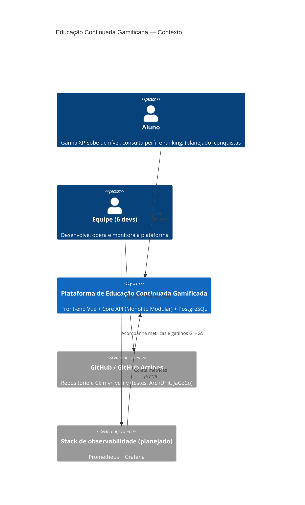
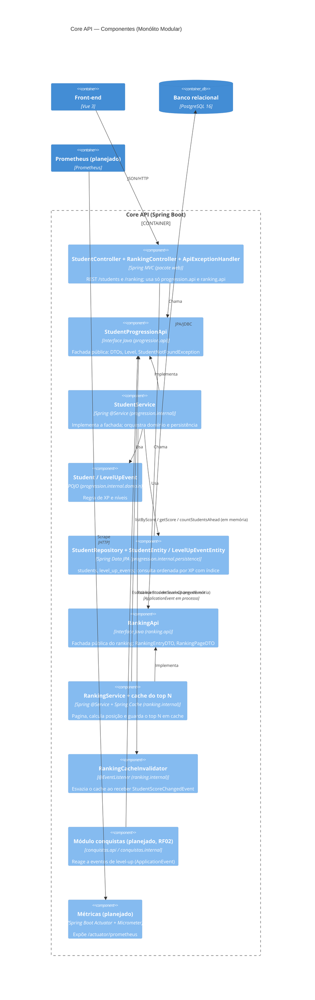
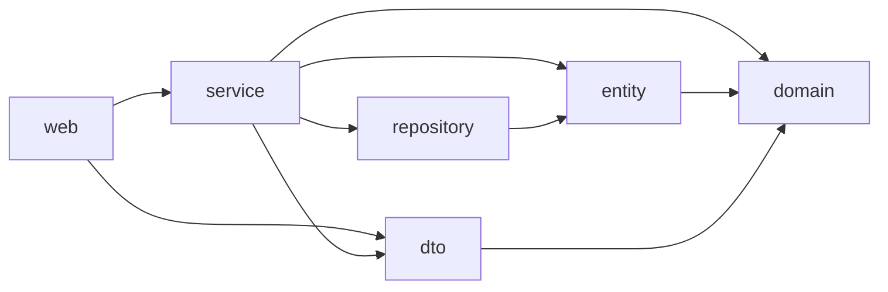
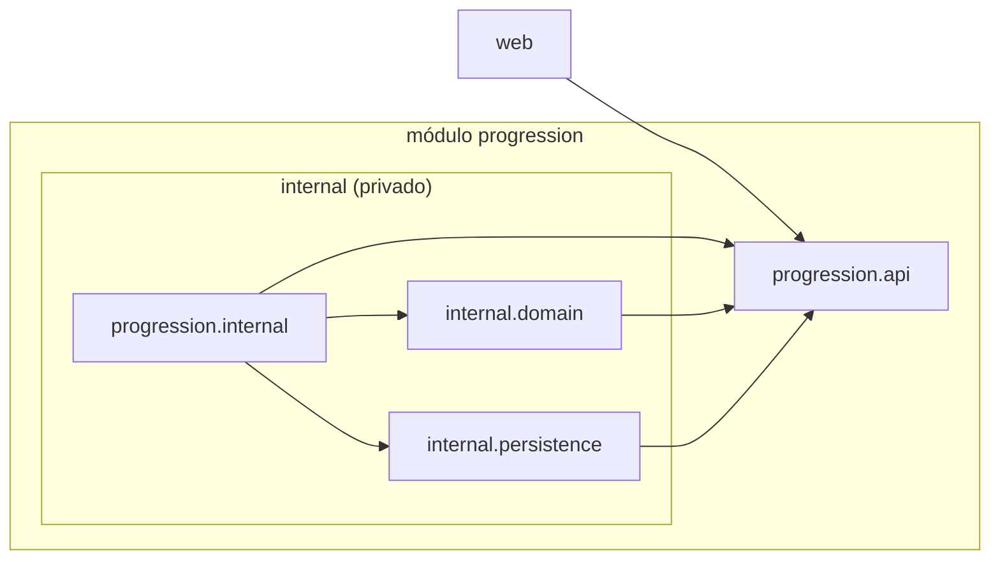
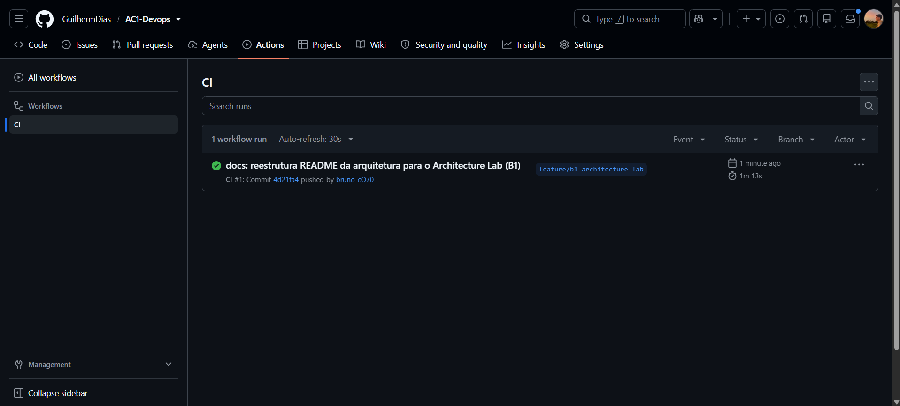
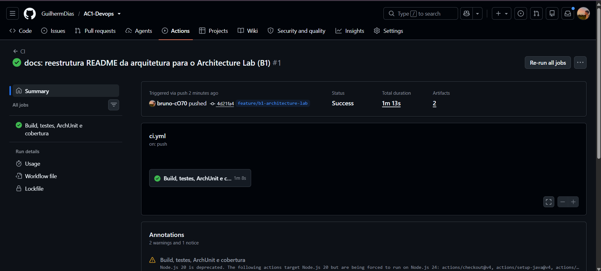
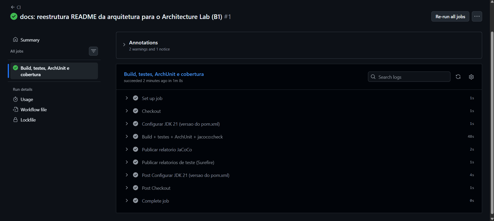
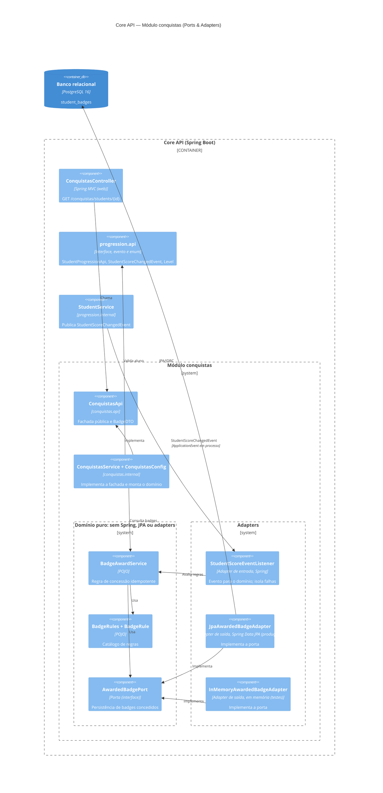

# Estudo de Caso: Educação Continuada Gamificada

Registro único e cumulativo do **Exercício B1 — Architecture Lab (DevOps e QA)**, sobre o Core da
plataforma de Educação Continuada Gamificada (AC1, Grupo 10).

## Contexto e case-base

**Cenário:** o MVP cresceu de **1.000 para até 100.000 usuários**; o **Ranking** cresce mais que
as outras funcionalidades; cursos, conquistas e recompensas continuam evoluindo.

**Base existente:** Java 21, Spring Boot 4.1, PostgreSQL 16, front-end Vue 3 servido pelo próprio
Core, Docker Compose e CI no GitHub Actions. Detalhes e instruções de execução no
[README do projeto](../../README.md).

> **Legenda de estado:** **Existe** = implementado e testado nesta branch. **Planejado** = desenho-alvo
> das próximas etapas; nenhum código correspondente existe ainda.

## Padrão de decisão

Cadeia de rastreabilidade seguida neste documento:

```
RF → RNF → ASR → RPC (trade-offs) → ADR → C4 → evidência no código
```

Cada desafio segue exatamente esta sequência:

1. **RF**
2. **RNF**, classificado por FURPS+
3. **ASR**, no máximo 3, cada um com uma frase dizendo como altera estrutura, comunicação, dados,
   implantação ou operação
4. **RPC**
5. **Decisão do Tech Lead**, respondendo às perguntas do desafio
6. **Alternativas** (mínimo 2) e trade-offs em tabela
7. **ADR**, em [`adr/`](adr/)
8. **C4**, atualizando só o nível afetado, em Mermaid
9. **Evidência**: mini-lab, teste, métrica ou falha simulada, com como reproduzir e o resultado obtido

Critérios aplicados em todas as decisões:

- Toda tecnologia responde a um problema do case; "é moderno" ou "o mercado usa" não são justificativa.
- Nem todo RNF é ASR.
- RPC é restrição, não solução.
- A microsolução testa uma hipótese arquitetural, não apenas o funcionamento da ferramenta.
- Prefere-se a solução mais simples que atenda aos ASRs.

Microsoluções ficam em `/labs/desafio-N/` ou no próprio código do Core, sempre linkadas aqui. Prints
ficam em [`evidencias/img/`](evidencias/img/), com o prefixo do desafio (`d1-`, `d2-`...).

## Matriz cumulativa de ASRs

A numeração é global: novos desafios continuam a partir da ASR6.

| ASR | Desafio de origem | RNF / FURPS+ | Decisão / ADR | Evidência | Status |
|---|---|---|---|---|---|
| **ASR1** — Evoluir funcionalidades com baixo acoplamento | Desafio 1 | Manutenibilidade / S | Monólito Modular, [ADR-001](adr/ADR-001-estilo-arquitetural-core.md) | [`ModularArchitectureTest`](../../src/test/java/org/example/ac1devops/architecture/ModularArchitectureTest.java); mini-lab (item 9.8) | **Atendido** |
| **ASR2** — Ranking com p95 ≤ 300 ms para 100.000 usuários | Desafio 1 | Desempenho e Escalabilidade / P | Índice, paginação, cache e gatilhos G1–G5, [ADR-001](adr/ADR-001-estilo-arquitetural-core.md) | [`RankingPerformanceTest`](../../src/test/java/org/example/ac1devops/ranking/internal/RankingPerformanceTest.java) (item 9.4) | **Parcial:** medido só em H2, sem carga e sem p95; observabilidade não implementada |
| **ASR3** — Fronteiras verificáveis automaticamente | Desafio 1 | Testabilidade / S | ArchUnit no `verify` e no CI, [ADR-001](adr/ADR-001-estilo-arquitetural-core.md) | Falha simulada em [`archunit-violacao.txt`](evidencias/archunit-violacao.txt); [`ci.yml`](../../.github/workflows/ci.yml); prints do CI: [runs](evidencias/img/d1-ci-verde.png), [resumo](evidencias/img/d1-ci-resumo.png), [etapas](evidencias/img/d1-ci-etapas.png) | **Atendido (CI no GitHub)** |
| **ASR4** — Mudar regra de gamificação sem tocar em persistência ou framework | Desafio 2 | Modificabilidade / S | Ports & Adapters só em `conquistas`, [ADR-002](adr/ADR-002-ports-and-adapters-em-conquistas.md) | [`BadgeAwardContract`](../../src/test/java/org/example/ac1devops/conquistas/internal/domain/BadgeAwardContract.java) nos dois adapters; [mutação da regra](evidencias/d2-mutacao-regra.txt) | **Atendido** |
| **ASR5** — Regra de gamificação testável sem Spring nem banco | Desafio 2 | Testabilidade / S | Domínio puro com adapter em memória; ArchUnit na fronteira, [ADR-002](adr/ADR-002-ports-and-adapters-em-conquistas.md) | [`BadgeAwardInMemoryTest`](../../src/test/java/org/example/ac1devops/conquistas/internal/domain/BadgeAwardInMemoryTest.java); [violação barrada](evidencias/d2-archunit-violacao.txt) | **Atendido** |

---

## Desafio 1 — Drivers e Evolução do Core

Como o Core deve evoluir quando o MVP cresce de 1.000 para até 100.000 usuários, com o Ranking
crescendo mais que as demais funcionalidades.

> Retrato do fim do Desafio 1. Mudanças posteriores estão no desafio correspondente; os totais de testes e
> cobertura vigentes estão na evidência do desafio mais recente.

### 1. RF

| RF | Estado | Classes / endpoints reais | Onde entra na arquitetura |
|---|---|---|---|
| **RF01 — Ranking** | **Existe.** | `GET /ranking?page&size`, `GET /ranking/top?n`, `GET /ranking/students/{id}` → `RankingController` → `RankingApi` (impl. `RankingService`) → `StudentProgressionApi.listByScore` / `getScore` / `countStudentsAhead` → `StudentRepository.findScoresOrderedByXp` / `countAhead`. DTOs `RankingEntryDTO`, `RankingPageDTO`; `400` via `InvalidRankingQueryException`. | Módulo `ranking` (`ranking.api` + `ranking.internal`), que consome **apenas** `StudentProgressionApi`; ordenação e paginação no banco, índice `idx_students_xp_total` e cache do top N (item 9.4). |
| **RF02 — Conquistas** | **Planejado no Desafio 1**; badges implementados no [Desafio 2](#desafio-2--organização-interna-do-core). | Conceito mais próximo: histórico de level-up — `LevelUpEvent` (domínio) / `LevelUpEventEntity` (tabela `level_up_events`), gerado em `Student.receiveXp`. | Novo módulo `conquistas` que reage a eventos de progressão em processo (Spring `ApplicationEvent`), sem chamada remota. |
| **RF03 — Cadastrar aluno** (US4) | **Existe.** | `POST /students` → `StudentController.createStudent` → `StudentProgressionApi.createStudent` (impl. `StudentService`) → `StudentRepository.save`. DTO `CreateStudentRequestDTO`. | Módulo `progression`. |
| **RF04 — Conceder XP e subir de nível** (US1, US2, US3) | **Existe.** | `POST /students/{id}/xp` → `StudentController.receiveXp` → `StudentService.receiveXp`; regra em `Student.receiveXp` + `Level.fromXp` (BRONZE 0, PRATA 100, OURO 300, DIAMANTE 700); um `LevelUpEvent` por faixa atravessada. DTO `ReceiveXpRequestDTO`. | Módulo `progression` (domínio em `progression.internal.domain`). |
| **RF05 — Consultar perfil do aluno** (US4) | **Existe.** | `GET /students/{id}` → `StudentController.getStudent` → `StudentService.getStudent`; `404` via `StudentNotFoundException` + `ApiExceptionHandler`. DTOs `StudentResponseDTO`, `LevelUpEventDTO`. | Módulo `progression`. |
| **RF06 — Listar alunos** | **Existe.** | `GET /students` → `StudentController.listStudents` → `StudentService.listStudents` (`findAll()` sem paginação, mantido por compatibilidade com o front-end). | Módulo `progression`. Para volume, o caminho é o `GET /ranking` paginado. |
| **RF-EVO — Cursos e recompensas** | **Planejado.** Não existem no código. | — | Módulos irmãos (`cursos`, `recompensas`) no mesmo padrão `api/` + `internal/`. |

Interfaces de apoio que já existem: front-end Vue 3 em `src/main/resources/static/index.html`
(consome `/students`) e documentação OpenAPI (`OpenApiConfig`, `/swagger-ui.html`, `/v3/api-docs`).

### 2. RNF (FURPS+)

| RNF | FURPS+ | Análise no contexto da AC1 | Meta mensurável | Situação hoje |
|---|---|---|---|---|
| **Manutenibilidade** | S (Supportability) | Com Ranking, Conquistas, Cursos e Recompensas entrando, uma organização só por camada técnica espalharia cada funcionalidade por todos os pacotes e permitiria qualquer import. | 0 violações das regras de `ModularArchitectureTest`; um novo módulo não exige alterar classes de `progression.internal`. | Existe: 8 regras ArchUnit verdes no `mvn verify`. |
| **Desempenho** | P (Performance) | O risco é de consulta, não de processo: `GET /students` faz `findAll()` sem paginação e carrega `levelUpEvents` em modo lazy (N+1). Um Ranking ingênuo em cima disso degradaria. | Ranking (top 100 e posição do aluno) com **p95 ≤ 300 ms** e **base de 100.000 alunos**; `POST /students/{id}/xp` com p95 ≤ 200 ms. | Ranking com 100.000 alunos no H2 de teste: página 0 em **15 ms**, última página em **49 ms**, posição de um aluno em **52 ms** (item 9.4). É medição única, não p95: falta medir em PostgreSQL sob carga HTTP. |
| **Escalabilidade** | P (Performance: capacidade) | Ranking é *read-heavy* e cresce mais que o resto. Monólito *stateless* escala horizontalmente; o ranking pode vir de cache. | Atender 100.000 usuários escalando réplicas do Core sem mudar código; nenhuma sessão em memória. | Core *stateless* (sem sessão HTTP); 1 réplica no `docker-compose.yml`. O cache do top N é por instância: com várias réplicas, trocar por um cache compartilhado (ex.: Redis), sem mudar o código do módulo. |
| **Testabilidade** | S (Supportability) | Domínio em POJO e regra de fronteira verificável por teste. | **Cobertura de 100%** de linhas e branches; piso de **90%** que quebra o build (`jacoco:check`). | Existe: 100% instruções/linhas/branches/métodos; piso de 90% no `pom.xml`. |
| **Observabilidade** | S (Supportability: serviceability) | Sem métricas não há como saber se os gatilhos de extração do Ranking (item 5) foram atingidos — a decisão depende disso. | Latência p95, taxa de erro e throughput por endpoint expostos em formato Prometheus e visualizados no Grafana; alerta se p95 do ranking > 300 ms. | **Não existe:** sem Actuator, Micrometer, Prometheus ou Grafana no projeto. Ver item 9.6. |
| **Complexidade operacional** | + (restrição de implementação e operação) | Hoje: 1 jar, 1 imagem Docker, 1 PostgreSQL, 1 `docker-compose.yml`, 1 workflow de CI. Serviços separados trariam múltiplos pipelines, contratos versionados, rede e dados distribuídos. | Continuar com **1 artefato, 1 banco e 1 pipeline**; ambiente completo sobe com um único `docker compose up`. | Atendido. |

### 3. ASR

| ASR | RNF de origem | Como altera a arquitetura (uma frase) |
|---|---|---|
| **ASR1 — Evoluir funcionalidades com baixo acoplamento** | Manutenibilidade | Altera a **estrutura**: o Core é dividido em módulos por funcionalidade (`api/` público + `internal/` privado) e só a API de um módulo pode ser usada pelo restante do sistema. |
| **ASR2 — Ranking com p95 ≤ 300 ms para 100.000 usuários** | Desempenho + Escalabilidade (medido via Observabilidade) | Altera **dados e implantação**: o Ranking ganha consulta indexada/paginada e cache próprios, o Core roda em réplicas *stateless* e expõe métricas que dizem quando escalar ou extrair. |
| **ASR3 — Fronteiras verificáveis automaticamente** | Testabilidade | Altera a **operação** (pipeline): as regras de dependência viram testes ArchUnit que rodam em todo commit e Pull Request, bloqueando o merge quando violadas. |

Observabilidade não é um driver isolado: é o meio de verificar a ASR2 e os gatilhos do item 5.
Complexidade operacional entra como **restrição** na escolha (itens 4 e 6), não como requisito a maximizar.

### 4. RPC

| RPC | Restrição / premissa | Impacto na decisão |
|---|---|---|
| **RPC1** | Core em **Java 21 / Spring Boot 4.1** (stack atual). | Modularização com recursos da própria stack (pacotes, interfaces, `ApplicationEvent`), sem nova linguagem ou runtime. |
| **RPC2** | Equipe de **6 desenvolvedores**. | Um único time; não há times independentes que justifiquem deploys independentes (lei de Conway). |
| **RPC3** | **Banco relacional único** (PostgreSQL 16). | Dividir o banco por serviço exigiria migração de dados e consistência eventual. |
| **RPC4** | **Legado da AC1**: tabelas `students` e `level_up_events`, endpoints `/students` consumidos pelo front-end Vue, 100% de cobertura herdada do ciclo RED→GREEN→BLUE. | Contratos HTTP, JSON e schema não podem quebrar (protegido por `StudentEndpointIntegrationTest`). |

**Premissas:** não há medição de carga em produção; 100.000 usuários cadastrados não significam
100.000 simultâneos; o Ranking pode tolerar alguns segundos de defasagem (cache).

### 5. Decisão do Tech Lead

**Quais RNFs viram ASRs?** Manutenibilidade (ASR1), Desempenho + Escalabilidade do Ranking (ASR2)
e Testabilidade das fronteiras (ASR3). Complexidade operacional é tratada como restrição.

**Há necessidade COMPROVADA de escala ou deploy independente?** **Não.** Na data da decisão não
havia medição de latência, de carga nem de gargalo do Ranking, que sequer existia. 100 mil usuários
é carga moderada para um monólito bem estruturado, com índices, paginação e cache, rodando em
réplicas *stateless*. Também não há demanda de deploy independente: um único time de 6 pessoas
publica um único artefato.

**A complexidade distribuída é justificável?** **Não, agora.** Microsserviços trariam rede,
contratos versionados, banco por serviço, consistência eventual e observabilidade distribuída
para resolver um problema que ainda não foi medido. Com 6 devs e um banco relacional único, o
custo superaria o benefício.

**Resumo da decisão:** **Monólito Modular.** Não há necessidade comprovada de escala ou deploy
independente, e a complexidade distribuída não se justifica para 6 devs com um banco relacional
único. O Ranking já é um módulo com API própria (`ranking`) e Conquistas entrará no mesmo padrão; a
extração do Ranking como serviço tem gatilhos mensuráveis (abaixo). Tabela completa em
**[Rastreabilidade](#911-rastreabilidade)**; registro formal no
[ADR-001](adr/ADR-001-estilo-arquitetural-core.md).

#### Gatilhos mensuráveis para extrair o Ranking como serviço

A extração (alternativa C) só deve ser reavaliada quando **pelo menos dois** gatilhos forem
observados de forma sustentada (ex.: 2 semanas em produção), **depois** de aplicados índice,
paginação e cache. As medições vêm do Prometheus/Grafana (item 8.2).

| # | Gatilho | Limite |
|---|---|---|
| G1 | Latência do endpoint de ranking | p95 > 300 ms sob carga real, mesmo com cache e índice |
| G2 | Carga desproporcional | Ranking > 60% das requisições ou da CPU do Core, forçando escalar o monólito inteiro só por ele |
| G3 | Contenção no banco | Consultas de ranking > 40% do tempo de banco ou elevando o p95 de `POST /students/{id}/xp` acima de 200 ms |
| G4 | Frequência de deploy | Ranking precisa de deploy ≥ 2×/semana independente dos demais e > 30% dos releases ficam bloqueados por outros módulos |
| G5 | Organização | Equipe cresce para ≥ 2 times com ownership separado do Ranking |

Pré-condição para extrair barato: o módulo `ranking` isolado atrás da sua API, com ArchUnit
verde — exatamente o que a alternativa B garante.

### 6. Alternativas e trade-offs

| Critério | (A) Monólito em Camadas | (B) Monólito Modular | (C) Decomposição em serviços (Ranking como serviço) |
|---|---|---|---|
| Manutenibilidade | Baixa com o crescimento: funcionalidades espalhadas pelas camadas, acoplamento livre. | **Alta**: cada funcionalidade isolada atrás de uma API; mudanças locais ao módulo. | Alta para o Ranking, mas exige versionar contrato HTTP/eventos entre Core e serviço. |
| Desempenho | Adequado com índice e cache. | Adequado com índice e cache (chamadas em memória, igual a A). | Ganho só se o Ranking for gargalo isolado; adiciona latência de rede e serialização. |
| Escalabilidade | Horizontal, do sistema inteiro. | Horizontal, do sistema inteiro; `ranking` já fica pronto para extração. | Escala o Ranking de forma independente (único benefício real, ainda não necessário). |
| Testabilidade | Testes unitários bons, sem verificação de fronteiras. | **Fronteiras testáveis** (ArchUnit) + testes por módulo. | Exige testes de contrato e ambientes integrados; mais difícil reproduzir localmente. |
| Observabilidade | Simples: um processo, um `/actuator/prometheus`. | Simples: um processo; métricas por endpoint/módulo com tags. | Distribuída: métricas por serviço, *tracing* entre serviços para seguir uma requisição. |
| Complexidade operacional | Mínima (1 jar, 1 banco). | **Mínima** (1 jar, 1 banco, 1 pipeline). | Alta: 2+ pipelines e deploys, rede, *service discovery*, dados duplicados ou banco compartilhado (antipadrão). |
| Aderência às RPCs | Atende RPC1–4. | Atende RPC1–4. | Conflita com RPC2 (6 devs) e RPC3 (banco único). |
| **Prós** | Simples, já existia. | Baixo acoplamento com custo operacional de monólito; prepara extração futura. | Escala e deploy independentes do Ranking. |
| **Contras** | Degrada a cada nova funcionalidade; não protege fronteiras. | Exige disciplina (garantida por ArchUnit no CI); a escala ainda é do conjunto. | Custo alto e prematuro; resolve um gargalo não comprovado. |

### 7. ADR

[**ADR-001 — Estilo arquitetural do Core: Monólito Modular**](adr/ADR-001-estilo-arquitetural-core.md)
— status **Aceito**, 2026-10-27.

- **Decisão:** Monólito Modular (B). Cada funcionalidade é um pacote-módulo
  `org.example.ac1devops.<modulo>` com `api/` (fachada pública) e `internal/` (service, domínio,
  persistência); o resto do sistema só usa a `api/`. Primeiro módulo: `progression`, com a
  fachada `StudentProgressionApi`.
- **Garantia:** `ModularArchitectureTest` (ArchUnit) no `mvn verify`, executado pelo CI em todo
  push e Pull Request.
- **Ranking:** não é extraído agora; reavaliação pelos gatilhos G1–G5, medidos com
  Prometheus/Grafana.
- **Trade-off aceito:** a escala continua sendo do conjunto e o banco é compartilhado (fronteira
  de dados só lógica), em troca de manter 1 artefato, 1 banco e 1 pipeline.

### 8. C4

Elementos marcados **(planejado)** ainda não existem no código; os demais existem nesta branch.

#### 8.1 Contexto (C4Context)



#### 8.2 Container (C4Container)


#### 8.3 Component do Core (C4Component)



### 9. Evidência

#### 9.1 Como reproduzir e resultado atual

Executado em 2026-11-02, Windows 11, Java 21.0.12, sobre o commit desta branch.

| Evidência | Como reproduzir | Resultado obtido |
|---|---|---|
| Build, testes, ArchUnit e piso de cobertura | `mvnw.cmd -B verify` | Sucesso. **61 testes**, 0 falhas, 0 erros, 0 ignorados. |
| Fronteiras do monólito modular | `mvnw.cmd test -Dtest=ModularArchitectureTest` | **8 regras** verdes. A hipótese "uma violação quebra o build" foi testada com falha simulada (item 9.9). |
| Cobertura | Abrir `target/site/jacoco/index.html` depois do `verify` | **100%**: linhas 172/172, branches 20/20, instruções 785/785, métodos 80/80, em 23 classes. |
| Ranking com 100.000 alunos | `mvnw.cmd test -Dtest=RankingPerformanceTest` | Item 9.4. Tempos no console, com o prefixo `[RankingPerformanceTest]`. |
| Cache do top N | `mvnw.cmd test -Dtest=RankingCacheIntegrationTest` | 2 testes verdes: serve do cache, invalida quando a pontuação muda e não invalida com XP inválido. |

#### 9.2 Implementação

**Implementado:** módulo `progression` (RF03–RF06) e módulo `ranking` (RF01), ambos no padrão
`api/` + `internal/`, consumidos pela camada `web`. O `ranking` usa apenas `StudentProgressionApi` e
recebe `StudentScoreChangedEvent` em processo para invalidar o cache.

**Não implementado ao fim do Desafio 1:** módulo `conquistas` (RF02, entregue no Desafio 2), cursos e recompensas (RF-EVO), observabilidade
(item 9.6). O front-end Vue ainda consome só `/students`; o ranking é acessível pela API e pelo
Swagger.

#### 9.3 Monólito Modular x Camadas

A comparação de critérios está no item 6. O efeito medido da modularização, detalhado no
mini-lab (item 9.8), foi:

| Métrica | Camadas (antes) | Modular (depois) |
|---|---|---|
| Arestas entre pacotes | 9 | 6 |
| Pacotes que `web` conhece | 2 | 1 |
| Dependências de `web` em classe concreta de implementação | 1 | 0 |
| Dependências de fora do módulo para `internal` | sem fronteira | 0, garantido por ArchUnit |

#### 9.4 Ranking para 100.000 usuários

`RankingPerformanceTest` (H2 do `@DataJpaTest`, consulta real do service ao banco, **sem cache**):

| Operação | Execução anterior (AC2) | Execução de 2026-11-02 |
|---|---|---|
| Página 0 (size 20) | 10 ms | 15 ms |
| Página 4999 (size 20, últimas posições) | 25 ms | 49 ms |
| Posição de um aluno | 45 ms | 52 ms |

O plano de execução registrado pelo teste mostra o uso do índice:
`PUBLIC.IDX_STUDENTS_XP_TOTAL ... /* index sorted */`.

**Limites desta evidência:** cada valor é uma medição única e sem concorrência, em H2 em memória. O
teste só falha acima de 1.000 ms, portanto **não comprova o p95 ≤ 300 ms da ASR2**. Isso continua
pendente: medir em PostgreSQL 16, sob carga HTTP. O cache do top N é por instância.

#### 9.5 Cobertura de testes

Situação atual no item 9.1: **100%** de linhas, branches, instruções e métodos, com
`Ac1DevOpsApplication` excluída da métrica. O piso de 90% de linhas e branches é verificado por
`jacoco:check` no `verify`. O histórico antes/depois da modularização está no item 9.9.

#### 9.6 Observabilidade

**Não implementada.** Não há Actuator, Micrometer, Prometheus nem Grafana no `pom.xml`, no
`docker-compose.yml`, em `src/` ou no CI; os termos aparecem apenas neste documento e no ADR-001,
como desenho-alvo. Consequência: os gatilhos G1–G5 (item 5) ainda não podem ser medidos.

#### 9.7 Teste com Mocks

Os testes unitários usam Mockito para isolar cada unidade de suas dependências, e os mocks dos
consumidores são as fachadas públicas dos módulos, o que reforça a fronteira do ADR-001:

| Teste | Dependência simulada | Testes |
|---|---|---|
| [`StudentServiceTest`](../../src/test/java/org/example/ac1devops/progression/internal/StudentServiceTest.java) | `StudentRepository`, `ApplicationEventPublisher` | 16 |
| [`RankingServiceTest`](../../src/test/java/org/example/ac1devops/ranking/internal/RankingServiceTest.java) | `StudentProgressionApi` | 5 |
| [`RankingControllerTest`](../../src/test/java/org/example/ac1devops/web/RankingControllerTest.java) | `RankingApi` | 5 |
| [`StudentControllerTest`](../../src/test/java/org/example/ac1devops/web/StudentControllerTest.java) | `StudentProgressionApi` | 6 |

`StudentEndpointIntegrationTest` e `RankingCacheIntegrationTest` complementam esses testes sem mocks
nas dependências principais.

> Itens 9.8 a 9.10: retrato do momento do mini-lab (36 testes e 6 regras ArchUnit). Os números atuais estão no item 9.1.

#### 9.8 Mini-lab — modularização do módulo `progression`

Conteúdo produzido no Desafio 1 e mantido como evidência da modularização já aplicada ao código.

**Funcionalidade escolhida:** como Ranking e Conquistas ainda não existiam (item 1), foi
modularizada a funcionalidade real mais próxima: a **progressão do aluno (XP e níveis, US1–US4)**,
que é exatamente a fonte de dados do futuro Ranking e dos eventos que alimentarão Conquistas.

**Comportamento externo inalterado:** mesmos endpoints (`/students`), mesmos DTOs/JSON, mesmas
tabelas (`students`, `level_up_events` — nomes explícitos em `@Table`/`@Column`). Os 26 testes
existentes continuaram passando sem alteração de asserções; só mudaram `package`/`import` e o
`StudentControllerTest` passou a mockar a interface `StudentProgressionApi` no lugar da classe
concreta `StudentService`.

##### Estrutura

ANTES (organização só por camada técnica):

```
org.example.ac1devops
├── web/         StudentController, ApiExceptionHandler
├── service/     StudentService, StudentNotFoundException
├── repository/  StudentRepository
├── entity/      StudentEntity, LevelUpEventEntity
├── dto/         CreateStudentRequestDTO, ReceiveXpRequestDTO, StudentResponseDTO, LevelUpEventDTO
├── domain/      Student, Level, LevelUpEvent
└── config/      OpenApiConfig
```

DEPOIS (módulo por funcionalidade, com API pública e implementação privada):

```
org.example.ac1devops
├── web/                         StudentController, ApiExceptionHandler  → usam só progression.api
├── config/                      OpenApiConfig
└── progression/                 MÓDULO de progressão (alunos, XP, níveis)
    ├── api/                     PÚBLICO: StudentProgressionApi (fachada), DTOs, Level,
    │                            StudentNotFoundException
    └── internal/                PRIVADO ao módulo
        ├── StudentService       implementa StudentProgressionApi
        ├── domain/              Student, LevelUpEvent (POJOs, regra de XP/nível)
        └── persistence/         StudentEntity, LevelUpEventEntity, StudentRepository
```

`Level` ficou em `api/` porque faz parte do contrato publicado (é o tipo do campo `level` e dos
eventos nos DTOs de resposta).

##### Dependências entre pacotes (imports `org.example.ac1devops.*`)

Levantamento feito por script sobre `src/main/java` (cada linha = pacote de origem → pacote
importado, com a quantidade de imports):

| ANTES | | DEPOIS | |
|---|---|---|---|
| `web → service` | 2 | `web → progression.api` | 5 |
| `web → dto` | 3 | `progression.internal → progression.api` | 7 |
| `service → domain` | 3 | `progression.internal → progression.internal.domain` | 2 |
| `service → dto` | 4 | `progression.internal → progression.internal.persistence` | 3 |
| `service → entity` | 2 | `progression.internal.domain → progression.api` | 2 |
| `service → repository` | 1 | `progression.internal.persistence → progression.api` | 2 |
| `repository → entity` | 1 | | |
| `entity → domain` | 2 | | |
| `dto → domain` | 2 | | |





##### Contagem de dependências

| Métrica | ANTES | DEPOIS |
|---|---|---|
| Arestas entre pacotes | 9 | 6 |
| Imports entre pacotes | 20 | 21 (+1: a interface `StudentProgressionApi`) |
| Pacotes que `web` conhece | 2 (`service`, `dto`) | 1 (`progression.api`) |
| Dependências de `web` em classe concreta de implementação | 1 (`StudentService`) | 0 |
| Dependências de fora do módulo para `internal` | — (não havia fronteira; `web` podia importar `entity`/`repository`) | 0 (garantido por ArchUnit) |
| Ciclos entre pacotes | 0 | 0 |

#### 9.9 Evidência de QA

##### Testes que protegem a decisão

| Teste | Tipo | O que garante |
|---|---|---|
| [`ModularArchitectureTest`](../../src/test/java/org/example/ac1devops/architecture/ModularArchitectureTest.java) | ArchUnit (6 regras) | `ninguemForaDoModuloAcessaInternal`, `apiDoModuloNaoDependeDoInternal`, `camadasRespeitadas` (Web → ProgressionApi ← ProgressionInternal; ninguém acessa Web/Config/Internal), `dominioSemFramework` (domínio sem Spring/JPA), `controllersFicamNaCamadaWeb`, `semCiclosEntrePacotes`. |
| [`StudentServiceTest`](../../src/test/java/org/example/ac1devops/progression/internal/StudentServiceTest.java) | Unitário (JUnit 5 + Mockito) | 10 cenários do service do módulo (8 existentes + 2 novos: reconstrução a partir do estado persistido gerando só os eventos novos, e XP inválido mantendo o estado). |
| [`StudentEndpointIntegrationTest`](../../src/test/java/org/example/ac1devops/web/StudentEndpointIntegrationTest.java) | Integração (`@SpringBootTest`, HTTP real + H2) | Fluxo completo `POST /students` → `POST /students/{id}/xp` → `GET /students/{id}` → `GET /students` e o `404` com mensagem: prova que o contrato externo não mudou. |
| `StudentControllerTest`, `StudentRepositoryTest`, `StudentTest`, `LevelTest`, `SwaggerIntegrationTest`, `Ac1DevOpsApplicationTests` | Já existentes | Continuam passando sem mudança de asserções. |

**Prova de que a regra funciona:** uma classe temporária em `web` com um campo do tipo
`progression.internal.persistence.StudentRepository` fez o build **falhar** em 2 regras
(`ninguemForaDoModuloAcessaInternal` e `camadasRespeitadas`); a classe foi removida em seguida.
Saída registrada em [`evidencias/archunit-violacao.txt`](evidencias/archunit-violacao.txt).

##### Resultado dos testes

| | ANTES (`main`, `ecc44f7`) | DEPOIS (fim do mini-lab) |
|---|---|---|
| Testes executados | 26 | 36 |
| Falhas / erros | 0 / 0 | 0 / 0 |
| Regras de arquitetura verificadas | 0 | 6 (ArchUnit) |
| Testes de integração HTTP do módulo (sem mock) | 0 | 2 |
| Piso de cobertura no build | não havia | `jacoco:check` — linhas ≥ 90% e branches ≥ 90% (falha o `verify`) |

##### Cobertura JaCoCo do módulo (classes da funcionalidade de progressão)

| Classe (ANTES → DEPOIS) | Instruções | Linhas | Branches |
|---|---|---|---|
| `service.StudentService` → `progression.internal.StudentService` | 100% → 100% (155) | 100% → 100% (29) | 100% → 100% (4/4) |
| `domain.Student` → `progression.internal.domain.Student` | 100% → 100% (74) | 100% → 100% (22) | 100% → 100% (4/4) |
| `domain.LevelUpEvent` → `progression.internal.domain.LevelUpEvent` | 100% → 100% (15) | 100% → 100% (6) | — |
| `entity.StudentEntity` / `LevelUpEventEntity` → `progression.internal.persistence.*` | 100% → 100% (85) | 100% → 100% (32) | — |
| `domain.Level` → `progression.api.Level` | 100% → 100% (68) | 100% → 100% (14) | 100% → 100% (4/4) |
| DTOs + `StudentNotFoundException` → `progression.api.*` | 100% → 100% (47) | 100% → 100% (6) | — |
| **Total do módulo** | **100% → 100% (444/444)** | **100% → 100% (109/109)** | **100% → 100% (12/12)** |

A cobertura de linhas já era 100% antes (herança do ciclo RED→GREEN→BLUE da AC1) e foi
**mantida** após a refatoração. O ganho de qualidade não está no percentual, mas em **o que** é
verificado: fronteiras do módulo (ArchUnit), fluxo HTTP real sem mocks e um piso de cobertura
que impede regressão. `StudentProgressionApi` é interface e não gera instruções no relatório.

Fontes brutas: [`evidencias/jacoco-antes.csv`](evidencias/jacoco-antes.csv) e
[`evidencias/jacoco-depois.csv`](evidencias/jacoco-depois.csv). Relatório HTML gerado em
`target/site/jacoco/index.html` a cada `./mvnw verify` e publicado como artifact pelo CI
(item 9.10).

#### 9.10 Evidência de DevOps — pipeline de CI

**Run no GitHub (ASR3):** run #1 do workflow `CI`, no commit `4d21fa4` da branch
`feature/b1-architecture-lab`: status **Success**, 1m 13s e 2 artifacts. O aviso de Node.js 20 que
aparece nos prints veio das actions usadas naquele run; o `ci.yml` foi atualizado depois para versões
que rodam em Node 24.

| Lista de runs | Resumo do run | Etapas do job |
|---|---|---|
|  |  |  |

Workflow: [`.github/workflows/ci.yml`](../../.github/workflows/ci.yml) (não havia workflow
anterior no repositório).

| Gatilho | Passos |
|---|---|
| `push` em qualquer branch e `pull_request` para `main` | 1. `actions/checkout` → 2. `actions/setup-java` (Temurin **21**, igual ao `<java.version>` do `pom.xml`, com cache Maven) → 3. `./mvnw -B clean verify` → 4. publica `target/site/jacoco/` como artifact **`jacoco-report`** e `target/surefire-reports/` como **`surefire-reports`** (mesmo se o build falhar). |

##### Como o pipeline protege a decisão arquitetural

1. **A regra modular é código executável.** `ModularArchitectureTest` roda dentro do
   `mvn verify` como qualquer teste; não depende de revisão manual lembrar da regra.
2. **Verificada a cada commit e a cada Pull Request.** Todo `push` dispara o workflow; todo PR
   para a `main` mostra o check `Build, testes, ArchUnit e cobertura`. Um import de
   `progression.internal` fora do módulo deixa o check **vermelho** com a mensagem do ArchUnit
   apontando classe e campo/método infrator (exemplo real em
   [`evidencias/archunit-violacao.txt`](evidencias/archunit-violacao.txt)).
3. **O contrato externo também é protegido.** `StudentEndpointIntegrationTest` falha se a
   refatoração (ou uma futura extração do Ranking) mudar status/JSON de `/students`.
4. **Qualidade não regride em silêncio.** `jacoco:check` falha o build abaixo de 90% de linhas ou
   branches; o relatório fica anexado ao run para auditoria.
5. **Merge só com CI verde.** Recomendado ativar em *Settings → Branches → Branch protection
   rules* da `main`: "Require a pull request before merging" + "Require status checks to pass"
   marcando o check `Build, testes, ArchUnit e cobertura`. Assim a decisão do ADR-001 não pode
   ser violada nem por push direto na `main`.

#### 9.11 Rastreabilidade

| RF | RNF | ASR | RPC | ADR | C4 | Evidência no código |
|---|---|---|---|---|---|---|
| RF01 Ranking (`/ranking`) | Desempenho, Escalabilidade, Observabilidade | ASR2 | RPC3 (banco único), RPC4 (legado) | ADR-001, Decisão itens 4–6 + gatilhos G1–G5 | Component: `RankingController` → `RankingApi` ← `RankingService` → `StudentProgressionApi`; Container: Prometheus/Grafana | [`RankingService`](../../src/main/java/org/example/ac1devops/ranking/internal/RankingService.java), [`StudentRepository`](../../src/main/java/org/example/ac1devops/progression/internal/persistence/StudentRepository.java), índice em [`StudentEntity`](../../src/main/java/org/example/ac1devops/progression/internal/persistence/StudentEntity.java), [`RankingPerformanceTest`](../../src/test/java/org/example/ac1devops/ranking/internal/RankingPerformanceTest.java), [`RankingCacheIntegrationTest`](../../src/test/java/org/example/ac1devops/ranking/internal/RankingCacheIntegrationTest.java) |
| RF02 Conquistas (planejado no Desafio 1; badges implementados no Desafio 2) | Manutenibilidade | ASR1 | RPC1 (Spring) | ADR-001, Decisão item 4 | Component: módulo `conquistas` (planejado) | `StudentScoreChangedEvent` (mecanismo de eventos já usado pelo ranking); `LevelUpEvent` em `progression.internal.domain`; regra `dominioSemFramework` |
| RF03–RF06 Progressão (`/students`, US1–US4) | Manutenibilidade, Testabilidade | ASR1, ASR3 | RPC2 (6 devs), RPC4 (legado) | ADR-001, Decisão itens 1–4 | Component: `StudentController` → `StudentProgressionApi` ← `StudentService` | [`StudentProgressionApi`](../../src/main/java/org/example/ac1devops/progression/api/StudentProgressionApi.java), [`ModularArchitectureTest`](../../src/test/java/org/example/ac1devops/architecture/ModularArchitectureTest.java), [`StudentServiceTest`](../../src/test/java/org/example/ac1devops/progression/internal/StudentServiceTest.java), [`StudentEndpointIntegrationTest`](../../src/test/java/org/example/ac1devops/web/StudentEndpointIntegrationTest.java) |
| (todos) | Testabilidade (cobertura 100%) | ASR3 | RPC4 (cobertura herdada) | ADR-001, Consequências | Context/Container: GitHub Actions | `jacoco:check` no [`pom.xml`](../../pom.xml), [`ci.yml`](../../.github/workflows/ci.yml) |
| (todos) | Observabilidade | ASR2 (meio de verificação) | RPC1 (Actuator/Micrometer da stack) | ADR-001, Decisão item 6 | Container: Prometheus, Grafana; Component: Métricas | Não implementado: item 9.6 |
| (todos) | Complexidade operacional | Restrição | RPC2, RPC3 | ADR-001, Alternativas (C rejeitada) | Container: 1 Core, 1 banco | [`docker-compose.yml`](../../docker-compose.yml), um único [`ci.yml`](../../.github/workflows/ci.yml) |

---

## Desafio 2 — Organização interna do Core

Como proteger o domínio contra dependências técnicas, se as regras de ranking, moedas, badges e
recompensas mudam com frequência.

### 1. RF

| RF | Estado | Classes / endpoints reais | Efeito deste desafio |
|---|---|---|---|
| **RF01 — Ranking** | **Existe.** | `GET /ranking`, `/ranking/top`, `/ranking/students/{id}`; ordenação em `StudentRepository` | Nenhuma mudança: a estrutura foi avaliada e mantida (item 5). |
| **RF02 — Conquistas e regras de gamificação** | **Existe (badges).** Moedas e recompensas seguem planejadas. | `GET /conquistas/students/{id}` → `ConquistasController` → `ConquistasApi`; concessão por `StudentScoreChangedEvent` → `StudentScoreEventListener` → `BadgeAwardService` | Módulo novo `conquistas`. |

O case não define quais badges existem, então o catálogo em
[`BadgeRules`](../../src/main/java/org/example/ac1devops/conquistas/internal/domain/BadgeRules.java) é
uma **proposta técnica** a validar com o produto:

| Badge | Condição |
|---|---|
| `PRIMEIROS_PASSOS` | XP total ≥ 1 |
| `NIVEL_PRATA`, `NIVEL_OURO`, `NIVEL_DIAMANTE` | Nível alcançado, pela regra existente `Level.fromXp` |
| `MIL_XP` | XP total ≥ 1000 |

### 2. RNF (FURPS+)

| RNF | FURPS+ | Meta mensurável | Resultado |
|---|---|---|---|
| **Modificabilidade** | S (Supportability) | Regra nova sem alterar porta, adapters ou schema | Atendida: cenário `deveAplicarRegraNovaSemAlterarOAdapter` nos dois adapters |
| **Testabilidade** | S (Supportability) | Todos os cenários da regra rodam sem Spring nem banco | Atendida: 9 cenários em 0,3 s, sem contexto Spring |
| **Manutenibilidade** | S (Supportability) | 0 violações das regras do ArchUnit | Atendida: 9 regras verdes |
| **Facilidade de evolução** | S (Supportability) | Módulo novo sem mudar contratos existentes | Atendida: `/students` e `/ranking` mantidos; `progression` não conhece `conquistas` |

### 3. ASR

| ASR | RNF de origem | Como altera a arquitetura (uma frase) |
|---|---|---|
| **ASR4 — Mudar regra de gamificação sem tocar em persistência ou framework** | Modificabilidade | Altera a **estrutura**: a regra fica em um domínio puro e a dependência com a persistência é invertida por uma porta. |
| **ASR5 — Regra de gamificação testável sem Spring nem banco** | Testabilidade | Altera a **operação**: a regra é verificada em todo build por um contrato executado com um adapter em memória, sem subir infraestrutura. |

Manutenibilidade e facilidade de evolução não geram ASR novo: já estão cobertas pela ASR1, e as
fronteiras, pela ASR3.

### 4. RPC

| RPC | Restrição | Impacto na decisão |
|---|---|---|
| **RPC1** | Core continua em Java 21 / Spring Boot. | O Spring permanece nas bordas do módulo; não há troca de framework. |
| **RPC5** | Regras existentes devem ser reaproveitadas. | `Level.fromXp` é reusada, e não reescrita, nas regras de nível. |
| **RPC6** | Proibido reescrever o produto inteiro só para aplicar um padrão. | `progression` e `ranking` mantêm a estrutura atual. |

### 5. Decisão do Tech Lead

**Qual dependência realmente precisa ser invertida?** Apenas **regra de concessão de badges →
persistência**, porque é a única combinação de regra volátil com dependência técnica.

| Dependência | Inverter? | Motivo |
|---|---|---|
| Concessão de badges → persistência | **Sim** | A regra muda com frequência e não pode exigir banco para ser testada. |
| XP e níveis → persistência | Não | A regra já é POJO puro e estável; o `StudentService` faz a ponte. |
| Ordenação do ranking → banco | Não | É uma decisão de desempenho: ordenar no domínio carregaria 100.000 linhas em memória, contrariando a ASR2. |
| Domínio → Spring | Já não existe | Verificado por ArchUnit. O Spring fica nas bordas. |
| Integrações externas | Não | Nenhuma existe no código; uma porta agora seria especulativa. |

**O custo estrutural é proporcional ao problema?** Sim, porque ficou limitado a um módulo. Conquistas tem
15 arquivos e 336 linhas: 6 arquivos de domínio e porta (116 linhas), 4 de adapters (127) e 5 de API,
aplicação e controller (93). Fora do módulo, só mudaram 8 linhas do `StudentService`. O retorno é a regra
testada em 0,3 s e alterável sem tocar nos adapters. Em `progression` o mesmo custo não teria retorno,
pois a regra já é pura e estável.

**DDD, Hexagonal, Clean e Onion são concorrentes ou podem ser combinados?** Podem ser combinados, pois
respondem a perguntas diferentes. DDD trata de **como modelar** o domínio e suas fronteiras. Hexagonal,
Clean e Onion tratam de **para onde apontam as dependências** e, entre si, são variações da mesma ideia:
são alternativas umas às outras, mas não ao DDD. Aqui se usa só o necessário (item 6).

**Decisão:** Ports & Adapters **somente em `conquistas`**, com os demais módulos inalterados. Registro
formal no [ADR-002](adr/ADR-002-ports-and-adapters-em-conquistas.md).

### 6. Alternativas e trade-offs

| Critério | (A) Modular com camadas | (B) Ports & Adapters só em Conquistas | (C) Hexagonal em todo o Core |
|---|---|---|---|
| Mudar uma regra | Possível, mas nada impede a regra de depender do banco | **Alteração só no catálogo do domínio** | Igual a B, inclusive onde a regra não muda |
| Testar a regra | Exige mocks ou banco | **Sem Spring nem banco** | Sem Spring nem banco |
| Custo estrutural | Menor | **Limitado a um módulo** | Alto: reescreve `progression` e `ranking` |
| Desempenho do ranking | Mantido | **Mantido** | Em risco, se a ordenação for ao domínio (ASR2) |
| Aderência às RPCs | Atende | **Atende** | Conflita com a RPC6 |
| Contra principal | Regra acoplada à persistência | Duas organizações internas no Core | Custo sem problema correspondente |

Uso de cada abordagem:

| Abordagem | Usada? | Justificativa |
|---|---|---|
| **Ports & Adapters / Hexagonal** | **Sim, em `conquistas`** | Resolve o problema do case com uma porta e dois adapters. |
| **DDD estratégico** | Parcial | O módulo já funciona como fronteira de contexto, e o código usa a linguagem do domínio. |
| **DDD tático** | Parcial | `Badge` e `StudentProgress` são objetos de valor, e `BadgeAwardService` é um serviço de domínio. Agregados e eventos de domínio próprios não se justificam em uma regra tão pequena. |
| **Clean Architecture** | Não | Casos de uso e presenters como camadas próprias não resolvem problema algum neste módulo. |
| **Onion** | Não | Tem a mesma direção de dependência do Hexagonal, com mais anéis nomeados. |

### 7. ADR

[**ADR-002 — Ports & Adapters só onde a regra muda: módulo Conquistas**](adr/ADR-002-ports-and-adapters-em-conquistas.md)
— status **Aceito**, 2026-11-02. Complementa o [ADR-001](adr/ADR-001-estilo-arquitetural-core.md), sem
substituí-lo.

### 8. C4

Nível afetado: **Component do Core**. Mostra só o módulo `conquistas` e o que o toca; os demais
componentes seguem como no Desafio 1.



Sentido das dependências: os adapters apontam para o domínio, e o domínio não aponta para nenhum deles.
`Level` é o único tipo externo que o domínio usa.

### 9. Evidência

**Hipótese testada:** isolar a regra atrás de uma porta permite trocar a persistência sem mudar o
comportamento da regra, testá-la sem infraestrutura e alterá-la sem tocar nos adapters, sem afetar os
endpoints existentes.

A microsolução está no próprio Core, em
[`conquistas/`](../../src/main/java/org/example/ac1devops/conquistas/). Resultados de 2026-11-02:

| # | O que se testa | Como reproduzir | Resultado obtido |
|---|---|---|---|
| 1 | Mesma regra nos dois adapters | `mvnw.cmd test -Dtest=BadgeAwardInMemoryTest,BadgeAwardJpaIntegrationTest` | Os **mesmos 9 cenários** de [`BadgeAwardContract`](../../src/test/java/org/example/ac1devops/conquistas/internal/domain/BadgeAwardContract.java) passam nos dois. |
| 2 | Os cenários exercitam mesmo a regra | Trocar temporariamente `xpAtLeast(1, ...)` por `xpAtLeast(2, ...)` e repetir o comando | **Os mesmos 3 cenários falham em cada adapter**: [`d2-mutacao-regra.txt`](evidencias/d2-mutacao-regra.txt). |
| 3 | Teste sem infraestrutura | Rodar cada teste isolado e comparar o log | Em memória: **0,3 s**, sem Spring e sem banco. JPA: **7,9 s**, com Spring e H2. |
| 4 | Regra nova sem tocar nos adapters | Cenário `deveAplicarRegraNovaSemAlterarOAdapter` | Passa nos dois adapters, sem mudança neles. |
| 5 | Fronteira do domínio | Criar no domínio uma classe com `@Component` e um campo `JpaAwardedBadgeAdapter`; rodar `mvnw.cmd test -Dtest=ModularArchitectureTest` | Build **falha em 3 regras**: [`d2-archunit-violacao.txt`](evidencias/d2-archunit-violacao.txt). |
| 6 | Falha em Conquistas não derruba o XP | `mvnw.cmd test -Dtest=ConquistasFailureIsolationTest` | Com a persistência falhando e com a restrição única violada, `POST /students/{id}/xp` responde **200** e salva o XP. |
| 7 | Endpoints existentes e fluxo real | `StudentEndpointIntegrationTest`, `ConquistasEndpointIntegrationTest` e chamadas em PostgreSQL 16 | `/students` e `/ranking` respondem como antes; 350 XP geram 3 badges, sem duplicar no evento seguinte. |
| 8 | Concorrência em PostgreSQL | [`concorrencia_xp.py`](../../labs/desafio-2/concorrencia_xp.py), com os comandos abaixo | **400 de 400 POST com 200**, 36 duplicações barradas pelo banco e 0 badges duplicados: [`d2-concorrencia.txt`](evidencias/d2-concorrencia.txt). |
| 9 | Build completo | `mvnw.cmd -B verify` | **84 testes**, 0 falhas. **100%** de cobertura: linhas 244/244, branches 26/26. |

Comandos da linha 8 (PowerShell). A porta 55432 evita conflito com um PostgreSQL local:

```powershell
docker run -d --rm --name d2-pg -e POSTGRES_DB=ac1devops_db -e POSTGRES_USER=postgres -e POSTGRES_PASSWORD=postgres -p 55432:5432 postgres:16
.\mvnw.cmd -B package -DskipTests
$env:SPRING_DATASOURCE_URL="jdbc:postgresql://localhost:55432/ac1devops_db"; $env:SERVER_PORT="18081"
java -jar target\Grupo10_ATDD-0.0.1-SNAPSHOT.jar
# em outro terminal:
python labs\desafio-2\concorrencia_xp.py
docker stop d2-pg
```

#### Defeito encontrado pela evidência

A primeira versão passava em todos os testes com H2 e mocks, mas o teste em PostgreSQL mostrou **2 de 40
requisições com 500** em `POST /students/{id}/xp`. Quando duas requisições disputavam o mesmo badge, o
rollback da restrição única limpava a sessão do open-in-view, e o `StudentService` ainda lia a coleção lazy
depois do evento. A correção foi montar a resposta antes de publicar o evento, com o teste
`violacaoDaRestricaoUnicaNaoDeveAfetarAConcessaoDeXp` reproduzindo a falha antes do ajuste.

#### Limites desta evidência

- **Perda de XP sob concorrência, anterior a este desafio:** nos mesmos testes, de 2.000 XP enviados ficaram
  entre 150 e 350, com level-ups repetidos, tanto antes quanto depois do Desafio 2. `receiveXp` lê e grava sem
  controle de concorrência. Isso **não foi corrigido aqui**.
- **Badges refletem o XP visto em cada evento:** nesse cenário, um aluno pode manter um badge acima do XP final
  salvo, consequência direta da perda de XP.
- **Latência:** o custo da avaliação síncrona em `POST /students/{id}/xp` não foi medido.
- **Tempos da linha 3:** são de uma única execução; o que importa é a ordem de grandeza, não o valor exato.

---

## Desafio 3

> **Status:** aguardando enunciado.

### 1. RF

A preencher.

### 2. RNF (FURPS+)

A preencher.

### 3. ASR

A preencher.

### 4. RPC

A preencher.

### 5. Decisão do Tech Lead

A preencher.

### 6. Alternativas e trade-offs

A preencher.

### 7. ADR

A preencher.

### 8. C4

A preencher.

### 9. Evidência

A preencher.

---

## Desafio 4

> **Status:** aguardando enunciado.

### 1. RF

A preencher.

### 2. RNF (FURPS+)

A preencher.

### 3. ASR

A preencher.

### 4. RPC

A preencher.

### 5. Decisão do Tech Lead

A preencher.

### 6. Alternativas e trade-offs

A preencher.

### 7. ADR

A preencher.

### 8. C4

A preencher.

### 9. Evidência

A preencher.

---

## Desafio 5

> **Status:** aguardando enunciado.

### 1. RF

A preencher.

### 2. RNF (FURPS+)

A preencher.

### 3. ASR

A preencher.

### 4. RPC

A preencher.

### 5. Decisão do Tech Lead

A preencher.

### 6. Alternativas e trade-offs

A preencher.

### 7. ADR

A preencher.

### 8. C4

A preencher.

### 9. Evidência

A preencher.

---

## Desafio 6

> **Status:** aguardando enunciado.

### 1. RF

A preencher.

### 2. RNF (FURPS+)

A preencher.

### 3. ASR

A preencher.

### 4. RPC

A preencher.

### 5. Decisão do Tech Lead

A preencher.

### 6. Alternativas e trade-offs

A preencher.

### 7. ADR

A preencher.

### 8. C4

A preencher.

### 9. Evidência

A preencher.

---

## Síntese final para a PoC da AF

A consolidar ao fim do Desafio 6, a partir da matriz cumulativa de ASRs.

## Equipe e links

**Grupo 10.** Contribuições registradas no [README do projeto](../../README.md#créditos):
`viniciusalegre20`, `bruno-cO70`, `LeovLuz` e `GuilhermDias`.

| Artefato | Caminho |
|---|---|
| Repositório | <https://github.com/GuilhermDias/AC1-Devops> |
| ADRs | [ADR-001](adr/ADR-001-estilo-arquitetural-core.md), [ADR-002](adr/ADR-002-ports-and-adapters-em-conquistas.md) |
| Diagramas | Desafio 1: item 8 (C4) e item 9.8 (dependências antes/depois). Desafio 2: item 8 (Component) |
| Fachadas dos módulos | [`StudentProgressionApi`](../../src/main/java/org/example/ac1devops/progression/api/StudentProgressionApi.java), [`RankingApi`](../../src/main/java/org/example/ac1devops/ranking/api/RankingApi.java), [`ConquistasApi`](../../src/main/java/org/example/ac1devops/conquistas/api/ConquistasApi.java) |
| Regras de arquitetura | [`ModularArchitectureTest`](../../src/test/java/org/example/ac1devops/architecture/ModularArchitectureTest.java) |
| Workflow de CI | [`.github/workflows/ci.yml`](../../.github/workflows/ci.yml) |
| Relatório de cobertura | Artifact `jacoco-report` de cada run do CI; local em `target/site/jacoco/index.html`; CSVs em [`evidencias/`](evidencias/) |
| Prova de violação barrada | [`evidencias/archunit-violacao.txt`](evidencias/archunit-violacao.txt) |
